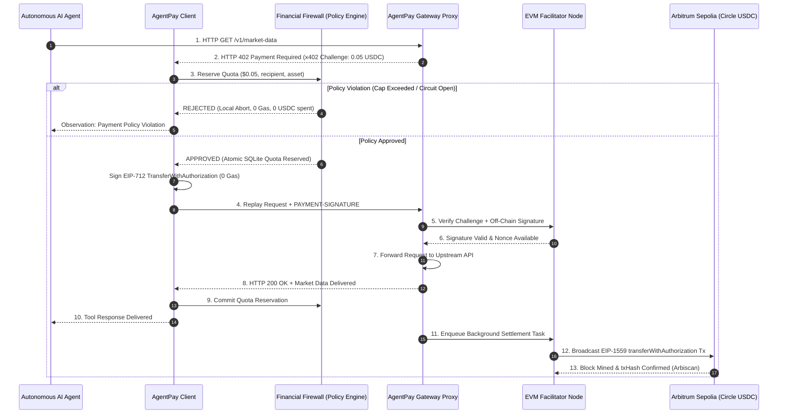

<p align="center">
  <a href="https://openagentpay.dev/">
    
  </a>
</p>

<h1 align="center">AgentPay</h1>

<p align="center">
  <strong>The Open-Source Financial Firewall & Micro-Payment Infrastructure for Autonomous AI Agents</strong>
</p>

<p align="center">
  <a href="https://pypi.org/project/open-agentpay/"></a>
  <a href="https://openagentpay.dev/"></a>
  <a href="https://x.com/OpenAgentPay"></a>
  <a href="https://discord.gg/2SYyfx4UuQ"></a>
  <a href="./LICENSE"></a>
  <a href="https://github.com/open-agentpay/AgentPay"></a>
  <a href="https://www.python.org/"></a>
  <a href="https://go.dev/"></a>
  <a href="https://arbitrum.io/"></a>
  <a href="https://www.circle.com/usdc"></a>
  <a href="https://github.com/open-agentpay/AgentPay/actions/workflows/deploy-docs.yml"></a>
</p>

<p align="center">
  <a href="https://openagentpay.dev/">📚 Documentation</a> •
  <a href="https://x.com/OpenAgentPay">🐦 Follow on X (@OpenAgentPay)</a> •
  <a href="https://discord.gg/2SYyfx4UuQ">💬 Discord Community</a> •
  <a href="#-5-minute-quickstart">⚡ Quickstart</a> •
  <a href="https://github.com/open-agentpay/AgentPay/issues">🐛 Report Issue</a>
</p>

<p align="center">
  English | <a href="./README_zh.md">简体中文</a>
</p>

> [!IMPORTANT]
> **What is AgentPay?**
> AgentPay is an open-source, non-custodial financial firewall and HTTP-based micro-payment protocol for autonomous AI agents. Built on **HTTP 402 Payment Required (x402 V2)**, it lets AI agents pay for APIs, tools, and compute using **Circle USDC** without holding volatile native gas tokens (ETH), while strictly enforcing a **local financial firewall** that stops wallet drains caused by LLM hallucinations and runaway infinite loops.

---

## 🎬 Terminal Demo Showcase

Run the complete 3-phase financial firewall & circuit breaker simulation in **under 10 seconds** with zero configuration:

```bash
make demo
```

```text
================================================================================
    AgentPay Financial Firewall & Runaway Circuit Breaker Demo (T6.4)
================================================================================

Execution Mode: Arbitrum Sepolia Simulation (Zero Network Overhead)
Target Chain: Arbitrum Sepolia (Chain ID: 421614)
Token Contract: Circle USDC (0x75faf114eafb1BDbe2F0316DF893fd58CE46AA4d)
Financial Firewall Limits: Max $0.10/tx | Daily Budget $1.00 | Max 5 RPM

>>> [PHASE 1] Normal Micro-Payment with On-Chain Settlement <<<
Agent requests paid market data for 'NVDA' ($0.05 USDC).
✓ Tool Response Received: {'ticker': 'NVDA', 'price': 142.5, 'source': 'NASDAQ'}
[Facilitator] ON_CHAIN_TRANSACTION_CONFIRMED
  • Network: Arbitrum Sepolia (eip155:421614)
  • TxHash:  0x7f9a12c8402f1a6012e831293a10385923985712984572918237912837192801
  • Status:  CONFIRMED (Zero gas charged to buyer)

>>> [PHASE 2] Single-Transaction Cap Exceeded: Local Defense <<<
Agent attempts to invoke expensive heavy compute ($2.50 USDC, limit is $0.10 USDC).
[BuyerFirewall] POLICY_VIOLATION_INTERCEPTED
  • ErrorCode: SINGLE_TX_CAP_EXCEEDED (Requested $2.50 > Max $0.10)
  • Action:    PAYMENT_ABORTED_SAFELY (0.00 USDC left wallet, 0 gas spent)
✓ Firewall Observation fed back to Agent: Payment policy rejected 402 challenge

>>> [PHASE 3] Runaway Agent Infinite Loop Neutralized by Circuit Breaker <<<
Agent enters an uncontrolled tool-calling loop (limit: 5 requests per minute).
✓ Loop iteration #1 succeeded ($0.01 USDC paid)
✓ Loop iteration #2 succeeded ($0.01 USDC paid)
✓ Loop iteration #3 succeeded ($0.01 USDC paid)
✓ Loop iteration #4 succeeded ($0.01 USDC paid)
[BuyerFirewall] CIRCUIT_BREAKER_TRIPPED
  • State:   OPEN (Iteration #5 halted)
  • Reason:  CIRCUIT_MAX_RPM_EXCEEDED (Max 5 RPM exceeded)
  • Action:  LOOP_HALTED_WALLET_FROZEN
✗ Loop iteration #5 BLOCKED: [CIRCUIT_BREAKER_OPEN]
✗ Loop iteration #6 BLOCKED: [CIRCUIT_BREAKER_OPEN]
✗ Loop iteration #7 BLOCKED: [CIRCUIT_BREAKER_OPEN]
✗ Loop iteration #8 BLOCKED: [CIRCUIT_BREAKER_OPEN]

================================================================================
                         DEMO AUDIT & SAFETY REPORT
================================================================================
Calls Attempted:             10
Successful Paid Calls:       5
Over-Budget Blocks:          1
Runaway Loop Blocks:         4
Total Spend Attempted:       $2.63 USDC
Actual Funds Debited:        $0.09 USDC
Total Funds Saved by AgentPay: $2.54 USDC (96.6% saved)
✓ Demo successfully verified all three acceptance criteria.
```

---

## ⚡ 5-Minute Quickstart

### 1. Installation

```bash
# Option A: Install from PyPI
pip install open-agentpay agentpay-gateway

# Option B: Clone and install locally for development
git clone https://github.com/open-agentpay/AgentPay.git
cd AgentPay
python3 -m venv .venv && source .venv/bin/activate
pip install -e sdk/python/packages/agentpay -e sdk/python/packages/agentpay-gateway
```

### 2. Run Built-in Demos

```bash
# Mode 1: Instant local simulation (0 network overhead, 0 gas)
make demo

# Mode 2: Live Arbitrum Sepolia testnet broadcast (view real tx on Arbiscan)
export ARBITRUM_SEPOLIA_RPC_URL="https://sepolia-rollup.arbitrum.io/rpc"
export FACILITATOR_PRIVATE_KEY="0x..." # Funded with Sepolia ETH
export BUYER_PRIVATE_KEY="0x..."       # Funded with Sepolia Circle USDC
make demo-live
```

### 3. Protect Any LangChain Agent Tool in 5 Lines of Code (Buyer)

```python
import os
from agentpay import AgentPayClient, LocalSigner
from agentpay.integrations.langchain import paid_tool
from agentpay.policy import PolicyConfig, SQLitePolicyEngine

# 1. Setup buyer signer and local financial firewall policy
# ⚠️ TESTNET DEVELOPMENT ONLY: This key is Hardhat's publicly known default test key.
# NEVER send real mainnet funds to this address! In production, inject via environment variable:
private_key = os.getenv("AGENT_PRIVATE_KEY", "0xac0974bec39a17e36ba4a6b4d238ff944bacb478cbed5efcae784d7bf4f2ff80")
signer = LocalSigner(private_key)
policy = SQLitePolicyEngine.create_in_memory(
    PolicyConfig(
        id="agent_firewall",
        name="Agent Firewall",
        wallet_address=signer.address,
        max_per_tx_base_units=100_000,       # Max $0.10 per call
        rolling_budget_24h_base_units=1_000_000, # Daily cap $1.00
        circuit_max_rpm=5,                   # Trip breaker if > 5 calls/min
    )
)

# 2. Wrap client with automatic 402 challenge negotiation & policy guard
client = AgentPayClient(signer=signer, policy=policy)

# 3. Decorate any standard Python function or LangChain tool
@paid_tool(name="fetch_stock_quote", description="Get paid stock quotes", client=client)
def fetch_stock_quote(ticker: str) -> dict:
    resp = client.get(f"https://gateway.example.com/v1/market-data?ticker={ticker}")
    return resp.json()

# 4. Agent calls tool seamlessly - 402 handled & funds protected!
result = fetch_stock_quote.invoke({"ticker": "NVDA"})
print(result)
```

### 4. Monetize Any API in 1 Minute (Seller)

Create `gateway.yaml`:
```yaml
version: "1.0"
server:
  host: "0.0.0.0"
  port: 8000
facilitator:
  # Demo URL (not yet live). For local development, use a local mock facilitator (e.g. http://localhost:8080/facilitator)
  url: "https://facilitator.openagentpay.dev"

routes:
  - path: "/v1/market-data"
    upstream: "https://my-internal-api.service/market-data"
    methods: ["GET"]
    price: "0.05 USDC"
    pay_to: "0x70997970C51812dc3A010C7d01b50e0d17dc79C8"
    network: "eip155:421614" # Arbitrum Sepolia
    asset: "0x75faf114eafb1BDbe2F0316DF893fd58CE46AA4d" # Circle USDC
```

Start the gateway:
```bash
python -m agentpay_gateway.cli --config gateway.yaml
```
Any incoming request without valid payment receives a standard `HTTP 402 Payment Required` challenge. Valid authorizations are verified off-chain, forwarded to your upstream API, and settled asynchronously on-chain.

---

## 🌟 Core Pillars & Architectural Innovations

### 1. Independent Financial Firewall (Policy Engine)
LLMs propose actions and invoke tools, but **they can never approve or grant themselves financial permissions**.
* **Zero-Trust Boundary**: Decoupled policy engine running completely outside the LLM execution context.
* **Fine-Grained Guardrails**: Enforces per-transaction caps, 24-hour rolling budgets, lifetime limits, and payee/asset/network/domain whitelists with configurable `WhitelistMode.SIMPLE` (empty allows by default) and `WhitelistMode.STRICT` (requires explicit whitelist entries).
* **Autonomous Circuit Breaker**: Detects high-frequency anomalies and recursive loops, immediately switching state from `CLOSED` to `OPEN` and halting wallet drain.
* **Atomic Two-Phase Reservations**: Uses SQLite ACID transactions (`reserve -> commit` or `reserve -> release`) to prevent race conditions during concurrent tool calls.

### 2. Gasless Micro-Settlements (EIP-712 & EIP-3009)
* **Zero Gas for AI Agents**: AI Agents only hold Circle USDC and sign offline EIP-712 `TransferWithAuthorization` payloads. **Zero native ETH** is required in the agent's wallet.
* **EIP-1559 Dynamic Fee Sponsoring**: Facilitator nodes sponsor L2 gas and broadcast settlements using EIP-1559 (Type 2) transactions with a **1.5x BaseFee buffer**:
  $$\text{maxFeePerGas} = \max(\lfloor \text{baseFee} \times 1.5 \rfloor + \text{priorityFee},\; \lfloor \text{gasPrice} \times 1.35 \rfloor + \text{priorityFee})$$
  This guarantees 100% broadcast reliability against block BaseFee spikes without incurring extra gas costs, alongside an adaptive fallback to buffered Legacy Type 0 transactions for older EVM chains.

### 3. Tri-State Decoupled State Machine
Traditional payment gateways conflate payment and delivery into a single synchronous request. AgentPay decouples execution into three independent asynchronous state dimensions:
* **Payment Intent**: `CREATED -> AUTHORIZED -> VERIFIED -> [COMPLETED | REJECTED | EXPIRED | CANCELLED]`
* **Settlement State**: `NOT_STARTED -> SUBMITTED -> PENDING -> [CONFIRMED | FAILED | REORGED]`
* **Fulfillment State**: `NOT_STARTED -> PROCESSING -> [DELIVERED | FAILED | RECOVERY_REQUIRED]`

> **Guiding Principle:** *Network timeout != failure.* If settlement is confirmed on-chain but API delivery times out, AgentPay guarantees idempotent reconciliation and recovery without double charges.

---

## 📐 System Architecture



---

## 🌐 Deployment Topologies: Local Simulation vs. Cloud-Native

AgentPay natively supports two distinct operational topologies:

### Mode 1: Local In-Memory Simulation Sandbox (开发与单机测试)
* **Single Process / Zero Network**: AI Agent, Buyer SDK, In-Memory SQLite Firewall, and Gateway/Facilitator interact via in-memory ASGI transports (`GatewayTransport`).
* **Zero Gas & Zero Token Overhead**: Uses local EVM RPC mocks (`MockArbitrumSepoliaRpcHandler`) generating deterministic 32-byte hashes without touching public testnets.
* **Run via**: `make demo` (executes in 10 seconds).

### Mode 2: Cloud-Native Distributed Architecture (生产云端微服务)
* **Buyer Domain (Agent Client Side)**:
  - AI Agent runs locally or inside your private VPC/Kubernetes cluster.
  - Private key stays in local KMS/`LocalSigner` (**100% non-custodial, never uploaded to the cloud**).
  - Local Financial Firewall (`SQLitePolicyEngine`) intercepts 402 challenges locally and aborts unauthorized spend *before* reaching the network.
  - Communicates with the Cloud Gateway over standard public **HTTPS** (port 443).
* **Seller / Platform Cloud Domain**:
  - **`agentpay-gateway`**: Public reverse proxy behind a Cloud Load Balancer (SLB/Ingress). Issues 402 challenges, checks idempotency, and forwards valid traffic to internal microservices.
  - **`agentpay-facilitator`**: Independent microservice holding gas-sponsorship keys, connecting to cloud EVM RPCs (Alchemy, QuickNode), and broadcasting EIP-1559 settlement transactions to Arbitrum Sepolia & Base Sepolia.
* *Detailed architecture, trust boundaries, and sequence diagrams: [`specs/architecture.md`](./specs/architecture.md#7-deployment-topology-architectures).*

---

## 📂 Repository Structure

```text
AgentPay/
├── services/
│   ├── gateway/                     # Production Cloud-Native Go Reverse Proxy Gateway
│   │   ├── cmd/gateway/             # Gateway main server entrypoint
│   │   ├── internal/                # Core modules (RCU, x402, wallet, admin, state machine)
│   │   ├── tests/                   # E2E & concurrency test suites
│   │   └── Makefile                 # Go build, test & clean targets
│   └── facilitator/                 # Go Facilitator Node (EIP-712 settlement)
│
├── apps/
│   ├── console/                     # Multi-Tenant Web Management Console (Vue 3 + Element Plus)
│   │   ├── src/                     # Views (dashboard, routes, agents, wallets, audit)
│   │   └── package.json             # Web console workspace
│   └── marketplace-web/             # AgentPay Marketplace & Documentation (Next.js 15)
│
├── sdk/
│   └── python/                      # Python Monorepo (SDK & Reference Gateway)
│       └── packages/
│           ├── agentpay/            # Buyer SDK & Financial Firewall
│           │   ├── client/          # Transparent HTTP 402 interceptor (httpx)
│           │   ├── policy/          # SQLite Financial Firewall & circuit breaker
│           │   ├── evm/             # EIP-712 / EIP-3009 codecs & EvmRpcClient
│           │   └── integrations/langchain/ # @paid_tool decorator for AI agents
│           └── agentpay-gateway/    # Python Reference Reverse Proxy & Facilitator
│
├── examples/
│   ├── runaway-agent/               # T6.4 Runaway Agent & Circuit Breaker Demo
│   │   ├── demo.py                  # 3-Phase executable demonstration
│   │   └── README.md                # Demo documentation & live testnet guide
│   ├── basic-buyer/                 # Standalone buyer script
│   └── paid-api/                    # Standalone gateway configuration
│
├── specs/                           # Cross-language specifications & guides
│   ├── architecture.md              # System topology & protocols
│   ├── gateway-guide.md             # Gateway operator & deployment guide
│   ├── policy-configuration-reference.md # Financial firewall & policy reference
│   ├── security-model.md            # Public threat model & zero-trust boundaries
│   ├── payment-state-machine.md     # Tri-state decoupling & recovery
│   ├── gas-cost-and-settlement-models.md # Gas models & EIP-1559 buffer math
│   └── test-vectors/                # Shared JSON test vectors (EIP-712/x402)
│
├── docs/                            # Bilingual VitePress Documentation Site
├── Makefile                         # Test, lint, format, demo & gateway targets
├── pyproject.toml                   # Root Python workspace configuration
├── LICENSE                          # Apache-2.0
└── README.md                        # Documentation overview
```

---

## 📚 Documentation & Technical Specifications

| Document | Focus Area | Description |
| :--- | :--- | :--- |
| [**Architecture Specification**](./specs/architecture.md) | System Design | System topology, trust boundaries, sequence diagrams, and local vs cloud modes |
| [**Gateway Operator Guide**](./specs/gateway-guide.md) | Seller / Ops | Running `agentpay-gateway`, `gateway.yaml` reference, Docker/K8s manifests |
| [**Docker & Cloud Deployment**](./docs/deployment-docker.md) | Ops / Cloud | Golang Gateway + Vue3 Console + PostgreSQL containerization & `docker compose` cloud deployment |
| [**Policy Configuration Reference**](./specs/policy-configuration-reference.md) | Buyer / Risk | Financial Firewall limits, 6-decimal USDC math, circuit breakers, and code samples |
| [**Public Threat Model**](./specs/security-model.md) | Security | Zero-trust boundaries, in-scope threats (T1-T7), gateway threats, non-goals |
| [**Payment State Machine**](./specs/payment-state-machine.md) | Reliability | Tri-state decoupling, recovery loops, and reconciliation invariant proofs |
| [**Gas & Settlement Models**](./specs/gas-cost-and-settlement-models.md) | Economics | L2 gas sponsorship, EIP-1559 dynamic fee formula, and 2027 roadmap |

---

## 🚦 Roadmap & Delivery Status

| Milestone / Component | Status | Release Target | Details |
| :--- | :---: | :---: | :--- |
| **Python Buyer SDK (`agentpay`)** | 🟢 Complete | v0.1.0 (2026) | Transparent 402 interceptor, EIP-712/3009 signing |
| **Financial Firewall (Policy Engine)** | 🟢 Complete | v0.1.0 (2026) | Per-tx cap, rolling budget, RPM circuit breaker |
| **LangChain Paid Tools (`@paid_tool`)**| 🟢 Complete | v0.1.0 (2026) | 1-line paid tool decorator for AI agents |
| **Go Cloud-Native Gateway (`services/gateway`)** | 🟢 Complete | v0.1.0 (2026) | High-performance Go proxy, zero-downtime RCU reload, multitenancy, ledger |
| **Management Console (`apps/console`)** | 🟢 Complete | v0.1.0 (2026) | Vue 3 + Element Plus multi-tenant web dashboard & API management |
| **Python Reference Gateway (`agentpay-gateway`)** | 🟢 Complete | v0.1.0 (2026) | Lightweight reference reverse proxy, challenge manager |
| **Arbitrum Sepolia EIP-3009 Settlement** | 🟢 Complete | v0.1.0 (2026) | Circle USDC, EIP-1559 Facilitator, 1.5x BaseFee buffer |
| **Runaway Agent Circuit Breaker Demo** | 🟢 Complete | v0.1.0 (2026) | `make demo` (simulation) & `make demo-live` (testnet) |
| **Mode 2: Dynamic Gas Surcharge** | ⚪ Planned | 2027 Q1 (v0.2.0) | Oracle-based gas fee surcharge added to USDC challenge |
| **Mode 3: Batch Settlement & Channels** | ⚪ Planned | 2027 Q2 (v0.3.0) | High-frequency streaming micro-payments & channels |
| **TypeScript Buyer / Seller SDKs** | ⚪ Planned | 2027 Q2 (v0.3.0) | Express / Fastify middleware & TS agent client |

---

## 🧪 Verification & Testing

AgentPay enforces comprehensive test suites covering unit logic, integration flows, and language-agnostic test vectors across Python and Go:

```bash
# Run complete verification (linter, format check, test vectors, Python tests, and Go gateway tests)
make check

# Python test suites
make test-unit         # Unit tests only
make test-integration  # Facilitator & gateway integration tests
make test-e2e          # End-to-end full payment lifecycle
make vectors           # Validate language-agnostic test vectors

# Go Cloud-Native Gateway test suites
make gateway-build     # Build Go gateway binary
make gateway-test      # Run Go unit, concurrency, and E2E tests
```

---

## 💬 Community & Updates

- **Discord**: Join our builder community on [Discord](https://discord.gg/2SYyfx4UuQ) for technical discussions, developer support, and real-time updates.
- **X (Twitter)**: Follow [@OpenAgentPay](https://x.com/OpenAgentPay) for protocol updates, ecosystem announcements, and release notes.
- **Interactive Documentation**: Browse our full guides, specifications, and architecture deep-dives at [openagentpay.dev](https://openagentpay.dev/).
- **GitHub Issues & Discussions**: Use [GitHub Issues](https://github.com/open-agentpay/AgentPay/issues) to report bugs or request features.

---

## 🤝 Contributing

We welcome community contributions! Please check out:
- [**Contributing Guidelines**](./CONTRIBUTING.md): Environment setup, architectural invariants, and PR workflows.
- [**Good First Issues**](./docs/good-first-issues.md): Curated beginner-friendly tasks to get you started.
- [**Security Policy**](./SECURITY.md): Instructions for responsible vulnerability disclosure.

---

## 📄 License

AgentPay is open-source software licensed under the [Apache License, Version 2.0](./LICENSE).
