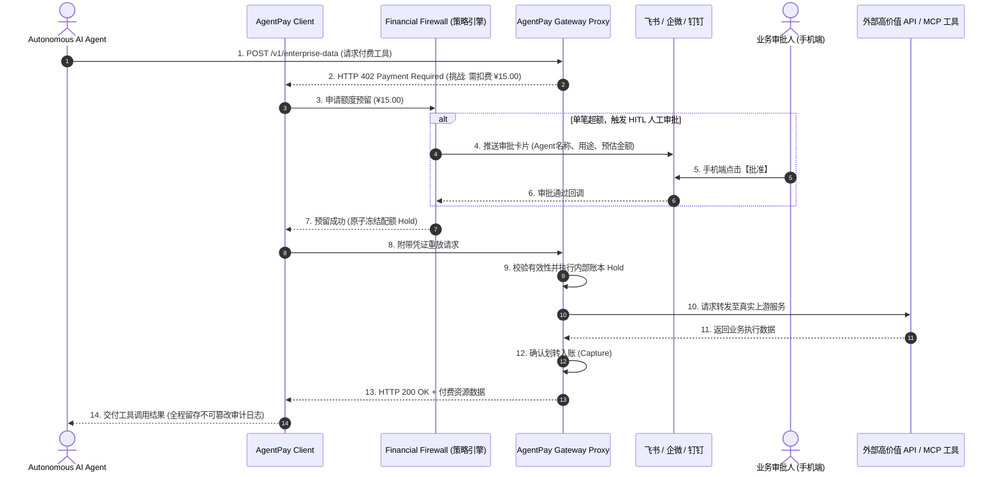

<p align="center">
  <a href="https://openagentpay.dev/zh/">
    
  </a>
</p>

<h1 align="center">AgentPay</h1>

<p align="center">
  <strong>企业级 AI 行为审计与资金防火墙 (AI Agent Gateway & FinOps)</strong><br />
  <em>让 AI 自主调用外部工具与商业模型，但绝不突破企业预算边界</em>
</p>

<p align="center">
  <a href="https://pypi.org/project/open-agentpay/"></a>
  <a href="https://www.npmjs.com/package/open-agentpay"></a>
  <a href="https://openagentpay.dev/zh/"></a>
  <a href="https://openagentpay.dev/zh/"></a>
  <a href="https://github.com/langfuse/langfuse"></a>
  <a href="./LICENSE"></a>
  <a href="https://www.python.org/"></a>
  <a href="https://www.typescriptlang.org/"></a>
  <a href="https://go.dev/"></a>
</p>

<p align="center">
  <a href="https://openagentpay.dev/zh/">📚 官方在线文档</a> •
  <a href="#-终端-demo-攻防效果演示">⚡ 3分钟上手</a> •
  <a href="#-核心四大支柱防控审算">🛡️ 核心能力</a> •
  <a href="https://github.com/open-agentpay/AgentPay/issues">🐛 提交反馈</a>
</p>

<p align="center">
  <a href="./README.md">English</a> | 简体中文
</p>

> [!IMPORTANT]
> **什么是 AgentPay？**  
> AgentPay 是一套专为 **生产级 AI Agent、大模型应用与 MCP 工具生态** 打造的企业级 **行为审计网关与资金防火墙（AI Agent Gateway & FinOps）**。  
> 
> 在大模型应用实战中，企业普遍面临**“Agent 死循环刷爆 API 欠费”、“黑盒资金失控无法对账”、“缺乏合规发票与等保审计”**的痛点。AgentPay 部署于 AI Agent 与外部付费资源之间，目前已提供 **单笔限额/24h滚动预算硬顶**、**突发死循环秒级熔断**、**不可篡改行为审计黑匣子** 以及 **6 位微单位企业预付虚拟账本（Wallet Hold/Capture/Release）+ x402 链上零 Gas 结算双轨通道**；同时在路线图中规划了 **飞书/企业微信超额卡片审批（HITL，规划中）**、**Langfuse 可观测性套件（规划中）** 与 **法币对公充值结算对接（规划中）**。

---

## 🎬 终端 Demo 攻防效果演示

只需一条命令，**10 秒内**即可无配置体验资金防火墙与死循环熔断器的攻防全过程：

```bash
make demo
```

```text
================================================================================
    AgentPay Financial Firewall & Runaway Circuit Breaker Demo (T6.4)
================================================================================

Mode: Enterprise Local Simulation (Zero Network Overhead)
Base Currency: CNY (6-decimal micro-units: 1 CNY = 1,000,000 base units)
Financial Firewall Limits: Max ¥0.10/tx | Daily Budget ¥1.00 | Max 5 RPM

>>> [PHASE 1] Normal Micro-Payment Tool Call (毫秒级放行) <<<
Agent requests paid market data for '000001.SZ' (¥0.05 CNY).
✓ Tool Response Received: {'ticker': '000001.SZ', 'price': 10.85, 'source': 'API'}
[GatewayLedger] TRANSACTION_CONFIRMED
  • Status:  CAPTURED (原子预占并确认扣除 50,000 微单位)

>>> [PHASE 2] Single-Transaction Cap Exceeded: Local Defense (超额硬拦截) <<<
Agent attempts to invoke expensive heavy report (¥2.50 CNY, limit is ¥0.10 CNY).
[FinancialFirewall] POLICY_VIOLATION_INTERCEPTED
  • ErrorCode: SINGLE_TX_CAP_EXCEEDED (Requested ¥2.50 > Max ¥0.10)
  • Action:    PAYMENT_ABORTED_SAFELY (¥0.00 left account, 0 risk)
✓ Firewall Observation fed back to Agent: Payment policy rejected 402 challenge

>>> [PHASE 3] Runaway Agent Infinite Loop Neutralized (死循环 3 秒拉闸) <<<
Agent enters an uncontrolled tool-calling loop (limit: 5 requests per minute).
✓ Loop iteration #1 succeeded (¥0.01 paid)
✓ Loop iteration #2 succeeded (¥0.01 paid)
✓ Loop iteration #3 succeeded (¥0.01 paid)
✓ Loop iteration #4 succeeded (¥0.01 paid)
[FinancialFirewall] CIRCUIT_BREAKER_TRIPPED
  • State:   OPEN (Iteration #5 halted)
  • Reason:  CIRCUIT_MAX_RPM_EXCEEDED (突发频率超限，死循环熔断电闸开启)
  • Action:  LOOP_HALTED_WALLET_FROZEN
✗ Loop iteration #5 BLOCKED: [CIRCUIT_BREAKER_OPEN]
✗ Loop iteration #6 BLOCKED: [CIRCUIT_BREAKER_OPEN]
✗ Loop iteration #7 BLOCKED: [CIRCUIT_BREAKER_OPEN]

================================================================================
                         DEMO AUDIT & SAFETY REPORT
================================================================================
Calls Attempted:             10
Successful Paid Calls:       5
Over-Budget Blocks:          1
Runaway Loop Blocks:         4
Total Spend Attempted:       ¥2.63 CNY
Actual Funds Debited:        ¥0.09 CNY
Total Funds Saved by AgentPay: ¥2.54 CNY (拦截并保护了 96.6% 的资金)
✓ Demo successfully verified all three acceptance criteria.
```

---

## ⚡ 5 分钟极速上手 (Quickstart)

### 1. 环境准备与安装

```bash
# Python SDK 与网关
pip install open-agentpay agentpay-gateway

# TypeScript / Node.js SDK
npm install open-agentpay
# 或: pnpm add open-agentpay / yarn add open-agentpay
```

### 2. 买方：5 行代码武装任何智能体

#### Python (Dify / LangChain / 原生 Python)

```python
import os
from agentpay import AgentPayClient, LocalSigner
from agentpay.policy import PolicyConfig, SQLitePolicyEngine

# 1. 初始化本地签名器与贴身金融防火墙策略
private_key = os.getenv(
    "AGENT_PRIVATE_KEY",
    "0xac0974bec39a17e36ba4a6b4d238ff944bacb478cbed5efcae784d7bf4f2ff80",  # 仅限本地测试网
)
signer = LocalSigner(private_key)
policy = SQLitePolicyEngine.create_in_memory(
    PolicyConfig(
        id="project_finance_firewall",
        name="研发部生产环境防火墙",
        wallet_address=signer.address,
        max_per_tx_base_units=500_000,            # 单笔上限 0.50 (6位微单位)
        rolling_budget_24h_base_units=50_000_000, # 24小时滚动总预算 50.00
        circuit_max_rpm=10,                       # 1分钟超过 10 次立即熔断拉闸
    )
)

# 2. 初始化安全客户端（自动拦截 HTTP 402 挑战并执行本地策略防火墙校验）
client = AgentPayClient(
    signer=signer,
    policy=policy,
)

# 3. 任何外部付费 API 或 MCP 工具调用均受防火墙贴身守护
response = client.get("https://gateway.internal.net/v1/business-data?company=test")
print(response.json())
```

#### TypeScript / Node.js (LangChain.js / Vercel AI / 原生 fetch)

```typescript
import { AgentPayClient, LocalSigner } from 'open-agentpay';
import { PolicyConfig, SQLitePolicyEngine, WhitelistMode } from 'open-agentpay/policy';

const signer = new LocalSigner(process.env.AGENT_WALLET_KEY!);
const policy = SQLitePolicyEngine.createInMemory(
  new PolicyConfig({
    id: 'agent_firewall',
    name: '企业智能体金融防火墙',
    walletAddress: signer.address,
    whitelistMode: WhitelistMode.SIMPLE,
    maxPerTxBaseUnits: 2_500_000n,         // 单笔最高预算 2.50 USDC
    rollingBudget24hBaseUnits: 5_000_000n, // 24小时滚动上限 5.00 USDC
  })
);

const client = new AgentPayClient({ signer, policy });

// 发送付费 API 请求，自动执行 402 握手与本地防火墙核验
const response = await client.get('https://gate.openagentpay.dev/v1/free/defi/dex-volume', {
  params: { chain: 'ethereum' },
});
console.log('HTTP Status:', response.status);
console.log('Result:', await response.json());
```

> **企业预付钱包模式（Go Gateway 虚拟账本）**：若使用网关预充值虚拟钱包（`Authorization: Bearer apk_live_...`），可通过 TypeScript SDK（`open-agentpay`）或网关两阶段 `agentpay-wallet` 挑战授权直接扣减预付账本余额，无需链上 Gas。

### 3. 卖方/企业统一网关：1 分钟将内部工具或高价值 API 上架

创建网关路由配置文件 `gateway.yaml`：

```yaml
version: "1.0"
server:
  host: "0.0.0.0"
  port: 8000

# 启用国内企业模式 (CNY 6位微单位虚拟账本)
region: "cn"
default_currency: "CNY"

routes:
  - path: "/v1/enterprise-data"
    upstream: "https://internal-risk-api.company.local/query"
    methods: ["POST"]
    # 每次调用扣除 ¥0.35 人民币 (350,000 微单位)，毫秒级 Hold -> Capture
    price: "350000 CNY"
    allowed_payment_methods: "agentpay-wallet"
```

启动网关反向代理：

```bash
python -m agentpay_gateway.cli --config gateway.yaml
# 或者运行生产级 Go 原生高性能网关：
# ./services/gateway/bin/gateway --config gateway.yaml
```

---

## 🛡️ 核心四大支柱：“防、控、审、算”

```
                              ┌────────────────────────────────────────┐
                              │ AgentPay: 企业级 AI 行为审计与资金防火墙│
                              └───────────────────┬────────────────────┘
             ┌─────────────────────┬──────────────┴───────┬─────────────────────┐
             ▼                     ▼                      ▼                     ▼
        【防：熔断防护】       【控：人在回路】        【审：合规留痕】       【算：FinOps 水表】
        • 死循环实时切断       • 飞书/企微审批卡片    • 不可篡改只追加事件   • 部门/项目/Agent 分级配额
        • 单笔/24h 额度封顶    • 402 异步挂起重放     • 网关客观事实(Observed)• 微信/支付宝/对公打款充值
        • Prompt 注入防盗刷    • 手机端一键放行       • 应对等保2.0合规导出  • 增值税发票与对账单导出
```

### 1. 防（Financial Firewall & Circuit Breaker）
- **多层预算硬顶**：单笔调用上限、24 小时滚动预算、终身额度上限。
- **死循环秒级熔断（RPM Circuit Breaker）**：实时监测 Agent 调用频次，识别失控递归，毫秒级开启熔断电闸，切断网络连接。
- **两阶段原子预占（Hold / Capture）**：解决多智能体并发调用时的超额竞态问题，杜绝穿透扣款。

### 2. 控（HITL Human-in-the-Loop，规划中 / Planned）
- **三级风控梯次**：常规小额调用自动放行；中大额触发人工审批（规划中）；超限调用硬顶阻断（已就绪）。
- **飞书 / 企业微信 / 钉钉 卡片审批（规划中 / Planned）**：设计规范见 [`specs/zh/cn-fiat-and-hitl-approval-spec.md`](./specs/zh/cn-fiat-and-hitl-approval-spec.md)，计划通过 402 异步挂起唤醒 IM 审批卡片并在批准后放行。

### 3. 审（不可篡改行为审计黑匣子，已就绪）
- **客观事实（Observed）与自报声明（Declared）隔离**：网关记录的网络状态、耗时、实际扣减金额为**唯一权威事实**；Agent 自报的业务字段仅作关联展示，严禁参与鉴权与计费。
- **只追加（Append-Only）事件流**：不可篡改、支持全链路时间线查询与审计导出。
- **一键断电电闸（Kill Switch）**：管理员可在控制台秒级封禁失控 Agent 的 API Key 或冻结租户钱包。

### 4. 算（AI FinOps & 财务闭环）
- **多级预算池（已就绪）**：租户（Tenant） $\to$ 项目（Project） $\to$ 具体 Agent，支持预付虚拟钱包两阶段 `Hold / Capture / Release` 与余额对账。
- **严守合规底线**：采用闭环内部预付虚拟账本，不可提现、不可跨租户互转。
- **企业法币充值与发票对接（规划中 / Planned）**：微信/支付宝扫码、对公转账自动核销与数电发票对接处于规划阶段（当前可通过管理台 API 执行人工充值入账 `TopUp`）。

---

## 🤝 与开源可观测平台 Langfuse 协同架构（规划中 / Planned）

AgentPay 绝不重复造轮子，而是与 **MIT 开源协议的 Langfuse** 深度结合：

- **Langfuse**：负责看清 Agent 的“脑子”（Prompt 管理、Token 消耗、生成质量评测）；
- **AgentPay**：负责管住 Agent 的“双手与钱包”（网络出入口、死循环熔断、外部 MCP 工具、飞书审批）。

```
Agent 发起调用 ───> 带上 Langfuse trace_id ───> AgentPay 网关拦截/计费/熔断 ───> 真实账单与审批回写至 Langfuse 看板
```

企业客户可使用官方提供的 `docker-compose.enterprise.yml` 一键部署全套 **“可观测性 + 资金防火墙”** 生产环境。

---

## 📐 系统交互架构



---

## 📂 代码目录结构

```text
AgentPay/
├── services/
│   ├── gateway/                     # 生产级云原生 Go 高性能反向代理网关
│   │   ├── cmd/gateway/             # 网关主程序入口
│   │   ├── internal/                # 核心模块 (RCU 热加载、x402、双轨账本、RBAC、状态机)
│   │   └── Makefile                 # Go 构建与并发测试
│   └── facilitator/                 # Go Facilitator 结算节点 (海外 EIP-712/3009 链上履约)
│
├── apps/
│   ├── console/                     # 多租户可视化 Web 管理控制台 (Vue 3 + Element Plus)
│   └── marketplace-web/             # 官方门户与双轨演示站 (Next.js 15)
│
├── sdk/
│   └── python/                      # Python SDK (含 httpx 中间件、LangChain 装饰器与贴身防火墙)
│
├── specs/zh/                        # 核心中文规格设计
│   ├── cn-fiat-and-hitl-approval-spec.md            # 法币充值与飞书/企微审批规范
│   ├── agent-audit-spec.md                          # Agent 身份与行为不可篡改审计规范
│   └── wallet-ledger-spec.md                        # 内部只追加虚拟账本规范
│
├── examples/
│   ├── runaway-agent/               # 失控智能体与熔断器一键演示 Demo
│   └── paid-api/                    # 卖方网关配置示例
│
├── Makefile                         # 统一编译、测试、格式化入口
├── LICENSE                          # Apache-2.0 开源协议
└── README_zh.md                     # 本说明文档
```

---

## 🚦 研发路线图

| 阶段 / 核心组件 | 状态 | 交付特性说明 |
| :--- | :---: | :--- |
| **金融防火墙（Policy Engine）** | 🟢 已就绪 | 单笔上限、滚动预算、白名单、RPM 熔断器 |
| **Go 高性能云原生网关 (`services/gateway`)** | 🟢 已就绪 | Go 原生反向代理、RCU 热加载、双轨账本、微秒级预占 (Hold/Capture) |
| **多租户管理控制台 (`apps/console`)** | 🟢 已就绪 | 多租户配额、Agent 授权、路由管理与审计日志时间线 |
| **Python SDK (`open-agentpay`)** | 🟢 已就绪 | 透明 402 拦截重试、贴身防火墙防护、LangChain 付费工具装饰器 |
| **TypeScript SDK (`@open-agentpay/sdk`)** | 🟢 已就绪 | 双轨买方客户端（Wallet + On-Chain EIP-3009）、本地策略引擎、Express/Fastify/Next.js 卖方中间件 |
| **飞书 / 企微 / 钉钉 卡片审批 (HITL)** | ⚪ 规划中 (Planned) | 402 异步挂起、IM 交互式审批卡片、一键批准原子重放放行（规范已定稿） |
| **Langfuse 深度集成套件** | ⚪ 规划中 (Planned) | Trace ID 穿透、网关拦截与扣费事件双向回写、一键交付 Compose |
| **国内企业法币充值与合规分账** | ⚪ 规划中 (Planned) | 微信/支付宝扫码、对公银行转账核销、持牌支付机构空中分账与增值税专票 |

---

## 💬 社区与支持

- **GitHub Issues**：[提交缺陷或功能建议](https://github.com/open-agentpay/AgentPay/issues)
- **文档与规范**：详见 [官方在线文档](https://openagentpay.dev/zh/)
- **商务咨询与企业版私有化支持**：欢迎提交 Issue 或联系团队获取企业版（AgentPay Enterprise）方案。

---

## 📄 开源许可证

AgentPay 基于 [Apache License, Version 2.0](./LICENSE) 协议完全开源。
