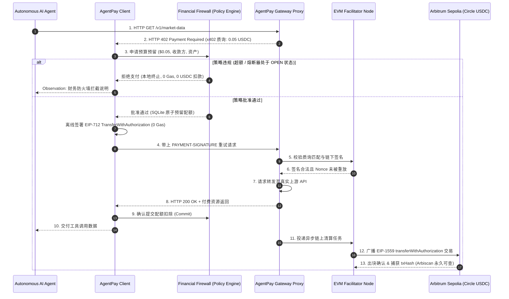

# AgentPay

<p align="center">
  <strong>专为自主 AI Agent 打造的开源财务防火墙与微支付基础设施</strong>
</p>

<p align="center">
  <a href="./LICENSE"></a>
  <a href="https://github.com/july-whj/AgentPay"></a>
  <a href="https://www.python.org/"></a>
  <a href="https://arbitrum.io/"></a>
  <a href="https://www.circle.com/usdc"></a>
  <a href="https://github.com/july-whj/AgentPay/actions"></a>
</p>

<p align="center">
  <a href="./README.md">English</a> | 简体中文
</p>

> [!IMPORTANT]
> **什么是 AgentPay？**
> AgentPay 是一套专为自主 AI Agent、大模型应用与 API 生态打造的开源、非托管财务安全防线与基于 HTTP 的微支付协议。基于 **HTTP 402 Payment Required (x402 V2)** 规范，它让 AI 智能体可以使用 **Circle USDC** 无感采购付费 API、数据与算力工具，且**无需在钱包持有易波动的原生 Gas 代币（ETH）**；同时在底层强制实施**本地财务防火墙（Financial Firewall）**，彻底杜绝因大模型幻觉与死循环调用导致的钱包资金被掏空（Wallet Drain）。

---

## 🎬 终端 Demo 运行效果演示

只需一条命令，**10 秒内**即可无配置复现财务防火墙与熔断器的三阶段攻防：

```bash
make demo
```

```text
================================================================================
    AgentPay Financial Firewall & Runaway Circuit Breaker Demo (T6.4)
================================================================================

Execution Mode: Arbitrum Sepolia Simulation (Zero Network Overhead)
Target Chain: Arbitrum Sepolia (Chain ID: 421614)
Token Contract: Circle USDC (0x75faf114eafb1BDbe2F0316DF893fd58CE46AA4d)
Financial Firewall Limits: Max $0.10/tx | Daily Budget $1.00 | Max 5 RPM

>>> [PHASE 1] Normal Micro-Payment with On-Chain Settlement <<<
Agent requests paid market data for 'NVDA' ($0.05 USDC).
✓ Tool Response Received: {'ticker': 'NVDA', 'price': 142.5, 'source': 'NASDAQ'}
[Facilitator] ON_CHAIN_TRANSACTION_CONFIRMED
  • Network: Arbitrum Sepolia (eip155:421614)
  • TxHash:  0x7f9a12c8402f1a6012e831293a10385923985712984572918237912837192801
  • Status:  CONFIRMED (Zero gas charged to buyer)

>>> [PHASE 2] Single-Transaction Cap Exceeded: Local Defense <<<
Agent attempts to invoke expensive heavy compute ($2.50 USDC, limit is $0.10 USDC).
[BuyerFirewall] POLICY_VIOLATION_INTERCEPTED
  • ErrorCode: SINGLE_TX_CAP_EXCEEDED (Requested $2.50 > Max $0.10)
  • Action:    PAYMENT_ABORTED_SAFELY (0.00 USDC left wallet, 0 gas spent)
✓ Firewall Observation fed back to Agent: Payment policy rejected 402 challenge

>>> [PHASE 3] Runaway Agent Infinite Loop Neutralized by Circuit Breaker <<<
Agent enters an uncontrolled tool-calling loop (limit: 5 requests per minute).
✓ Loop iteration #1 succeeded ($0.01 USDC paid)
✓ Loop iteration #2 succeeded ($0.01 USDC paid)
✓ Loop iteration #3 succeeded ($0.01 USDC paid)
✓ Loop iteration #4 succeeded ($0.01 USDC paid)
[BuyerFirewall] CIRCUIT_BREAKER_TRIPPED
  • State:   OPEN (Iteration #5 halted)
  • Reason:  CIRCUIT_MAX_RPM_EXCEEDED (Max 5 RPM exceeded)
  • Action:  LOOP_HALTED_WALLET_FROZEN
✗ Loop iteration #5 BLOCKED: [CIRCUIT_BREAKER_OPEN]
✗ Loop iteration #6 BLOCKED: [CIRCUIT_BREAKER_OPEN]
✗ Loop iteration #7 BLOCKED: [CIRCUIT_BREAKER_OPEN]
✗ Loop iteration #8 BLOCKED: [CIRCUIT_BREAKER_OPEN]

================================================================================
                         DEMO AUDIT & SAFETY REPORT
================================================================================
Calls Attempted:             10
Successful Paid Calls:       5
Over-Budget Blocks:          1
Runaway Loop Blocks:         4
Total Spend Attempted:       $2.63 USDC
Actual Funds Debited:        $0.09 USDC
Total Funds Saved by AgentPay: $2.54 USDC (拦截并保护了 96.6% 的资金)
✓ Demo successfully verified all three acceptance criteria.
```

---

## ⚡ 5 分钟极速上手 (Quickstart)

### 1. 环境准备与安装

```bash
git clone https://github.com/july-whj/AgentPay.git
cd AgentPay
python3 -m venv .venv && source .venv/bin/activate
pip install -e python/packages/agentpay -e python/packages/agentpay-gateway
```

### 2. 运行内置演示

```bash
# 模式 1：本地零网络仿真模式（无需测试币、0 Gas、10 秒完成全链路）
make demo

# 模式 2：Arbitrum Sepolia 测试网公网广播（真实出块，Arbiscan 永久可查）
export ARBITRUM_SEPOLIA_RPC_URL="https://sepolia-rollup.arbitrum.io/rpc"
export FACILITATOR_PRIVATE_KEY="0x..." # 持有 Sepolia ETH 的代付钱包
export BUYER_PRIVATE_KEY="0x..."       # 持有 Circle USDC 的 Agent 钱包
make demo-live
```

### 3. 买方：5 行代码武装任何 LangChain Agent 工具

```python
from agentpay.client.client import AgentPayClient
from agentpay.client.signer import LocalSigner
from agentpay.integrations.langchain import paid_tool
from agentpay.policy.config import PolicyConfig
from agentpay.policy.sqlite_engine import SQLitePolicyEngine

# 1. 初始化买方私钥与本地财务防火墙策略
signer = LocalSigner("0xac0974bec39a17e36ba4a6b4d238ff944bacb478cbed5efcae784d7bf4f2ff80")
policy = SQLitePolicyEngine.create_in_memory(
    PolicyConfig(
        id="agent_firewall",
        wallet_address=signer.address,
        max_per_tx_base_units=100_000,       # 单笔交易限额 $0.10 USDC
        rolling_budget_24h_base_units=1_000_000, # 24小时滚动预算 $1.00 USDC
        circuit_max_rpm=5,                   # 每分钟超过 5 次立即拉闸熔断
    )
)

# 2. 创建具备 402 自动协商与防火墙拦截能力的客户端
client = AgentPayClient(signer=signer, policy=policy)

# 3. 使用 @paid_tool 装饰任何 LangChain 工具或 Python 函数
@paid_tool(name="fetch_stock_quote", description="获取付费美股实时行情", client=client)
def fetch_stock_quote(ticker: str) -> dict:
    resp = client.get(f"https://gateway.example.com/v1/market-data?ticker={ticker}")
    return resp.json()

# 4. Agent 无感调用工具：402 自动签名应对，超额或死循环由本地防火墙硬拦截！
result = fetch_stock_quote.invoke({"ticker": "NVDA"})
print(result)
```

### 4. 卖方：1 分钟将任何现有 API 变现

创建网关路由配置文件 `gateway.yaml`：
```yaml
version: "1.0"
server:
  host: "0.0.0.0"
  port: 8000
facilitator:
  url: "https://facilitator.agentpay.network"

routes:
  - path: "/v1/market-data"
    upstream: "https://my-internal-api.service/market-data"
    methods: ["GET"]
    price: "0.05 USDC"
    pay_to: "0x70997970C51812dc3A010C7d01b50e0d17dc79C8"
    network: "eip155:421614" # Arbitrum Sepolia
    asset: "0x75faf114eafb1BDbe2F0316DF893fd58CE46AA4d" # Circle USDC
```

启动网关反向代理：
```bash
python -m agentpay_gateway.cli --config gateway.yaml
```
未附带签名的请求将自动收到标准的 `HTTP 402 Payment Required` 质询；附带合法 EIP-712 授权的请求将在毫秒级完成链下验签、转发上游业务并交付响应，同时由网关在后台异步向 Arbitrum 提交链上清算。

---

## 🌟 核心支柱与架构创新

### 1. 独立的财务防火墙（策略引擎 Policy Engine）
大语言模型提议调用工具或发起交易，但**绝不能自我批准或修改财务权限**。
* **零信任边界**：策略引擎运行于独立的执行环境中，完全脱离 LLM 上下文。
* **细粒度预算控制**：强制约束单笔交易限额、24 小时滚动预算、终身额度上限及商户/资产白名单。
* **自主熔断器（Circuit Breaker）**：实时识别高频异常与递归死循环耗资模式，毫秒级将状态由 `CLOSED` 切为 `OPEN`，彻底锁死钱包。
* **两阶段原子预留**：基于 SQLite ACID 事务保障（`reserve -> commit` / `reserve -> release`），彻底解决并发工具调用时的超额竞态问题。

### 2. 免 Gas 微结算（EIP-712 & EIP-3009）
* **AI Agent 零 Gas 负担**：智能体钱包只需持有 Circle USDC，仅签署离线 EIP-712 `TransferWithAuthorization` 消息。**钱包内无需持有任何原生 ETH**。
* **EIP-1559 动态费率与 1.5x BaseFee 安全缓冲**：Facilitator 履约网关代付 L2 Gas，采用 EIP-1559（Type 2）交易广播结算：
  $$\text{maxFeePerGas} = \max(\lfloor \text{baseFee} \times 1.5 \rfloor + \text{priorityFee},\; \lfloor \text{gasPrice} \times 1.35 \rfloor + \text{priorityFee})$$
  > [!NOTE]
  > 在 EIP-1559 机制下，`maxFeePerGas` 仅代表费率上限，实际扣除仍为实际 baseFee + priorityFee。1.5 倍上浮**100% 免疫出块波动被拒，且不会多花一分 Gas**，并支持对旧链的自适应 Legacy 降级。

### 3. 三态解耦状态机（Tri-State Decoupled State Machine）
传统网关将支付与交付耦合在单次同步请求中，AgentPay 严格解耦为三个异步状态维度：
* **支付意图（Payment Intent）**：`CREATED -> AUTHORIZED -> VERIFIED -> [COMPLETED | REJECTED | EXPIRED | CANCELLED]`
* **结算状态（Settlement State）**：`NOT_STARTED -> SUBMITTED -> PENDING -> [CONFIRMED | FAILED | REORGED]`
* **交付状态（Fulfillment State）**：`NOT_STARTED -> PROCESSING -> [DELIVERED | FAILED | RECOVERY_REQUIRED]`

> **核心设计哲学：** *网络超时 ≠ 扣款失败。* 即使上游业务交付因超时挂起，AgentPay 保障幂等重试自愈，杜绝重复扣款。

---

## 📐 支付与安全交互时序



---

## 📂 代码目录结构

```text
AgentPay/
├── python/packages/
│   ├── agentpay/                    # 买方 SDK 与财务防火墙
│   │   ├── client/                  # 透明 HTTP 402 拦截重试中间件 (httpx)
│   │   ├── policy/                  # SQLite 财务防火墙与熔断器引擎
│   │   ├── evm/                     # EIP-712 / EIP-3009 编解码与 EvmRpcClient
│   │   └── integrations/langchain/  # @paid_tool LangChain 智能体工具装饰器
│   │
│   └── agentpay-gateway/            # 卖方反向代理网关与 Facilitator
│       ├── proxy/                   # 流式正向代理与 ASGI 网关服务
│       ├── payment/                 # PaymentVerifier 与后台 AsyncSettlementWorker
│       ├── facilitator/             # EvmFacilitatorService (EIP-1559 清算)
│       └── state/                   # GatewayStateCoordinator 与 SQLite 幂等状态机
│
├── examples/
│   ├── runaway-agent/               # T6.4 失控智能体与熔断器一键演示 Demo
│   │   ├── demo.py                  # 三阶段攻防可执行演示脚本
│   │   └── README.md                # Demo 详细运行指南与测试网领水说明
│   ├── basic-buyer/                 # 基础买方示例脚本
│   └── paid-api/                    # 基础卖方配置示例
│
├── specs/                           # 跨语言规范与测试向量
│   ├── architecture.md              # 系统总体架构与拓扑规范
│   ├── payment-state-machine.md     # 三态解耦状态机与故障自愈说明
│   ├── gas-cost-and-settlement-models.md # 三种 Gas 经济分摊模型与动态费率计算
│   ├── security-model.md            # 零信任威胁模型与安全边界
│   └── test-vectors/                # 跨语言 JSON 测试向量 (EIP-712/x402)
│
├── Makefile                         # 测试、代码检查、格式化与 demo 目标
├── pyproject.toml                   # Python 工作区统一配置
├── LICENSE                          # Apache-2.0 开源协议
└── README_zh.md                     # 中文主页说明
```

---

## 🚦 研发路线图与交付进度

| 阶段 / 核心组件 | 状态 | 目标版本 | 交付特性说明 |
| :--- | :---: | :---: | :--- |
| **Python 买方 SDK (`agentpay`)** | 🟢 已完成 | v0.1.0 (2026) | 透明 402 自动重试、EIP-712/3009 本地签名 |
| **财务防火墙（策略引擎 Policy Engine）** | 🟢 已完成 | v0.1.0 (2026) | 单笔上限、滚动预算、白名单、RPM 熔断器 |
| **LangChain 付费工具（`@paid_tool`）** | 🟢 已完成 | v0.1.0 (2026) | 1 行代码武装 Agent 付费工具调用 |
| **自托管反向代理（`agentpay-gateway`）** | 🟢 已完成 | v0.1.0 (2026) | 零侵入路由转发、402 质询管理、幂等去重 |
| **Arbitrum Sepolia 链上结算与履约** | 🟢 已完成 | v0.1.0 (2026) | Circle USDC 合约、EIP-1559 广播、1.5x BaseFee 缓冲 |
| **失控循环熔断演示 Demo** | 🟢 已完成 | v0.1.0 (2026) | `make demo` (本地极速仿真) 与 `make demo-live` (公网) |
| **Go 高性能云原生网关 (`agentpay-gateway-go`)** | ⚪ 规划中 | 2027 Q1 (v0.2.0) | 单二进制独立发布、Go 原生高并发反向代理与验签 |
| **Gas 模式 2：动态加价分摊（Dynamic Surcharge）** | ⚪ 规划中 | 2027 Q1 (v0.2.0) | 预估 Gas 并通过 Oracle 附加至 USDC 质询，Facilitator 零亏损 |
| **Gas 模式 3：批量聚合与状态通道延迟清算** | ⚪ 规划中 | 2027 Q2 (v0.3.0) | 高频微额流式计费、多笔合并 multicall 或状态通道净额提交 |
| **TypeScript 买卖双方 SDK** | ⚪ 规划中 | 2027 Q2 (v0.3.0) | Express / Fastify 变现插件与 TS 买方客户端 |

---

## 🧪 自动化测试与质量保障

AgentPay 拥有极其严苛的工程测试套件，全面覆盖底层密码学、状态转移矩阵与并发资产竞争：

```bash
# 执行完整自动化质检（Ruff 代码风格、格式校验、规范向量测试、全套单元与集成测试）
make check

# 单独执行指定测试集
make test-unit         # 纯单元测试
make test-integration  # 网关代理与链上 Facilitator 集成测试
make test-e2e          # 端到端全链路支付生命周期测试
make vectors           # 验证跨语言一致性 JSON 测试向量
```

---

## 📄 开源许可证

AgentPay 基于 [Apache License, Version 2.0](./LICENSE) 协议完全开源。
