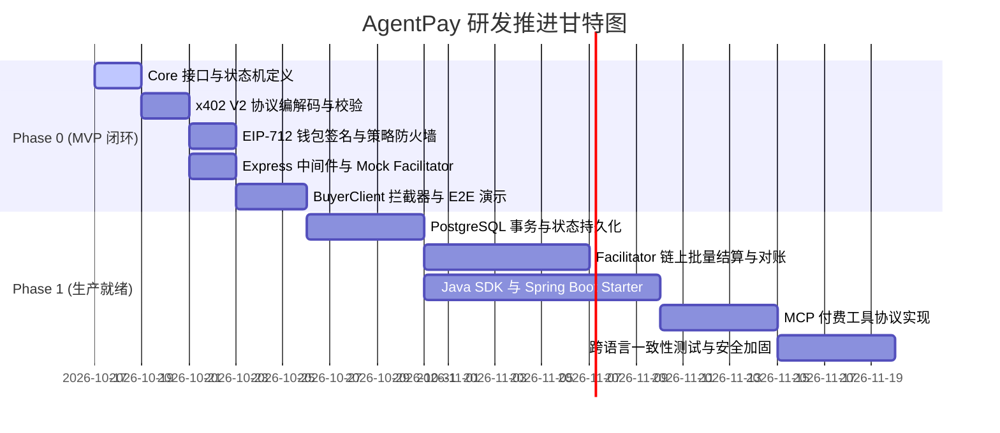

# AgentPay 研发计划与任务拆解 (Development Plan)

## 1. 研发总体排期与里程碑

项目整体划分为两大阶段推进：
* **Phase 0：MVP 极简原型验证期 (Sprint 1)**
  * 核心目标：1 周内打通买方 Agent、策略防火墙、卖方 Express 中间件与 Mock Facilitator 的全链路闭环，产出可运行 POC。
* **Phase 1：企业级双栈与生产就绪期 (Sprint 2 ~ Sprint 5)**
  * 核心目标：完成 PostgreSQL 事务持久化、Java / Spring Boot Starter、真实的 Base 链上 Gasless 批量结算及 MCP 工具生态支持。

---

## 2. Phase 0: MVP 任务工作分解 (WBS)

### 模块一：核心协议与工具链基础 (Day 1 - Day 2)
* **[WBS-01] 初始化 TypeScript 工作空间子包**
  * 创建 `packages/core`、`packages/x402-v2`、`packages/wallet`、`packages/policy`、`packages/express`、`packages/agent-client` 目录。
  * 配置统一的 `tsconfig.base.json` 与 tsup / unbuild 打包脚本。
* **[WBS-02] `@agentpay/core` 类型落地**
  * 定义 `PaymentChallenge`、`PaymentAuthorization`、`PriceRule`、`PolicyConfig` 等核心接口。
  * 定义三态枚举（`PaymentIntentStatus`、`SettlementStatus`、`FulfillmentStatus`）。
* **[WBS-03] `@agentpay/x402-v2` 编解码与 Schema**
  * 实现 `encodeChallenge` / `decodeChallenge`（严格 Base64URL 与 Zod 运行时验证）。
  * 实现 `encodeSignatureHeader` / `decodeSignatureHeader`。

---

### 模块二：财务防火墙与钱包签名 (Day 3 - Day 4)
* **[WBS-04] `@agentpay/wallet` LocalSigner 实现**
  * 基于 Viem 实现 `LocalSigner`，支持输入私钥并构建 EIP-712 Typed Data。
  * 封装符合 EIP-3009 `TransferWithAuthorization` 的哈希与签名工具函数。
* **[WBS-05] `@agentpay/policy` 内存策略引擎**
  * 实现 `MemoryPolicyEngine`：
    * 单笔金额封顶限制（`maxPerTx`）。
    * 24 小时动态滚动预算扣减（`dailyBudget`）。
    * 商户收款地址与域名白名单（`whitelist`）。
    * 超限即时阻断并抛出 `BudgetExceededException`。

---

### 模块三：服务端中间件与清算枢纽 (Day 5)
* **[WBS-06] `services/facilitator` 极简清算服务**
  * 搭建轻量 Express 服务，实现 `POST /v1/verify` 接口。
  * 使用 Viem 的 `recoverTypedDataAddress` 校验 EIP-712 签名。
  * 内存缓存 `used_nonces` 集合，防止同一签名重放二次消费。
* **[WBS-07] `@agentpay/express` 卖方中间件**
  * 拦截未授权请求并生成 `HTTP 402` 附带 `PAYMENT-REQUIRED` 挑战头。
  * 解析请求头中的 `PAYMENT-SIGNATURE`，转发 Facilitator 验签。
  * 验签成功后放行调用业务 Controller。

---

### 模块四：客户端拦截器与端到端闭环验收 (Day 6 - Day 7)
* **[WBS-08] `@agentpay/agent-client` 自动重试客户端**
  * 拦截 HTTP 402 响应。
  * 自动触发策略检查与 `LocalSigner` 签名。
  * 自动补全 `PAYMENT-SIGNATURE` 并无感重试。
* **[WBS-09] 端到端演示脚本 (`examples/typescript-buyer` + `examples/typescript-seller`)**
  * 场景 1：正常购买流程（402 -> 签名 -> 200 交付数据）。
  * 场景 2：超出单笔限额拦截（策略拒绝，不签名）。
  * 场景 3：预算池耗尽拦截（连续调用触发每日预算上限，自动拒绝）。
  * 场景 4：重放攻击防御演示（同一签名二次发起请求被 409 拦截）。

---

## 3. 验收标准与交付物 (Definition of Done)

| 阶段 | 交付物 | 验收准则 |
| :--- | :--- | :--- |
| **MVP 阶段** | `examples/typescript-poc` 可运行脚本 | 运行 `pnpm test:e2e`，自动化完成 4 类核心场景（正常支付、单笔拦截、超额拦截、防重放），且测试用例 100% 通过。 |
| **持久化阶段** | `infra/postgres/init.sql` + 状态机 | 支持 PostgreSQL 数据库原子 CAS 扣减配额，模拟并发无超支。 |
| **Python 阶段**| `agentpay-python` (PyPI package) | 编写 LangChain / CrewAI 驱动的 Python Agent，通过 `httpx` 拦截器调用 protected API，签名与策略校验通过。 |
| **Java 阶段** | `agentpay-spring-boot-starter` | Spring Boot 示例项目引入注解 `@RequiresPayment`，成功与 TypeScript / Python BuyerClient 互通。 |
| **MCP 阶段** | `examples/mcp-paid-tool` | 在 Claude Desktop / Cursor 中注册 AgentPay 付费 MCP Tool，Agent 自主完成工具支付调用。 |

---

## 4. 关键技术风险与应对预案

1. **EIP-712 跨语言签名哈希不一致**：
   * *预案*：在 `specs/conformance/test-vectors/` 中固化权威的 JSON 测试向量，TypeScript Viem 与 Java Web3j 必须在单元测试中直接对齐这些固定向量。
2. **并发场景下的滚动预算竞争问题**：
   * *预案*：MVP 阶段在内存中使用 Node.js 单线程 Event Loop 保证原子操作；Phase 1 采用 PostgreSQL 单行 SQL 比较并更新（CAS），坚决杜绝脏读。
3. **RPC 节点延迟导致的假死**：
   * *预案*：严格践行“网络超时不等于失败”原则，客户端与中间件设置 5 秒超时保护，状态推入 `UNKNOWN` 由后台恢复 Worker 处理。
