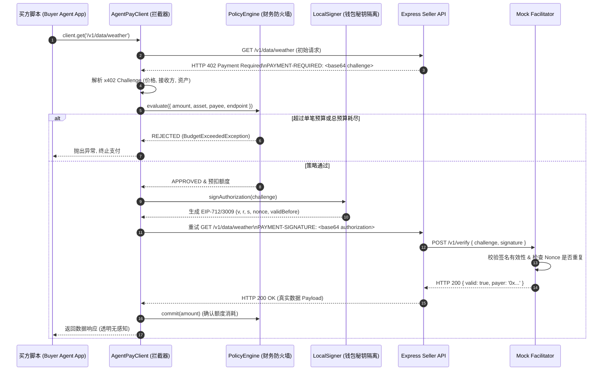

# AgentPay MVP 版本详细设计文档

## 1. MVP 目标与范围界定 (Scope & Objectives)

### 1.1 核心价值验证目标
MVP（Minimum Viable Product）的核心目标是以最快速度、最高信噪比验证 **AgentPay 闭环支付链路与核心架构假设**：
1. **闭环协议握手 (Protocol Loop)**：验证自主 AI Agent 在遭遇 `HTTP 402 Payment Required` 时，能够透明捕获 Challenge、构造合法签名并自动完成重放获取资源的完整体验。
2. **财务防火墙可靠性 (Firewall Invariant)**：验证策略引擎（Policy Engine）能够严格拦截超出单笔限额、超出日滚动预算或非白名单商户的恶意/幻觉请求，保证**不签名、不泄漏凭证**。
3. **EIP-712/3009 签名与离线验签 (Signature Verification)**：在不需要买方 Agent 持有原生链 Gas 的前提下，完成合法的链下转账授权签名，并由卖方/Facilitator 正确反解与校验。

### 1.2 MVP 交付边界
* **包含 (In Scope)**：
  * 基于 TypeScript 的端到端闭环工程。
  * `packages/core`：核心接口、状态机枚举与领域对象定义。
  * `packages/x402-v2`：x402 挑战头与签名头编解码器。
  * `packages/wallet`：支持本地私钥的 `LocalSigner` 抽象。
  * `packages/policy`：内存型（In-Memory）策略引擎实现（支持单笔限额、24小时预算池、白名单）。
  * `packages/agent-client`：基于 Fetch / Axios 的透明 402 HTTP 拦截客户端。
  * `packages/express`：Express 付费路由保护中间件。
  * `services/facilitator`：轻量级 Facilitator 服务（提供 `/v1/verify` 离线验签与内存 Nonce 防重放）。
  * 完整的可运行演示用例（`examples/typescript-e2e-poc`）。
* **暂不包含 (Out of Scope for MVP)**：
  * 真实的以太坊/Base 链上批量打包与广播（MVP 阶段由 Facilitator 进行数学验签并确认，正式上链在 Phase 1 接入）。
  * PostgreSQL 物理持久化（MVP 状态先驻留在内存/轻量 SQLite 中，为 Phase 1 留出标准 DAO 接口）。
  * Java / Spring Boot SDK（在 Phase 1 交付）。

---

## 2. MVP 系统拓扑与交互链路



---

## 3. 核心模块与包设计 (Package Breakdown)

### 3.1 `@agentpay/core`
* **职能**：定义所有公共 TypeScript 接口、类型与协议常量。
* **核心定义**：
  * `PaymentChallenge`：包含 `network`、`asset`、`payee`、`amount`、`validBefore` 等元数据。
  * `PaymentAuthorization`：包含 `payer`、`nonce`、`validAfter`、`validBefore`、`signature` 等字段。
  * `IPolicyEngine`：策略评估与额度提交接口。
  * `ISigner`：统一钱包签名抽象接口。

### 3.2 `@agentpay/x402-v2`
* **职能**：标准化 HTTP 协议头编解码与 EIP-712 结构哈希生成。
* **特性**：
  * 使用 Zod 进行严格的 Schema 运行时校验。
  * 基于 Viem 进行无依赖轻量级 EIP-712 Typed Data 格式化。
  * Base64URL 编解码安全防护，防止特殊字符截断。

### 3.3 `@agentpay/policy`
* **职能**：在 Agent 发起签名之前进行刚性规则拦截。
* **规则集**：
  * `maxPerTransaction`：单笔最高限额（如 1 USDC = 1,000,000 基数单位）。
  * `rollingBudget24h`：24 小时动态预算池。
  * `whitelistMerchants`：允许交易的商户收款地址或域名列表。
  * `consecutiveErrorThreshold`：连续错误熔断阈值。

### 3.4 `@agentpay/wallet`
* **职能**：私钥保管与 EIP-712 密码学计算。
* **MVP 实现**：`LocalSigner`
  * 仅接收本地环境变量注入的私钥（如 `process.env.AGENT_PRIVATE_KEY`）。
  * 严禁将私钥实例传递给上层 Agent 或暴露给提示词上下文。

### 3.5 `@agentpay/agent-client`
* **职能**：买方核心驱动层。包装标准 `fetch`，自动处理 402 流程。
* **使用形态**：
  ```typescript
  import { AgentPayClient } from '@agentpay/agent-client';
  import { LocalSigner } from '@agentpay/wallet';
  import { MemoryPolicyEngine } from '@agentpay/policy';

  const client = new AgentPayClient({
    signer: new LocalSigner(process.env.AGENT_PRIVATE_KEY),
    policy: new MemoryPolicyEngine({
      maxPerTx: 1_000_000n, // 1 USDC
      dailyBudget: 10_000_000n, // 10 USDC
    })
  });

  // 对 Agent 而言，调用完全透明：
  const response = await client.fetch('https://api.provider.com/v1/market-data');
  const data = await response.json();
  ```

### 3.6 `@agentpay/express`
* **职能**：卖方中间件。为 API 路由注入 402 保护。
* **使用形态**：
  ```typescript
  import express from 'express';
  import { agentPayMiddleware } from '@agentpay/express';

  const app = express();

  app.get('/v1/market-data', agentPayMiddleware({
    price: 100_000n, // 0.1 USDC
    payee: '0x1234...',
    asset: '0x036CbD53842c5426634e7929541eC2318f3dCF7e', // Base Sepolia USDC
    network: 'eip155:84532',
    facilitatorUrl: 'http://localhost:4000'
  }), (req, res) => {
    res.json({ snapshot: 'BTC-USDC-TICKER', price: 95000 });
  });
  ```

---

## 4. 异常处理与防御边界

1. **预算超限处理**：
   * 触发策略拦截时，立即抛出强类型 `BudgetExceededException`。
   * 不产生任何网络签名流量，控制台打印审计日志。
2. **重放攻击防御**：
   * Facilitator 维护全局 `used_nonces` 集合（内存 Set + TTL）。
   * 相同 Nonce 再次发起 `/verify` 请求时，直接返回 `409 Conflict - Nonce Already Spent`。
3. **过期签名防御**：
   * 挑战头附带 `validBefore`（例如当前时间 + 300 秒）。
   * Facilitator 与 Seller Middleware 均校验 `currentTime < validBefore`。
