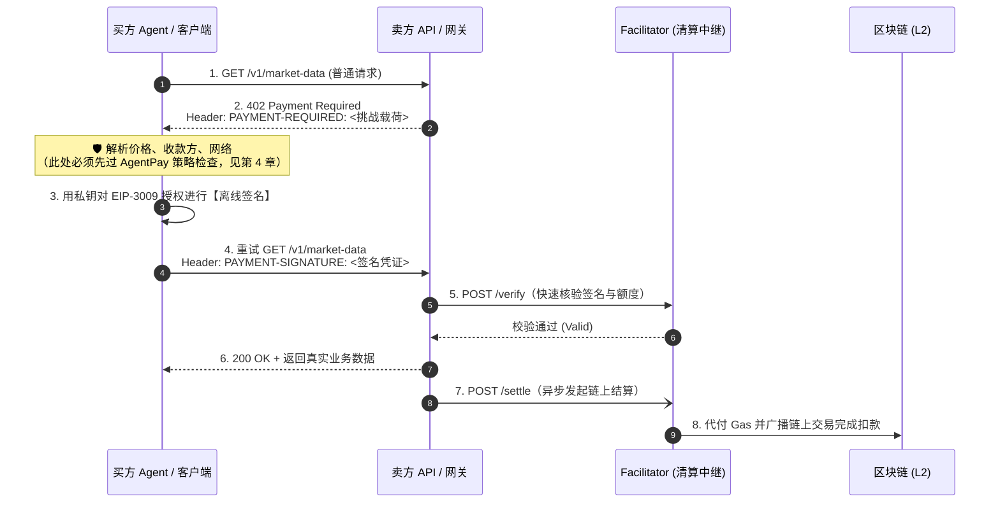

# HTTP 402 与 x402 协议原理

> **一句话**：HTTP 标准早在三十年前就预留了 `402 Payment Required` 状态码；而 x402 终于把它变成了一个真正可用的开放协议——“服务器报价，客户端离线签名付款，带凭证重试拿到资源”。

**本篇你会了解**：
- `402 Payment Required` 状态码尘封三十年的来历与破局
- x402 V2 协议的完整六步握手流程与核心设计哲学
- 关键 HTTP 头部与 JSON 挑战载荷的逐字段硬核拆解
- 交易中的三大核心角色（买方、卖方、Facilitator 清算中继）
- **核心洞察**：x402 到底**不管什么**？为什么裸奔运行 x402 会导致灾难？

---

## 1. 被“预留”了三十年的状态码

凡是写过 Web 代码的人都熟悉 `200 OK`（成功）、`401 Unauthorized`（未认证）、`404 Not Found`（未找到）和 `500 Internal Server Error`（服务器错误）。但在 HTTP/1.1 规范（RFC 2068，1997 年）中，其实还静静躺着一个极具前瞻性的状态码：

> **`402 Payment Required`** —— “该状态码留作将来使用（Reserved for future use）。”

互联网先驱们早在三十年前就意识到，网络请求不仅需要传输超文本，还应该具备原生传输“价值（金钱）”的能力。然而在当时的金融条件下，信用卡手续费高昂且需要人工输入，电子现金（DigiCash）尚未普及，互联网一直缺乏一种**无需开户、可编程、支持毫美分级微支付**的原生货币体系。于是，`402` 状态码长期处于“标准定义了，但全世界没人用”的尴尬境地。

直到高性能区块链（L2）与合规稳定币（如 USDC）走向成熟，这块缺失了三十年的拼图终于被补齐：**x402** 正是围绕 HTTP 402 状态码量身打造的机器原生开放支付协议。它将“付费”无缝嵌入到了标准的 HTTP 请求-响应周期中，让 Agent 付钱变得像发送一个普通网页请求一样自然。

> **📌 协议演进现状（截至 2026 年 10 月）**：
> x402 协议最早由 Coinbase 于 2025 年 5 月发起推出，并于 2025 年 12 月正式发布架构更成熟的 **V2 版本**；2026 年 4 月起，该协议正式移交至 Linux Foundation（Linux 基金会）旗下的 **x402 Foundation** 进行中立化治理，并于同年 7 月完成全面运营启动，核心成员涵盖全球主流支付巨头、云厂商与加密基础设施机构。详见 [ecosystem-landscape.md](./ecosystem-landscape.md)。

---

## 2. 一次 x402 付款的完整握手流程

我们先通过时序图，看清一次标准的 x402 V2 交易在底层是如何流转的：



用通俗的话拆解，整个过程分为六个核心步骤：

1. **先要资源（试探请求）**：买方 Agent 像调用普通免费接口一样，直接发送 `GET /v1/market-data`。它不需要提前知道这个接口收不收费、收多少钱。
2. **服务器报价（402 拦截）**：卖方网关发现该请求未携带支付凭证，于是拦截请求并返回 `402 Payment Required`，同时在响应头里附带一份机器可读的“账单（挑战载荷）”——明确告知：**要付多少、付给谁、用哪条链、什么币种、多久之内有效**。
3. **客户端离线签名（核心设计）**：买方 Agent 解析账单后，在本地使用钱包私钥签署一份**“授权转账凭证”**（例如基于 EIP-3009 标准的 `transferWithAuthorization`）。
    - 💡 **关键点**：注意此时客户端**只做本地密码学签名（耗时仅几毫秒），并没有自己去连接区块链发交易！** 这使得客户端完全不需要操心节点 RPC 拥堵或账户里有没有原生 Gas 代币（如 ETH）。
4. **带凭证重试（二次请求）**：买方 Agent 重新发送一模一样的 `GET /v1/market-data` 请求，只是这次在请求头里塞入了刚才签好的 `PAYMENT-SIGNATURE` 凭证。
5. **服务器秒级验证并交付（先货后落袋）**：卖方收到重试请求后，将签名发给 Facilitator（或本地验证器）核验签名真伪、检查付款人链上余额是否充足。验证通过仅需几十毫秒，卖方**立即返回 `200 OK` 和业务数据**，绝不拖慢 Agent 的工作流。
6. **事后异步结算（链上交割）**：业务数据交付的同时，卖方异步通知 Facilitator 将刚才那份签名凭证打包广播到区块链上，真正把 USDC 从买方钱包划转到卖方钱包。

---

## 3. 关键请求头与载荷拆解（V2 规范）

在 x402 V2 规范中，所有的支付协商都通过三个标准化的 HTTP Header 完成：

| HTTP 头部名称 | 传输方向 | 核心作用与包含内容 |
|---|---|---|
| `PAYMENT-REQUIRED` | 卖方服务器 → 买方客户端<br>（随 `402` 响应返回） | **支付挑战（报价单）**：声明支持的网络（CAIP-2 格式）、资产合约、最小单位金额、收款地址、签名方案及有效期等。 |
| `PAYMENT-SIGNATURE` | 买方客户端 → 卖方服务器<br>（随第二次重试请求发送） | **支付凭证（签名支票）**：包含付款人地址、防重放随机数（Nonce）、有效时间窗以及密码学签名结果（v, r, s 或紧凑签名）。 |
| `PAYMENT-RESPONSE` | 卖方服务器 → 买方客户端<br>（随 `200 OK` 响应返回） | **结算回执**：用于向客户端回传本次支付的核验状态、结算流水号或最终链上交易哈希（TxHash）。 |

> ⚠️ **版本兼容性铁律**：
> x402 早期的 V1 草案曾使用 `X-PAYMENT` 请求头，而 **V2 规范已全面废弃 `X-` 前缀，统一使用上述三个标准头部**。在工程实现中，**严禁将 V1 与 V2 的头部格式混用**。AgentPay 中关于这些头部的严格载荷定义与编码要求，请参考 [api-specs.md](../../api-specs.md) 与协议一致性规范（T1.3）。

### 挑战载荷（Challenge Payload）深度解剖

当服务器返回 `402` 时，`PAYMENT-REQUIRED` 头（通常经 Base64 编码）解码后的核心 JSON 结构如下：

```json
{
  "version": "2.0",
  "network": "eip155:421614",
  "asset": "0x75faf114eafb1BDbe2F0316DF893fd58CE46AA4d",
  "decimals": 6,
  "amount": "100000",
  "payee": "0xSellerPayoutAddress...",
  "scheme": "EIP-3009",
  "validAfter": 1729000000,
  "validBefore": 1729000300
}
```

这里每一个字段的设计都暗藏着严谨的金融工程考量：

- **`amount: "100000"`（为什么是字符串格式的整数？）**：
  USDC 在链上采用 **6 位小数（`decimals: 6`）**，因此 `"100000"` 最小单位代表 $100000 \div 10^6 = 0.1\text{ USDC}$（即 10 美分）。
    - 🚨 **安全红线**：为什么不用数字类型的 `0.1`？因为在计算机编程中，IEEE 754 浮点数运算存在著名的精度丢失问题（例如 `0.1 + 0.2 = 0.30000000000000004`）。在金融系统中，哪怕一丁点浮点误差都会导致密码学签名验签失败或账目不平。因此，**全链路强制使用“字符串包裹的最小单位整数（BigInt）”是 AgentPay 不可触碰的安全红线之一**（详见 [safety-redlines](../06-resources/safety-redlines.md)）。
- **`network: "eip155:421614"`（CAIP-2 跨链标准）**：
  采用行业标准的 **CAIP-2（Chain Agnostic Improvement Proposals）** 命名空间来唯一标识区块链网络。`eip155` 代表 EVM 兼容链，`421614` 是 Arbitrum Sepolia 测试网的 Chain ID（若是 Base 主网则为 `eip155:8453`）。这保证了协议未来可以无缝扩展至非 EVM 链（如 Solana）。
- **`scheme: "EIP-3009"`（免 Gas 授权标准）**：
  指定底层使用的签名机制。EIP-3009 是 USDC 官方合约原生支持的标准，允许用户通过离线签名授权他人划转指定数量的代币，且内置了基于随机字节（32-byte random nonce）的防重放机制，无需按顺序排队，极其适合高并发的 Agent 调用。
- **`validAfter` 与 `validBefore`（生命期枷锁）**：
  限定这张“签名支票”的生效时间与过期时间（Unix 时间戳）。窗口通常仅设为短短几分钟（如 300 秒）。一旦超时，哪怕黑客截获了这串签名，智能合约也会在链上直接拒绝执行，杜绝了历史签名被延迟盗刷的风险。

---

## 4. 生态中的三个核心角色

在 x402 的协作网络中，职责被清晰地解耦为三个角色：

| 角色 | 核心职责 | 工程实现门槛 |
|---|---|---|
| **1. 买方（Client / Agent）** | 发起 HTTP 请求、解析 402 报价、执行本地安全策略检查、调用私钥完成离线签名并重试。 | 极低（只需集成轻量级 SDK 或通过 AgentPay 代理）。 |
| **2. 卖方（Server / API 网关）** | 对受保护资源拦截并返回 402 报价、将客户端签名转发给 Facilitator 核验、向客户端交付业务数据。 | 极低（无需自己写智能合约或跑区块链节点，只需加一层中间件）。 |
| **3. Facilitator（清算中继）** | 替卖方验证签名有效性与付款人余额、替买方**代付链上 Gas 费**、将离线签名打包广播上链并监控最终确认。 | 高（需维护高可用 RPC 节点池、Gas 资金池与防双花风控）。 |

> 💡 **为什么需要 Facilitator（清算中继）？**
> 想象一下，如果让一个卖天气数据的 Web2 开发者自己去搭区块链节点、管理 ETH Gas 钱包、处理区块重组（Reorg），99% 的开发者都会直接放弃。Facilitator 把所有脏活累活（核验、垫付 Gas、上链广播）全包揽了，让卖方只需要发两个普通的 HTTP 请求（`/verify` 和 `/settle`）就能收下稳定币。
> 更重要的是，**x402 是一个彻底开放的协议，而不是某个垄断的支付处理商**：任何企业或组织都可以自己运行私有的 Facilitator，也可以自由选择 Coinbase、Cloudflare 等第三方提供的商业 Facilitator 服务。

---

## 5. x402 **不管**什么？—— 这正是 AgentPay 存在的原因

读完上面丝滑的握手流程，请把目光拉回第 2 节时序图中的第 3 步备注：**“🛡️ 此处必须先过 AgentPay 策略检查”**。

很多开发者在初次接触 x402 时会产生一个危险的错觉：“既然 x402 已经有密码学签名、有效期限制和防重放了，我直接给 Agent 装个官方 x402 客户端库，再配个装有 1,000 USDC 的私钥，不就可以上线了吗？”

**大错特错！因为 x402 协议规定的是“怎么付（How to pay）”，但它完全不管“该不该付（Whether to pay）”。**

一个只实现了标准 x402 协议的“裸奔”客户端，其默认逻辑是：**只要遇到 `402 Payment Required`，就自动掏出私钥按对方的要求签名付款。** 在 Agent 自主探索外部世界的场景下，这会引发三类致命的资损灾难：

### 灾难场景一：天价刺客与提示词注入（Malicious Overpricing）
- **发生过程**：你的 Agent 在全网搜索行业资料时，访问了一个被黑客控制的恶意 API（或者通过间接提示词注入被诱导访问了钓鱼链接）。该服务器返回了一个完全符合 x402 V2 标准格式的 `402` 响应，但里面的 `amount` 填的是 `"500000000"`（即 **500 USDC**，而不是正常的 0.01 USDC）。
- **x402 的反应**：协议格式完全合法！裸奔的客户端毫不犹豫地签下了 500 美元的转账授权，一秒钟内倾家荡产，且链上不可撤回。

### 灾难场景二：代码死循环与“重试风暴”（Retry Storm）
- **发生过程**：卖方接口标价很良心，每次只需 0.05 USDC。但由于卖方服务器内部 Bug，或者 Agent 自身解析返回结果的逻辑陷入了死循环（例如拿不到预期字段就无限重试），Agent 在 1 分钟内以每秒 20 次的速度疯狂请求该接口。
- **x402 的反应**：每次请求都是一次合法的独立握手！客户端在 1 分钟内连续签出 1,200 张支票，瞬间烧掉 60 美元，直到钱包彻底见底。

### 灾难场景三：收款方偷梁换柱（Payee Spoofing）
- **发生过程**：Agent 本来打算调用知名服务商 A 的接口，但由于 DNS 劫持、中间人攻击或大模型幻觉拼错了 URL，请求发到了仿冒网站 B。网站 B 返回了 `402`，并将 `payee`（收款地址）填成了黑客自己的钱包。
- **x402 的反应**：只认签名不认人！客户端照常向陌生黑客地址签名打款。

---

### 破局：AgentPay 是插在“收到 402”与“落笔签名”之间的铁闸

在传统“人类程序员写死调用某个固定 API”的场景里，上述问题或许可以通过人工排查避免；但在**“Agent 自主规划、动态调用陌生工具”**的时代，让私钥对所有的 402 响应有求必应，无异于把印钞机大门向全网敞开。

```text
卖方返回 402 报价 ──► [ 🚨 AgentPay 金融防火墙拦截 ] ──(校验通过)──► 私钥落笔签名
                             │
                             ├─► 1. 单笔金额是否超过阈值？（防天价刺客）
                             ├─► 2. 当前任务/今日累计花费是否超标？（防预算失控）
                             ├─► 3. 调用频率是否触发熔断？（防死循环重试风暴）
                             └─► 4. 收款地址与域名是否在白名单/信誉库内？（防钓鱼欺诈）
```

**这正是 AgentPay 存在的核心价值**：x402 铺好了价值传输的“高速公路”，而 AgentPay 则是设立在私钥签名之前的**“智能收费站与防暴装甲车”**。两者的边界与协作关系，详见后续章节 [agentpay-vs-x402.md](../03-infra-map/agentpay-vs-x402.md)。

---

## 小结

- **历史破局**：HTTP `402 Payment Required` 闲置三十年后，由 x402 协议结合稳定币与 L2 区块链将其真正激活，实现了原生于 Web 请求的价值传输。
- **高效握手**：x402 采用**“请求 → 402 报价 → 客户端离线签名 → 带签名重试 → 验签秒级交付 → Facilitator 异步上链结算”**的机制，兼顾了无需开户的开放性与毫秒级的低延迟体验。
- **严谨规范**：V2 规范使用 `PAYMENT-REQUIRED` 与 `PAYMENT-SIGNATURE` 头部，金额强制采用**字符串格式的最小单位整数**以彻底杜绝浮点精度误差。
- **安全边界**：x402 只解决“怎么把钱付出去”，绝不解决“这笔钱该不该付”。要防止 Agent 被天价账单、死循环或钓鱼接口掏空钱包，必须在收到 402 与私钥签名之间接入 **AgentPay 金融防火墙**。

**下一篇**：[stablecoins-and-usdc.md](./stablecoins-and-usdc.md) —— 稳定币基础：为什么 x402 与 AgentPay 选择 USDC 作为核心结算资产？