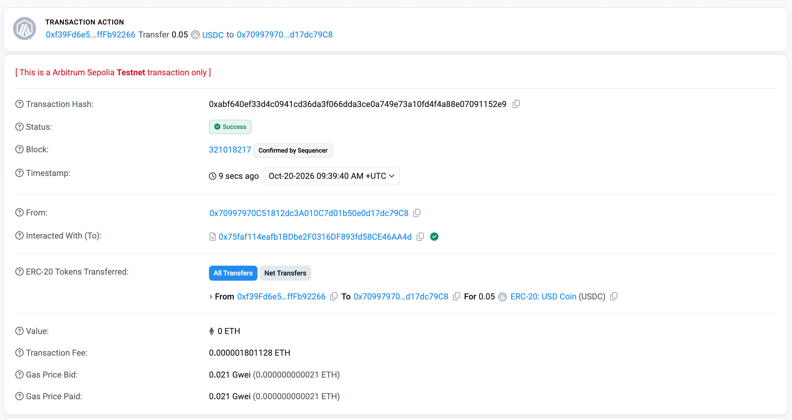

# 10 分钟 Demo

::: warning 实验性项目
AgentPay 尚未经过独立安全审计，请勿用于生产环境的真实资金。本页只使用测试网和测试代币。
:::

## 你将看到什么

用一个脚本，在一台机器上依次演示三个场景：

| 场景 | 发生了什么 | 防火墙的反应 |
|---|---|---|
| **1. 正常付款** | Agent 购买一条 NVDA 行情，价格 $0.05 | 放行 → 签名 → 结算，Agent 拿到数据 |
| **2. 超额付款** | Agent 调用一个 $2.50 的重型计算接口 | 单笔上限是 $0.10，直接拒绝，**不签名** |
| **3. 失控循环** | Agent 陷入无限调用循环 | 每分钟最多 5 次，超过后熔断，后续调用全部被阻断 |

Demo 中防火墙的配置是：

```text
单笔上限 $0.10  |  24 小时预算 $1.00  |  每分钟最多 5 次
```

## 准备

- Python 3.10 或以上、`make`、`git`
- 克隆仓库：

```bash
git clone https://github.com/july-whj/AgentPay.git
cd AgentPay
```

- 依赖安装请参照仓库 README 的 Quickstart。

<!-- TODO: 补充依赖安装的实际命令 -->

## 第一步：本地模拟运行（推荐先跑这个）

```bash
make demo
```

这个模式在本机内存里模拟整条链路，**不联网、不消耗 Gas、不需要测试币**，几秒钟就能跑完，而且每次结果一致。

### 阶段一：正常付款

```text
>>> [PHASE 1] Normal Micro-Payment with On-Chain Settlement <<<
Agent requests paid market data for 'NVDA' ($0.05 USDC).
✓ Tool Response Received: {'ticker': 'NVDA', 'price': 142.5, ...}
[Facilitator] ON_CHAIN_TRANSACTION_CONFIRMED
```

Agent 只是调用了一次普通的工具，但背后发生了这些事：

1. 卖方返回"需要付款"的要求；
2. 防火墙检查：$0.05 没有超过单笔上限，预算充足 → **放行**；
3. 本地签名器产生一份离线的转账授权；
4. 带着授权重新请求，拿到数据；
5. Facilitator 把授权提交结算。

日志里有一行值得注意：

```text
"gasChargedToBuyer": "0.0000 ETH (Free EIP-3009 Transfer)"
```

买方钱包里只需要 USDC，不需要持有 ETH 来付 Gas。（原理见 [免 Gas 授权](../02-agent-payments/gasless-eip-3009.md)）

### 阶段二：超出单笔上限

```text
[BuyerFirewall] POLICY_VIOLATION_INTERCEPTED
  "errorCode": "SINGLE_TX_CAP_EXCEEDED",
  "requestedAmountUsdc": "2.50",
  "maxAllowedPerTxUsdc": "0.10",
  "action": "PAYMENT_ABORTED_SAFELY",
  "walletFundsDrained": "0.00 USDC"
```

请求 $2.50，上限 $0.10，防火墙在**签名之前**就拒绝了。没有签名，就没有任何资金可能离开钱包。

日志里还有一行 `toolObservation`，这是防火墙把拒绝原因反馈给 Agent 的内容。Agent 能知道"为什么被拒绝"，可以据此换一个方案，但它没有办法改变规则。

### 阶段三：失控循环被熔断

```text
[BuyerFirewall] CIRCUIT_BREAKER_TRIPPED
  "iteration": 5,
  "breakerState": "OPEN",
  "reason": "CIRCUIT_MAX_RPM_EXCEEDED (Max 5 RPM exceeded)",
  "cooldownSeconds": 300
✗ Loop iteration #5 BLOCKED by Circuit Breaker
```

Agent 进入死循环，一口气发出 8 次调用。前 4 次正常付款，加上阶段一的那一次，一分钟内的付款达到了 5 次的上限。从第 5 次循环开始，熔断器进入打开状态，后面的调用全部被阻断，冷却时间为 300 秒。

这就是 [为什么需要金融防火墙](../04-agentpay-concepts/financial-firewall.md) 里那场"一小时烧掉 1,800 USDC"的循环，被截断在几秒之内。

### 最后的审计报告

```text
Calls Attempted:             10
Successful Paid Calls:       5
Over-Budget Blocks:          1
Runaway Loop Blocks:         4
Total Spend Attempted:       $2.63 USDC
Actual Funds Debited:        $0.09 USDC
Total Funds Saved by AgentPay: $2.54 USDC
```

这几个数字可以这样对上：

| 数字 | 含义 |
|---|---|
| 10 次调用 | 阶段一 1 次 + 阶段二 1 次 + 阶段三 8 次 |
| 5 次成功付款 | 阶段一 1 次 + 循环中前 4 次 |
| 5 次被拦截 | 超额 1 次 + 熔断 4 次 |
| 实际扣款 $0.09 | 5 次成功付款的合计 |
| 被拦下的 $2.54 | 超额的 $2.50 + 被熔断的 4 次调用 |

注意：**熔断前已经付出去的 4 次小额付款不会被追回。** 防火墙限制的是损失的上限，而不是让损失为零。

## 第二步（可选）：真实的链上结算

如果你想看到交易真正出现在区块浏览器上：

```bash
make demo-live
```

这个模式会向 Arbitrum Sepolia 测试网真实广播交易。

### 额外的准备

- **Facilitator 钱包**需要少量 Arbitrum Sepolia 测试网 ETH，用来支付 Gas；
- **买方钱包**需要测试网 USDC（Circle 官方测试代币）；
- 按 README 配置密钥与 RPC。

<!-- TODO: 补充环境变量名与水龙头说明 -->

::: danger 不要使用公开的密钥
很多教程和开发工具里的默认示例账户，私钥是**公开已知**的，任何人都能操作这些地址，链上的机器人也会盯着它们。运行 live 模式请**新生成**一对测试密钥，并且只充入测试币。任何示例密钥都**绝对不能**用于主网。
:::

### 在 Arbiscan 上验证

运行结束后，阶段一的日志里会有一个真实的交易哈希和 Arbiscan 链接。下面是这次运行的交易页面：



可以对照这几项来读：

| Arbiscan 字段 | 看到的内容 | 含义 |
|---|---|---|
| **Status** | Success | 链上执行成功 |
| **ERC-20 Tokens Transferred** | 从买方转给收款方，0.05 USDC | 这就是 Agent 付出的钱，与 Demo 里的 $0.05 一致 |
| **From** | Facilitator 钱包地址 | 发起交易并**支付 Gas 的是 Facilitator，不是买方** |
| **Transaction Fee** | 约 0.0000018 ETH | 这笔 Gas 由 Facilitator 承担，买方为 0 |
| **Value** | 0 ETH | 交易本身没有转移 ETH，转移的是 USDC |
| **Timestamp** | 与日志中的时间一致 | 可以与终端日志互相印证 |

这张图同时证明了一件事：买方通过一份离线签名授权了转账，真正上链的是 Facilitator，买方不需要为 Gas 付一分钱。

::: details 实时模式下可能看到的 nonce too low 日志

<!-- TODO: 问题修复后删除本段 -->

在 live 模式的末尾，后台结算阶段可能出现类似下面的日志：

```text
Failed to broadcast settlement tx: RPC error -32000: nonce too low ...
Settlement submission failed ... Facilitator error 409: Nonce has already been submitted for settlement
```

`nonce too low` 表示 Facilitator 钱包准备使用的交易序号，已经落后于链上该账户当前的序号。常见原因是同一个钱包同时广播多笔交易，或者这个地址正被其他人或程序同时使用。

遇到这种情况时，对应的那几笔结算没有成功上链，需要通过对账补发。这也说明了 [超时不等于失败](../04-agentpay-concepts/timeout-is-not-failure.md) 里的道理：**"提交失败"不等于"这笔付款不存在"，需要查清楚再处理，而不是盲目重发。**

:::

## 验证清单

跑完之后，对照一下你应该看到：

- [ ] 阶段一：拿到了行情数据，日志里 Gas 由买方承担的部分是 0
- [ ] 阶段二：出现 `SINGLE_TX_CAP_EXCEEDED`，被拒绝的金额没有离开钱包
- [ ] 阶段三：循环从第 5 次开始被熔断，状态为 `OPEN`
- [ ] 报告：被拦下的金额远大于实际扣款
- [ ] （live 模式）阶段一的交易能在 Arbiscan 上查到

## 动手改一改

打开 `examples/runaway-agent/demo.py`，找到防火墙的三个参数（单笔上限、24 小时预算、每分钟次数），试试：

1. 把单笔上限调大到 $3.00，再运行一次。阶段二还会被拒绝吗？如果被拒绝，拒绝的原因变成了什么？
2. 把每分钟次数调到 20。熔断会在第几次循环触发？
3. 把 24 小时预算调到 $0.05，阶段三的结果会怎样？

每次改完，对照日志里的 `errorCode` 看是哪一条规则拦住了请求。

## 下一步

- 想理解防火墙背后的设计：[为什么需要金融防火墙](../04-agentpay-concepts/financial-firewall.md)
- 想理解并发下预算为什么不会超支：[预算预留](../04-agentpay-concepts/budget-reservation.md)
- 想用 Web 控制台配置网关和策略：[在控制台配置第一个付费路由](./first-paid-route.md)