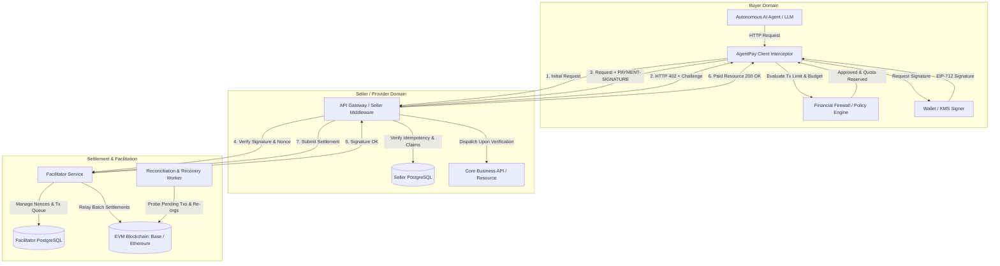
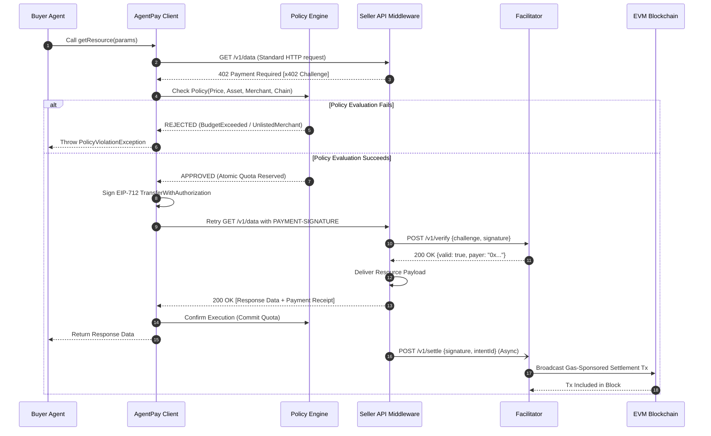
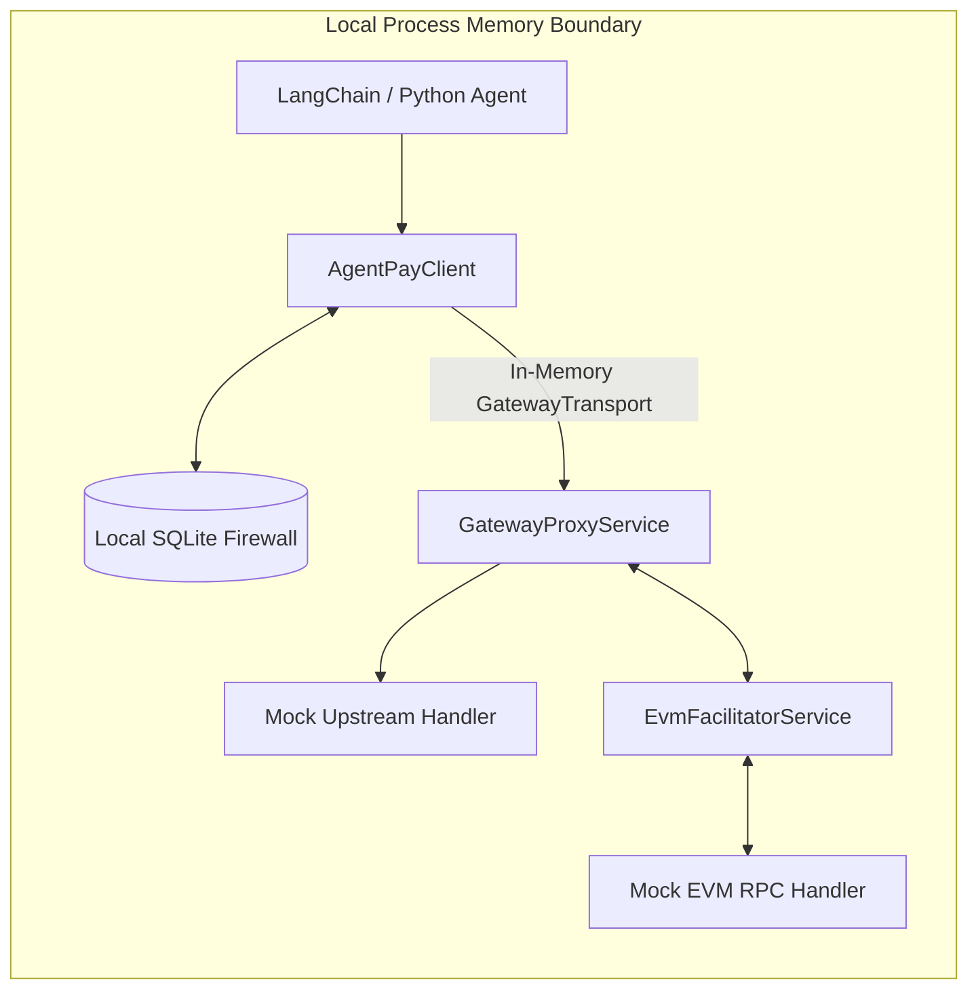
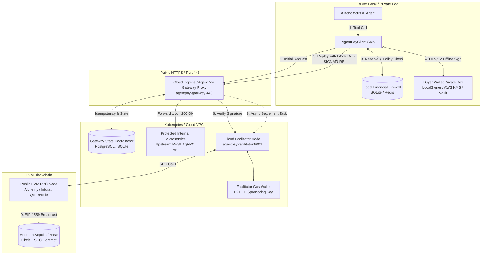

# AgentPay Architecture Specification

## 1. Overview & Architectural Goals

**AgentPay** is an open-source, non-custodial financial infrastructure and security layer for autonomous AI agents. It standardizes HTTP-based micro-payments over the **x402 V2** protocol and integrates an out-of-band **Financial Firewall (Policy Engine)** that prevents financial loss resulting from AI hallucinations, infinite loops, and unauthorized transactions.

### Key Tenets
1. **Zero-Trust for AI Autonomous Actions:** AI models propose transactions, but the cryptographic signing and payment execution occur strictly behind an independent, non-LLM policy boundary.
2. **Decoupled Asynchronous Lifecycle:** Separates high-level payment intent, blockchain consensus/settlement, and downstream service fulfillment to protect against network timeouts.
3. **Cross-Language Equivalence (Roadmap):** Specification-driven conformance vectors ensuring deterministic protocol, state machine, and cryptographic parity across current Python/Go implementations and planned multi-language SDKs.
4. **Gasless Micro-Settlements:** Employs EIP-712 / EIP-3009 signed authorizations. Buyer Agents require zero native gas tokens (ETH/MATIC/etc.), which are sponsored and settled by Facilitator nodes.

---

## 2. System Topology & Core Components



### Component Roles & Responsibilities

| Component | Responsibility |
| :--- | :--- |
| **Buyer Agent** | High-level agent runtime or script initiating HTTP calls to tools, APIs, and data sources. |
| **AgentPay Client Interceptor** | Transparent HTTP client wrapper that detects `402 Payment Required`, triggers policy evaluation, collects EIP-712 signatures, and replays requests. |
| **Policy Engine (Firewall)** | Standalone security engine enforcing rate limits, per-transaction caps, daily rolling budgets, and destination whitelists. |
| **Gateway / Seller Proxy** | High-performance Go Reverse Proxy (`gateway-go`) intercepting incoming requests, generating x402 challenges, managing wallet reservations, and coordinating verification. |
| **Facilitator Service** | High-performance gateway that validates off-chain EIP-712/3009 signatures, sponsors gas, and batches on-chain settlement transactions. |
| **Reconciliation Worker** | Asynchronous service that polls unconfirmed settlements, repairs state after network splits, and triggers automated recovery workflows. |

---

## 3. Protocol & Standards Baseline

1. **x402 V2 Protocol:**
   * **Challenge Header:** `PAYMENT-REQUIRED` with base64/JSON encoded challenge payload containing accepted payment schemes, supported networks, token contract addresses, price, and expiration timestamp.
   * **Authorization Header:** `PAYMENT-SIGNATURE` containing the payer address, nonce, expiration, signature type (`EIP-712` or `EIP-3009`), and raw cryptographic signature.
2. **CAIP-2 Chain Identifiers:**
   * Standardized chain namespaces (e.g., `eip155:8453` for Base Mainnet, `eip155:84532` for Base Sepolia).
3. **EIP-712 & EIP-3009 Authorization:**
   * Type-safe structured signing (`TransferWithAuthorization` / `ReceiveWithAuthorization`).
   * Eliminates the traditional ERC-20 `approve` + `transferFrom` two-step gas cost.
4. **Idempotency Standards:**
   * Every payment request carries an `Idempotency-Key` (UUIDv4) header and deterministic SHA-256 payload digest.
5. **EIP-1559 Dynamic Fee & Settlement Sponsoring:**
   * Facilitator settlement broadcasts utilize EIP-1559 (Type 2) transactions with a 1.5x `baseFee` buffer ($\text{maxFeePerGas} = \max(\lfloor \text{baseFee} \times 1.5 \rfloor + \text{priorityFee},\; \lfloor \text{gasPrice} \times 1.35 \rfloor + \text{priorityFee})$) to completely prevent block BaseFee fluctuation rejections without incurring additional gas expenses, accompanied by an adaptive fallback to buffered Legacy Type 0 transactions for legacy chains (see [gas-cost-and-settlement-models.md](file:///Users/wanghongjie/aiPoiject/AgentPay/specs/gas-cost-and-settlement-models.md)).

---

## 4. End-to-End Payment Flow



---

## 5. Technology Stack & Multi-Language Roadmap

To serve different operational requirements while guaranteeing identical protocol behavior:

### 5.1 Current Implementation (v0.1.x Baseline)
* **Go Reverse Proxy Gateway (`gateway-go/`):** High-throughput cloud-native reverse proxy, embedded Policy Engine, multitenant wallet & ledger, low-latency EIP-712 cryptographic verification (`geth/crypto`), structured logging, and minimal container footprints.
* **Python Client SDK (`python/packages/agentpay`):** Targeted at the primary AI Agent and LLM framework ecosystem (LangChain, CrewAI, AutoGen, LlamaIndex), featuring transparent HTTP interceptors (`httpx`, `aiohttp`) and native MCP server tools.

### 5.2 Multi-Language Roadmap (2027+)
* **TypeScript / Node.js Stack:** Targeted at JS/TS AI agents (Browser, Bun, MCP servers) and Next.js / Express microservices.
* **Java Stack:** Targeted at enterprise financial backends and Spring Cloud gateways.

### 5.3 Shared Conformance Vectors (`specs/conformance/test-vectors/`)
* EIP-712 domain separator serialization across `eth-account`/`web3.py` (Python), `go-ethereum` (Go), and future SDKs.
* x402 V2 challenge parser and signature encoder.
* State machine transition edge cases.
* Policy budget deduction math with 64-bit integer overflow protection.

---

## 6. Gas Economics & Settlement Sponsorship Models

Under EIP-3009 meta-transactions (`transferWithAuthorization`), the Buyer Agent is cryptographically gasless (holds only payment tokens, e.g. USDC, with 0 ETH required), while the EVM transaction caller (`msg.sender` / Facilitator) pays miner gas fees.

AgentPay formally supports three settlement sponsorship modes (detailed in [`specs/gas-cost-and-settlement-models.md`](./gas-cost-and-settlement-models.md)):

1. **Mode 1: Seller-Subsidized Gasless Settlement (2026 Baseline - v0.1.0):**
   * Facilitator sponsors L2 native gas (Arbitrum Sepolia / Base Sepolia, $0.001 - $0.005 per tx); Buyer pays exact API price in USDC.
   * Ideal for high-margin APIs and friction-free agent micro-payments.
2. **Mode 2: Dynamic Gas Surcharge & Reimbursement (2027 Q1 - v0.2.0):**
   * Gateway dynamically estimates EVM gas + L1 data fees, converts to USDC via Oracle, and appends to Challenge `amount`. Buyer pays both via USDC signature, fully reimbursing the Facilitator.
   * Ideal for Ethereum L1, gas spikes, and low-margin / pass-through GPU compute.
3. **Mode 3: Batch Aggregation & State Channel Delayed Settlement (2027 Q2 - v0.3.0):**
   * Gateway validates authorizations off-chain and fulfills requests immediately; Facilitator flushes payments via batch multicall contracts or state channels.
   * Amortizes transaction gas by >95%, enabling sub-cent ($0.0001) per-token streaming micro-payments.

---

## 7. Deployment Topology Architectures

AgentPay supports two primary deployment topologies designed for distinct phases of the software and agent lifecycle: **Local Embedded Simulation** (for rapid development and testing) and **Cloud-Native Distributed** (for production API monetization and autonomous multi-agent systems).

```
┌─────────────────────────────────────────────────────────────────────────────────────────┐
│                               AgentPay Deployment Topologies                            │
├────────────────────────────────────────────┬────────────────────────────────────────────┤
│ 1. Local Embedded / Simulation Topology    │ 2. Cloud-Native Distributed Topology       │
├────────────────────────────────────────────┼────────────────────────────────────────────┤
│ • Single process / local sandbox           │ • Multi-tier, cross-network distribution   │
│ • In-memory transport (zero network TCP)   │ • Buyer Agent in local/private VPC         │
│ • Mock EVM JSON-RPC (zero gas/testnet fee) │ • Seller Gateway in public Cloud / K8s     │
│ • Sub-millisecond CI/CD execution          │ • Independent Cloud Facilitator node       │
│ • Ideal for unit tests, demos, local devs  │ • Production Arbitrum/Base mainnet/testnet │
└────────────────────────────────────────────┴────────────────────────────────────────────┘
```

### 7.1 Topology 1: Local Embedded / Simulation Sandbox

#### Architectural Characteristics
All system components run within a single local runtime (process or test harness), eliminating external network dependencies:
* **Buyer Agent & Client SDK**: Executed directly within the local Python runtime.
* **Financial Firewall**: `SQLitePolicyEngine` operates against an in-memory database (`:memory:`) or a local temporary SQLite file (`buyer_wallet.db`), providing full ACID two-phase reservations.
* **Transport Layer**: `AgentPayClient` utilizes an in-memory ASGI transport (`GatewayTransport`), routing HTTP requests directly into `GatewayProxyService` without binding TCP sockets or triggering operating system network firewalls.
* **Facilitator & EVM RPC**: Handled by `MockArbitrumSepoliaRpcHandler`, which simulates Ethereum JSON-RPC 2.0 methods (`eth_sendRawTransaction`, `eth_getTransactionReceipt`, `eth_call`, `eth_estimateGas`) locally, emitting deterministic 32-byte hashes.



#### Primary Use Cases
1. **Automated CI/CD**: Running end-to-end integration and security test suites (`make check`, 340+ tests) in 3 seconds.
2. **Offline Algorithm Verification**: Testing agent tool selection and circuit breaker tripping without internet access.
3. **One-Command Demonstration**: The `make demo` target runs this topology out of the box.

---

### 7.2 Topology 2: Cloud-Native Distributed Architecture

In real-world production, the Buyer and Seller operate in completely independent trust and network domains connected solely via the public Internet over standard HTTPS.



#### Component Allocation & Security Boundaries

#### 1. Buyer Domain (Local Environment / Buyer Kubernetes Pod)
* **Zero-Trust Principle (Private Keys Never Leave the Local Trust Domain)**:
  The Buyer's private key (`BUYER_PRIVATE_KEY`) is strictly maintained inside the Buyer's local process or secure key management service (KMS). It is **never** transmitted across the network, sent to the Gateway, or shared with the Facilitator.
* **Local Financial Firewall Enforcement**:
  `SQLitePolicyEngine` runs sidecar to the AI Agent. When an external Seller Gateway returns `HTTP 402 Payment Required`, the firewall intercepts the challenge locally:
  * Validates single-transaction limit, 24-hour rolling budget, and RPM limits.
  * If the Seller Gateway demands an exorbitant fee (e.g. $500 instead of $0.05), the local firewall **aborts immediately on the client side**. Zero funds leave the wallet, and zero network calls reach the blockchain.
* **Gasless Agent Wallets**:
  The Buyer wallet holds **only Circle USDC**. It requires zero native gas tokens (ETH), eliminating multi-asset management and rebalancing operational overhead for agent developers.
* **Client Code (Standard HTTPS)**:
  ```python
  # Buyer Client: Communicates directly with Cloud Gateway over public HTTPS
  signer = LocalSigner(os.environ["BUYER_PRIVATE_KEY"])
  policy = SQLitePolicyEngine(conn, config)
  # Default httpx transport communicates over standard public HTTPS
  client = AgentPayClient(signer=signer, policy=policy)
  
  # Transparent call to cloud gateway
  resp = client.get("https://api.seller.com/v1/market-data?ticker=NVDA")
  ```

#### 2. Seller Cloud Domain (Kubernetes Cluster / Cloud VPC)
* **AgentPay Gateway (`agentpay-gateway`)**:
  * Deployed behind a public-facing Cloud Load Balancer (SLB / Ingress / Nginx) on port 443.
  * Intercepts unauthenticated requests, maps routes using `gateway.yaml`, issues x402 V2 challenges, and manages idempotency leases via `GatewayStateCoordinator`.
  * Forwards valid requests to protected internal microservices (`upstream`) residing in private VPC subnets.
* **Facilitator Service (`agentpay-facilitator`)**:
  * Deployed as an internal microservice (e.g. `http://facilitator-service.internal:8001`) or hosted SaaS endpoint.
  * Holds the gas-sponsoring operational key (`FACILITATOR_PRIVATE_KEY`).
  * Connects to high-availability EVM RPC providers (e.g. Alchemy, QuickNode, Infura) with fallback redundancy.
  * Performs off-chain signature verification and on-chain nonce state inspection (`authorizationState`).
  * Runs the asynchronous settlement worker (`AsyncSettlementWorker`), packaging payments into EIP-1559 Type-2 transactions with dynamic 1.5x BaseFee buffers to ensure reliable block inclusion.

#### Cloud Gateway Configuration Example (`gateway.yaml`):
```yaml
version: "1.0"

server:
  host: "0.0.0.0"
  port: 8000

# Cloud Facilitator Service Endpoint (Internal VPC address)
facilitator:
  url: "http://facilitator-service.internal:8001"
  timeout_seconds: 5.0

# Route Monetization Matrix
routes:
  - path: "/v1/market-data"
    upstream: "http://market-service.production.svc.cluster.local:9000/v1/market-data"
    methods: ["GET"]
    price: "0.05 USDC"
    pay_to: "0x70997970C51812dc3A010C7d01b50e0d17dc79C8"
    network: "eip155:421614"                           # Arbitrum Sepolia
    asset: "0x75faf114eafb1BDbe2F0316DF893fd58CE46AA4d" # Circle USDC Contract

  - path: "/v1/ai/heavy-compute"
    upstream: "http://inference-service.production.svc.cluster.local:8080/compute"
    methods: ["POST"]
    price: "2.50 USDC"
    pay_to: "0x70997970C51812dc3A010C7d01b50e0d17dc79C8"
    network: "eip155:421614"
    asset: "0x75faf114eafb1BDbe2F0316DF893fd58CE46AA4d"
```

---

### 7.3 Topology Comparison Matrix

| Evaluation Dimension | Topology 1: Local Embedded Sandbox | Topology 2: Cloud-Native Distributed |
| :--- | :--- | :--- |
| **Primary Environment** | Local developer workstation, CI/CD runner | Cloud VPC, Kubernetes, Docker Swarm |
| **Network Protocol** | In-memory ASGI channel (`GatewayTransport`) | Public HTTPS (TLS 1.3, port 443) |
| **Private Key Location** | Local test key (`LocalSigner`) | Local Agent Pod / KMS (Never uploaded) |
| **Firewall Location** | Local in-memory / SQLite file | Local Agent sidecar (Zero-trust perimeter) |
| **Blockchain Target** | Local EVM RPC simulator (Zero network) | Public testnet/mainnet (Arbitrum Sepolia / Base) |
| **Buyer Gas Token Need** | Zero (simulated) | Zero (EIP-3009 gasless meta-tx) |
| **Facilitator Role** | Synchronous in-memory mock handler | Dedicated asynchronous background daemon |
| **Settlement Latency** | < 1 ms | 1.5 – 3.0 s (network & block mining time) |
| **Setup Overhead** | Zero setup (`make demo`) | Container deployment (`docker compose` / K8s) |


