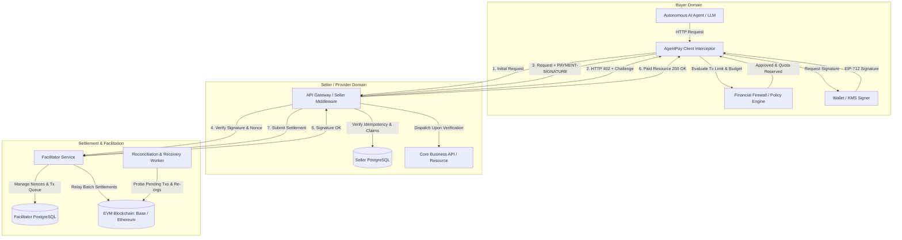
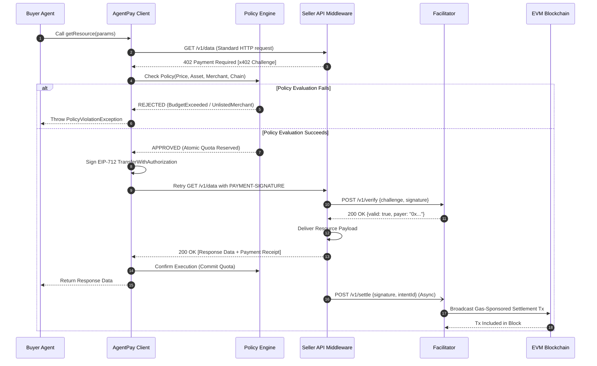

# AgentPay Architecture Specification

## 1. Overview & Architectural Goals

**AgentPay** is an open-source, non-custodial financial infrastructure and security layer for autonomous AI agents. It standardizes HTTP-based micro-payments over the **x402 V2** protocol and integrates an out-of-band **Financial Firewall (Policy Engine)** that prevents financial loss resulting from AI hallucinations, infinite loops, and unauthorized transactions.

### Key Tenets
1. **Zero-Trust for AI Autonomous Actions:** AI models propose transactions, but the cryptographic signing and payment execution occur strictly behind an independent, non-LLM policy boundary.
2. **Decoupled Asynchronous Lifecycle:** Separates high-level payment intent, blockchain consensus/settlement, and downstream service fulfillment to protect against network timeouts.
3. **Cross-Language Equivalence:** Full protocol, state machine, and cryptographic parity between TypeScript (pnpm monorepo) and Java / Spring Boot (Gradle multi-project).
4. **Gasless Micro-Settlements:** Employs EIP-712 / EIP-3009 signed authorizations. Buyer Agents require zero native gas tokens (ETH/MATIC/etc.), which are sponsored and settled by Facilitator nodes.

---

## 2. System Topology & Core Components

### Component Roles & Responsibilities

| Component | Responsibility |
| :--- | :--- |
| **Buyer Agent** | High-level agent runtime or script initiating HTTP calls to tools, APIs, and data sources. |
| **AgentPay Client Interceptor** | Transparent HTTP client wrapper that detects `402 Payment Required`, triggers policy evaluation, collects EIP-712 signatures, and replays requests. |
| **Policy Engine (Firewall)** | Standalone security engine enforcing rate limits, per-transaction caps, daily rolling budgets, and destination whitelists. |
| **Seller Middleware** | Express / Fastify (TS) or Spring Boot Starter (Java) intercepting incoming requests, generating x402 challenges, and coordinating verification with Facilitators. |
| **Facilitator Service** | High-performance gateway that validates off-chain EIP-712/3009 signatures, sponsors gas, and batches on-chain settlement transactions. |
| **Reconciliation Worker** | Asynchronous service that polls unconfirmed settlements, repairs state after network splits, and triggers automated recovery workflows. |

---

## 3. Protocol & Standards Baseline

1. **x402 V2 Protocol:**
   * **Challenge Header:** `PAYMENT-REQUIRED` with base64/JSON encoded challenge payload containing accepted payment schemes, supported networks, token contract addresses, price, and expiration timestamp.
   * **Authorization Header:** `PAYMENT-SIGNATURE` containing the payer address, nonce, expiration, signature type (`EIP-712` or `EIP-3009`), and raw cryptographic signature.
2. **CAIP-2 Chain Identifiers:**
   * Standardized chain namespaces (e.g., `eip155:8453` for Base Mainnet, `eip155:84532` for Base Sepolia).
3. **EIP-712 & EIP-3009 Authorization:**
   * Type-safe structured signing (`TransferWithAuthorization` / `ReceiveWithAuthorization`).
   * Eliminates the traditional ERC-20 `approve` + `transferFrom` two-step gas cost.
4. **Idempotency Standards:**
   * Every payment request carries an `Idempotency-Key` (UUIDv4) header and deterministic SHA-256 payload digest.
5. **EIP-1559 Dynamic Fee & Settlement Sponsoring:**
   * Facilitator settlement broadcasts utilize EIP-1559 (Type 2) transactions with a 1.5x `baseFee` buffer ($\text{maxFeePerGas} = \max(\lfloor \text{baseFee} \times 1.5 \rfloor + \text{priorityFee},\; \lfloor \text{gasPrice} \times 1.35 \rfloor + \text{priorityFee})$) to completely prevent block BaseFee fluctuation rejections without incurring additional gas expenses, accompanied by an adaptive fallback to buffered Legacy Type 0 transactions for legacy chains (see [gas-cost-and-settlement-models.md](file:///Users/wanghongjie/aiPoiject/AgentPay/specs/gas-cost-and-settlement-models.md)).

---

## 4. End-to-End Payment Flow

---

## 5. Polyglot Parity Architecture (TypeScript + Python + Go + Java)

To provide an identical developer experience regardless of language:
* **TypeScript Stack (`packages/`):** Targeted at AI agents (Node.js, Bun, Browser, MCP servers) and modern JS microservices.
* **Python Stack (`python/`):** Targeted at the primary AI Agent and LLM framework ecosystem (LangChain, CrewAI, AutoGen, LlamaIndex), featuring transparent HTTP interceptors (`httpx`, `requests`, `aiohttp`) as well as the v0.1.0 reference gateway implementation.
* **Go Stack (`gateway-go/`):** Targeted at high-throughput cloud-native reverse proxies, low-latency EIP-712 cryptographic verification (`geth/crypto`), structured logging (Zap/Zerolog), audit trails, and minimal Docker/Kubernetes deployments.
* **Java Stack (`java/`):** Targeted at enterprise SaaS providers, Spring Cloud gateways, and high-throughput corporate backends.
* **Shared Conformance Vectors (`specs/conformance/test-vectors/`):**
  * EIP-712 domain separator serialization across Viem (TS), `eth-account`/`web3.py` (Python), `go-ethereum` (Go), and Web3j (Java).
  * x402 V2 challenge parser and signature encoder.
  * State machine transition edge cases.
  * Policy budget deduction math with 64-bit integer / BigInteger overflow protection.

---

## 6. Gas Economics & Settlement Sponsorship Models

Under EIP-3009 meta-transactions (`transferWithAuthorization`), the Buyer Agent is cryptographically gasless (holds only payment tokens, e.g. USDC, with 0 ETH required), while the EVM transaction caller (`msg.sender` / Facilitator) pays miner gas fees.

AgentPay formally supports three settlement sponsorship modes (detailed in [`specs/gas-cost-and-settlement-models.md`](./gas-cost-and-settlement-models.md)):

1. **Mode 1: Seller-Subsidized Gasless Settlement (2026 Baseline - v0.1.0):**
   * Facilitator sponsors L2 native gas (Arbitrum / Base, $0.001 - $0.005 per tx); Buyer pays exact API price in USDC.
   * Ideal for high-margin APIs and friction-free agent micro-payments.
2. **Mode 2: Dynamic Gas Surcharge & Reimbursement (2027 Q1 - v0.2.0):**
   * Gateway dynamically estimates EVM gas + L1 data fees, converts to USDC via Oracle, and appends to Challenge `amount`. Buyer pays both via USDC signature, fully reimbursing the Facilitator.
   * Ideal for Ethereum L1, gas spikes, and low-margin / pass-through GPU compute.
3. **Mode 3: Batch Aggregation & State Channel Delayed Settlement (2027 Q2 - v0.3.0):**
   * Gateway validates authorizations off-chain and fulfills requests immediately; Facilitator flushes payments via batch multicall contracts or state channels.
   * Amortizes transaction gas by >95%, enabling sub-cent ($0.0001) per-token streaming micro-payments.

