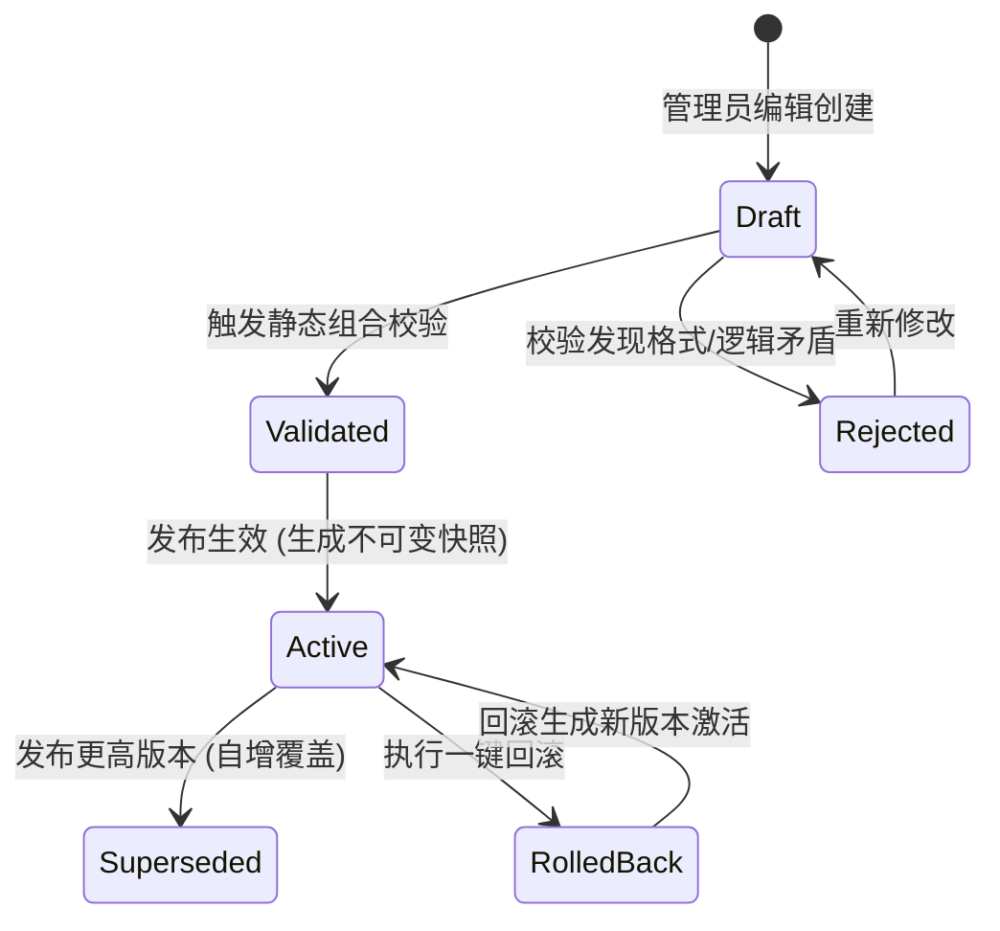
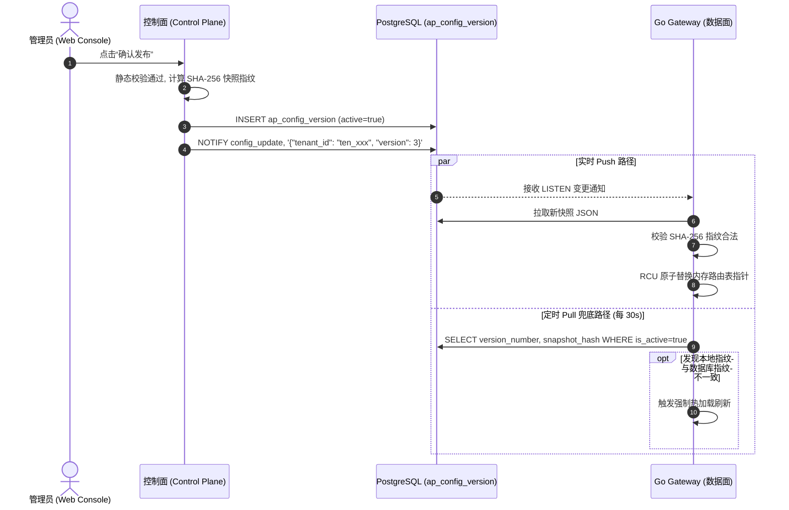

# AgentPay 配置发布与运行时缓存契约规范 (T1.4 Specification)

> **版本**：v2.0.0 (T1.4 统一规范)  
> **状态**：**已定稿 (Approved Specification)**  
> **适用范围**：Web 管理控制台（控制面）、Go Gateway（数据面）、PostgreSQL 配置持久化  
> **机器可读模式**：  
> - [`specs/conformance/config-snapshot.schema.json`](./conformance/config-snapshot.schema.json) (不可变快照 JSON Schema)  
> - [`specs/test-vectors/config-publishing.json`](./test-vectors/config-publishing.json) (配置发布与回滚测试向量)  

---

## 1. 核心设计原则

1. **草稿绝对隔离（Draft Isolation）**：
   - 处于草稿态（`draft`）的路由或策略变更仅存在于管理控制台会话或草稿区，**严禁对在线 Gateway 请求产生任何实质影响**。
2. **不可变版本快照（Immutable Snapshot & Content Addressing）**：
   - 配置发布一旦完成，系统立刻生成一份完整的全局配置快照（包含该租户名下所有的 Routes、Policies 及绑定关系），赋予递增的 `version_number` 与确定性 SHA-256 内容指纹（`snapshotHash`），存入 `ap_config_version`；
   - 该快照**绝对只读、严禁更新或删除**。
3. **数据面微秒级原子热切换（Zero-Downtime RCU Swap）**：
   - Go Gateway 在内存中采用类似 Linux RCU（Read-Copy-Update）的原子指针替换机制。当新版本发布生效时，Gateway 瞬间将活跃配置指针切换到新快照，正在执行中的旧请求继续引用旧快照直至完成，新请求即刻使用新规则，全程零连接中断、零吞吐抖动。
4. **强健降级与高可用防御（Fail-Safe Degradation）**：
   - 若控制面服务宕机、数据库短时失联或网络分区，Gateway **坚决不停摆**，严格基于内存与本地磁盘落盘镜像（Local Cache）持续提供代理与验签服务。

---

## 2. 配置生命周期状态机

| 状态 (State) | 作用空间 | 对数据面 (Gateway) 的可见性 | 读写权限 |
|---|---|---|---|
| `draft` | 控制台草稿区 | **不可见**（绝不加载） | 可读写编辑 |
| `validated` | 控制台校验区 | **不可见** | 准备发布 |
| `active` | 生产线上运行态 | **当前唯一生效版本** | 只读不可变 |
| `superseded` | 历史归档区 | 仅用于已发出请求追溯关联 | 只读不可变 |
| `rolled_back` | 历史回滚区 | 仅用于审计与记录 | 只读不可变 |

---

## 3. 严格静态校验矩阵 (Validation Rules)

在点击“发布”前，控制面必须通过下列**无死角静态规则拦截**，任何一条失败均禁止发布：

### 3.1 路由层校验 (Route Rules)
1. **URI 格式合规**：`upstream_url` 必须是合法 URI（以 `http://` 或 `https://` 开头），禁止私有非法协议；
2. **PathPattern 唯一性**：同一租户内 `path_pattern` 绝对唯一，禁止模糊重叠歧义匹配；
3. **收款地址校验**：`payee_address` 必须符合有效以太坊地址规范（`^0x[a-fA-F0-9]{40}$`）；
4. **定价非负**：`price_base_units >= 0`（支持免费或付费路由）；
5. **支付方式枚举**：`allowed_payment_methods` 严格限定于 `wallet`、`onchain`、`both` 之一。

### 3.2 策略层校验 (Policy Rules)
1. **预算上限阶梯校验**：单笔上限必须严格小于或等于 24 小时滚动预算上限：
   $$\text{max\_amount\_per\_request} \le \text{rolling\_24h\_budget\_cap}$$
2. **网络白名单校验**：`whitelisted_networks` 每一项必须符合 CAIP-2 规范（如 `eip155:42161`）；
3. **熔断阈值合理性**：`circuit_breaker_max_rpm >= 1`，避免非法零频次导致默认直接熔断。

---

## 4. 不可变快照生成与哈希指纹算法

当校验通过并发布时，控制面执行以下原子固化步骤：

1. **版本号分配**：查询 `MAX(version_number) + 1`，分配新 `version_id`（如 `ver_...`）；
2. **规范化 JSON 序列化 (Canonical JSON)**：
   - 提取该租户名下所有 `status='active'` 的 routes 和 policies；
   - 按照 `route_id` 与 `policy_id` 进行字典升序排序；
   - 去除所有无意义空格并序列化为严格 JSON 字符串；
3. **计算确定性指纹**：
   $$\text{snapshotHash} = \text{"sha256:"} + \text{SHA256}(\text{Canonical\_JSON})$$
4. **原子落库**：
   - 写入 `ap_config_version` 表；
   - 将原先 `is_active=true` 的记录标记为 `false`；
   - 触发版本变更事件通知（`LISTEN/NOTIFY`）。

---

## 5. Gateway 运行时缓存与刷新协议

Go Gateway 数据面采用 **Push（事件触发） + Pull（定时巡检）** 混合架构，确保配置刷新实时且零丢失：

---

## 6. 异常容灾与安全降级行为

| 异常场景 | 网关运行时防御行为 | 安全保障 |
|---|---|---|
| **控制面完全宕机 / 网络中断** | Gateway 依靠**当前内存中已有的配置快照及本地磁盘备份**继续工作，绝不停摆。 | 保证已发布服务的持续可用性，控制面故障绝不影响数据面转发与计费。 |
| **首次冷启动且数据库失联** | Gateway 启动时若完全无法获取任何快照，且本地无磁盘缓存，遵循 **Fail-Closed（默认拒绝）**：对所有请求返回 `503 Service Unavailable`。 | 严禁在无风控和无定价策略下放行任何外部调用，防止资金敞口泄露。 |
| **快照哈希校验失败（篡改告警）** | 若 Gateway 拉取到的快照反算哈希与声明的 `snapshotHash` 不一致，拒绝加载并保留现有配置，同时输出最高优先级安全告警日志。 | 防范传输链路劫持或恶意篡改。 |

---

## 7. 秒级一键回滚 (One-Click Rollback)

若在线服务发布新规则后出现异常，管理员可在控制台执行一键秒级回滚：
1. 管理员指定历史目标版本（如从 `v3` 回滚至 `v1`）；
2. 系统读取 `v1` 的 `snapshot_json`，生成新的自增版本记录 `v4`（`change_summary: "Rollback to version v1"`），但其负载与哈希严格等同于 `v1`；
3. 将 `v4` 标记为 `active`；
4. Gateway 在数毫秒内完成原子指针切换，服务瞬间恢复到历史稳定状态。
