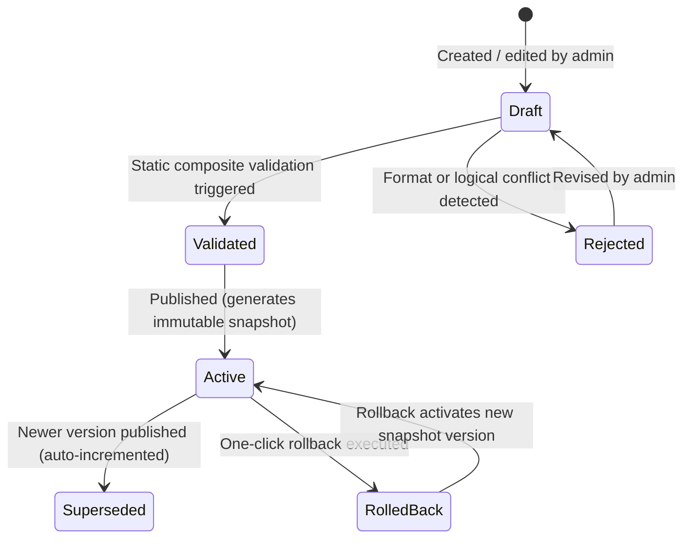
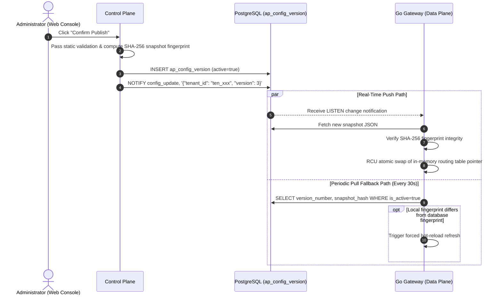

# AgentPay Configuration Publishing & Runtime Cache Specification (T1.4 Specification)

> **Version**: v2.0.0 (T1.4 Unified Specification)  
> **Status**: **Approved Specification**  
> **Scope**: Web Management Console (Control Plane), Go Gateway (Data Plane), PostgreSQL Configuration Persistence  
> **Machine-Readable Schemas**:  
> - [`specs/conformance/config-snapshot.schema.json`](./conformance/config-snapshot.schema.json) (Immutable Snapshot JSON Schema)  
> - [`specs/test-vectors/config-publishing.json`](./test-vectors/config-publishing.json) (Configuration Publishing & Rollback Test Vectors)  

---

## 1. Core Design Principles

1. **Strict Draft Isolation**:
   - Route or policy edits in `draft` state exist exclusively within the management console session or draft workspace and **must never affect live Gateway traffic**.
2. **Immutable Snapshot & Content Addressing**:
   - Upon publishing, the system immediately materializes a complete tenant configuration snapshot (containing all active Routes, Policies, and bindings for that tenant), assigns a monotonically increasing `version_number` and a deterministic SHA-256 content fingerprint (`snapshotHash`), and persists it in `ap_config_version`.
   - Published snapshots are **strictly read-only and must never be updated or deleted**.
3. **Microsecond Atomic Hot-Swap on the Data Plane (Zero-Downtime RCU Swap)**:
   - The Go Gateway uses an in-memory Read-Copy-Update (RCU) atomic pointer swap. When a new version is activated, the Gateway atomically swaps its active configuration pointer to the new snapshot; in-flight requests continue referencing the previous snapshot until completion, while new requests immediately evaluate against the new rules with zero dropped connections or latency spikes.
4. **Fail-Safe Degradation & High Availability**:
   - If the control plane goes offline, the database experiences a transient outage, or a network partition occurs, the Gateway **continues serving traffic without interruption** using its in-memory snapshot and local disk cache.

---

## 2. Configuration Lifecycle State Machine

| State | Scope | Visibility to Data Plane (Gateway) | Read/Write Permissions |
|---|---|---|---|
| `draft` | Console draft workspace | **Invisible** (never loaded) | Read/write editable |
| `validated` | Console validation staging | **Invisible** | Ready to publish |
| `active` | Production runtime | **Sole active version** | Read-only immutable |
| `superseded` | Historical archive | Referenced only for historical request tracing | Read-only immutable |
| `rolled_back` | Rollback archive | Retained for auditing and history | Read-only immutable |

---

## 3. Strict Static Validation Matrix

Before a configuration can be published, the control plane enforces the following **static validation rules**; any violation blocks publication:

### 3.1 Route Validation Rules
1. **URI Format Compliance**: `upstream_url` must be a valid URI starting with `http://` or `https://`; private or malformed schemes are rejected.
2. **PathPattern Uniqueness**: `path_pattern` must be strictly unique within the same tenant, preventing ambiguous overlapping route matches.
3. **Payee Address Validation**: `payee_address` must be a valid Ethereum address matching `^0x[a-fA-F0-9]{40}$`.
4. **Non-Negative Pricing**: `price_base_units >= 0` (supports both free and paid routes).
5. **Payment Method Enum**: `allowed_payment_methods` must be one of `wallet`, `onchain`, or `both`.

### 3.2 Policy Validation Rules
1. **Budget Hierarchy Check**: The single-request cap must be less than or equal to the 24-hour rolling budget cap:
   $$\text{max\_amount\_per\_request} \le \text{rolling\_24h\_budget\_cap}$$
2. **Network Allowlist Validation**: Every entry in `whitelisted_networks` must conform to CAIP-2 format (e.g., `eip155:42161`).
3. **Circuit Breaker Threshold Sanity**: `circuit_breaker_max_rpm >= 1`, preventing invalid zero thresholds from tripping the circuit breaker immediately.

---

## 4. Immutable Snapshot Generation & Hash Fingerprint Algorithm

Once static validation passes and publication is confirmed, the control plane executes the following atomic steps:

1. **Version Number Allocation**: Queries `MAX(version_number) + 1` and allocates a new `version_id` (e.g., `ver_...`).
2. **Canonical JSON Serialization**:
   - Extracts all routes and policies with `status='active'` under the tenant.
   - Sorts entries lexicographically in ascending order by `route_id` and `policy_id`.
   - Strips insignificant whitespace and serializes into a canonical JSON string.
3. **Deterministic Fingerprint Calculation**:
   $$\text{snapshotHash} = \text{"sha256:"} + \text{SHA256}(\text{Canonical\_JSON})$$
4. **Atomic Persistence**:
   - Inserts the new record into `ap_config_version`.
   - Marks the previously `is_active=true` record as `false`.
   - Emits a version change notification (`LISTEN/NOTIFY`).

---

## 5. Gateway Runtime Cache & Refresh Protocol

The Go Gateway data plane uses a hybrid **Push (event-driven) + Pull (periodic polling)** architecture to guarantee real-time, loss-free configuration updates:

---

## 6. Fault Tolerance & Fail-Safe Degradation

| Failure Scenario | Gateway Runtime Defense Behavior | Security Guarantee |
|---|---|---|
| **Control Plane Outage / Network Partition** | Gateway continues serving traffic using the **current in-memory configuration snapshot and local disk backup**. | Ensures continuous availability of published services; control-plane faults never disrupt data-plane forwarding or billing. |
| **Cold Start with Database Unreachable** | If the Gateway cannot fetch any snapshot on initial startup and no local disk cache exists, it enforces **Fail-Closed** behavior and returns `503 Service Unavailable` for all requests. | Prevents unauthenticated or unpriced external calls from bypassing risk controls and leaking financial exposure. |
| **Snapshot Hash Verification Failure (Tamper Alert)** | If the recomputed hash of a fetched snapshot does not match its declared `snapshotHash`, the Gateway rejects the update, retains the existing configuration, and logs a critical security alert. | Protects against transit hijacking or unauthorized database tampering. |

---

## 7. One-Click Rollback

If an issue arises after publishing new rules, an administrator can execute a sub-second one-click rollback from the console:
1. The administrator selects a historical target version (e.g., rolling back from `v3` to `v1`).
2. The system reads `snapshot_json` from `v1` and creates a new auto-incremented version record `v4` (`change_summary: "Rollback to version v1"`) whose payload and hash are identical to `v1`.
3. `v4` is marked `active`.
4. The Gateway completes an atomic pointer swap within milliseconds, restoring service behavior to the known-good historical state.
