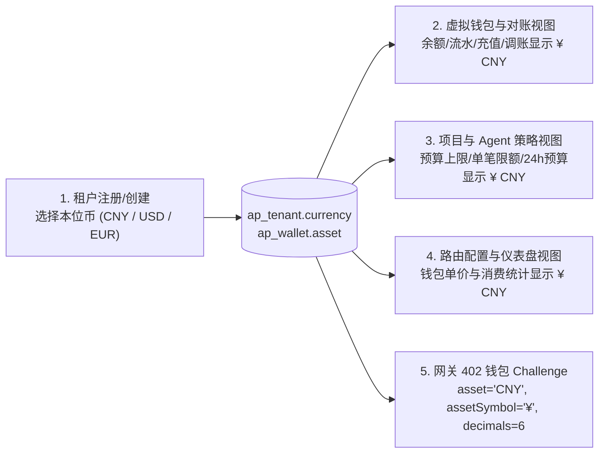

# AgentPay 多法币虚拟钱包本位制与多链结算扩展规范 (T1.9 Specification)

> **版本**：v1.0.0 (T1.9 计价本位制与多链扩展规范)  
> **状态**：**已定稿 (Approved Specification)**  
> **关联规范**：  
> - [`specs/wallet-ledger-spec.md`](./wallet-ledger-spec.md) (T1.7 内部虚拟钱包与账本规范)  
> - [`specs/multitenant-data-model.md`](./multitenant-data-model.md) (T1.2 多租户逻辑数据模型规范)  
> - [`specs/agentpay-wallet-x402-extension.md`](./agentpay-wallet-x402-extension.md) (虚拟钱包 x402 协议扩展)  
> - [`specs/architecture.md`](./architecture.md) (系统总体架构规范)  

---

## 1. 背景与设计目标

随着 AgentPay 从单一测试网（Arbitrum Sepolia USDC）向全球多租户 SaaS 平台及多链生态演进，系统面临两个核心架构问题：
1. **虚拟钱包的多法币计价与展示**：不同国家/地区的租户习惯使用本国法币（如中国区使用人民币 `CNY`、北美使用美元 `USD`、欧洲使用欧元 `EUR`）进行充值、预算审批、路由定价与财务对账；同时 AI 微支付单次调用金额极低（常低于传统法币最小单位“1 分”）。
2. **链上结算的多链与多精度代币扩展**：卖方网关可能同时支持多条区块链（Arbitrum、Base、Optimism、Polygon、Solana 等）及不同小数精度的稳定币（6 位小数的 USDC 与 18 位小数的 DAI/USDT），买方本地财务防火墙需要统一尺度的风险控制，避免跨精度累加失真与 64 位整数溢出。

本规范确立 **“租户级单一法币本位制（方案 A）+ 6 位微单位精度（Micro-Units）+ 计价与链上多链结算解耦”** 的总体架构。

---

## 2. 虚拟钱包多法币设计（方案 A：租户级单一本位币）

### 2.1 核心架构决策（C1–C5）

| 决策编号 | 决策事项 | 确定方案 | 决策依据与安全边界 |
| :--- | :--- | :--- | :--- |
| **C1** | **租户本位币模式** | **租户级单一本位币（Tenant Base Currency）** | 每个租户拥有且仅拥有一个主虚拟钱包，绑定单一本位法币（`CNY`、`USD` 或 `EUR`）。租户下的项目预算、路由钱包定价、Agent 策略限额、账本流水及控制台 UI 全局统一使用该本位币，消除跨币种子钱包碎片化与实时汇损纠纷。 |
| **C2** | **本位币设定时机与锁定** | **注册/创建租户时选定，产生流水后永久锁定** | 租户注册（`Register` / `CreateTenant`）时指定 `currency`（默认按语言环境预选：中文 `CNY`，英文 `USD`），并同步初始化同币种主钱包与默认项目。在钱包流水数为 0 且未创建任何路由前允许 Owner 修改一次；一旦产生充值流水或创建路由，币种字段永久只读锁定（Immutable）。 |
| **C3** | **内部账本统一精度** | **固定 6 位微单位（`decimals = 6`，Micro-Fiat）** | 传统法币“分（2 位小数）”无法表达 `¥0.002`（2 厘）或 `$0.0005` 的 AI 令牌级微支付。所有法币在内部账本中统一使用 $10^{-6}$ 微单位整数（`1 CNY/USD/EUR = 1,000,000 base units`），严禁使用 `float`。 |
| **C4** | **外部法币充值换算** | **充值入账边界一次性精度放大** | 对接微信、支付宝、Stripe 等法币渠道时，在 `ap_topup_order` 记录外部渠道原始币种与最小单位（分/Cents），入账 `ap_ledger_entry` 时按 $\text{amount\_base\_units} = \text{fiat\_minor\_units} \times 10^{6 - \text{iso\_decimals}}$ 转换为 6 位微单位整数。 |
| **C5** | **双轨路由（`both`）独立定价** | **钱包本位币价与链上 USDC 价显式分离** | 当路由 `allowed_payment_methods = 'both'` 且租户本位币非 `USD`（如 `CNY`）时，路由同时维护虚拟钱包价格（`price_base_units`，单位 `CNY`）与链上结算价格（`onchain_price_base_units`，单位 `USDC`），两条通道各司其职，严禁运行时模糊混用。 |

---

### 2.2 支持的本位币字典与精度映射规范

系统内置标准法币字典（`CurrencyRegistry`），前后端与网关共享以下定义：

| 货币代码 (`currency`) | 货币名称 | 显示符号 (`symbol`) | ISO 4217 传统小数位 (`iso_decimals`) | AgentPay 账本小数位 (`ledger_decimals`) | 1 标准货币单位对应的 `base_units` | 外部充值放大倍率 ($10^{6 - \text{iso}}$) |
| :--- | :--- | :---: | :---: | :---: | :---: | :---: |
| **`CNY`** | 人民币 (Chinese Yuan) | `¥` | 2（分） | **6** | `1,000,000` | $\times 10,000$ |
| **`USD`** | 美元 (US Dollar) | `$` | 2（Cent） | **6** | `1,000,000` | $\times 10,000$ |
| **`EUR`** | 欧元 (Euro) | `€` | 2（Cent） | **6** | `1,000,000` | $\times 10,000$ |
| **`JPY`** *(预留)* | 日元 (Japanese Yen) | `¥` | 0（円） | **6** | `1,000,000` | $\times 1,000,000$ |

> **示例**：租户本位币为 `CNY`，通过微信支付充值 `¥10.00`（微信回调金额为 `1000` 分）：
> - `ap_topup_order.payment_minor_amount = 1000`，`payment_currency = 'CNY'`；
> - 入账转换：$1000 \times 10^{6 - 2} = 10,000,000$（`10.000000 CNY`）；
> - 调用单价为 `¥0.35` 的 API 路由时，扣减 `350,000` base units。

---

### 2.3 租户生命周期与全系统 UI / 协议联动规范

一旦租户在注册时确定了 `tenant.currency`（例如 `CNY`），全系统各模块遵循“单一数据源（Single Source of Truth）”联动：



1. **控制面 API 与数据库联动**：
   - `POST /api/v1/auth/register` 与 `POST /api/v1/tenants` 接收可选参数 `currency`（枚举值：`CNY` | `USD` | `EUR`，未传时默认 `USD`）；
   - 创建租户事务内，同步将 `ap_tenant.currency` 与 `ap_wallet.asset` 设为该币种；
   - 提供 `PATCH /api/v1/tenants/{tenant_id}/currency` 接口：仅当该租户下 `COUNT(ap_ledger_entry) == 0` 且 `COUNT(ap_route) == 0` 时允许更改，否则返回 `409 ERR_CURRENCY_LOCKED`。
2. **Web 控制台（`console`）全局联动**：
   - `useTenantStore` 暴露当前租户的 `currency`（如 `'CNY'`）、`currencySymbol`（如 `'¥'`）以及统一格式化函数 `formatCurrency(baseUnits)`；
   - 钱包页、项目预算页、Agent 防火墙策略页、路由管理页、支付审计页、仪表盘中的所有金额展示与输入框单位后缀，全部动态绑定 `tenantStore.currentCurrency`。
3. **网关路由双轨定价规则**：
   - 当 `allowed_payment_methods = 'wallet'` 时：路由仅需配置本位币价格 `price_base_units`（单位为 `tenant.currency`）；
   - 当 `allowed_payment_methods = 'onchain'` 时：路由配置链上价格（单位为 `USDC` 等链上代币）；
   - 当 `allowed_payment_methods = 'both'` 时：
     - 若 `tenant.currency == 'USD'`，钱包价（USD）与链上价（USDC）均为 6 位精度美元本位，默认共享 `price_base_units`，也可分别指定；
     - 若 `tenant.currency != 'USD'`（如 `CNY` 或 `EUR`），路由表通过 `price_base_units`（钱包本位币价，如 `350000` = `¥0.35 CNY`）与 `onchain_price_base_units`（链上结算价，如 `50000` = `0.05 USDC`）分别存储，网关根据客户端请求头（携带 API Key 走钱包 vs 无 API Key 走链上）下发对应币种与金额的 402 Challenge。

---

## 3. 多链与多资产结算扩展设计（Multi-Chain & Multi-Asset Architecture）

为了在支持多条区块链（Arbitrum、Base、Optimism、Polygon、Solana）及多种代币（USDC、USDT、DAI、PYUSD）时保持买方防火墙的简单与安全，AgentPay 采用 **“买方本位币统一风控 + 协议多链候选协商 + 签名驱动插件化”** 架构。

### 3.1 买方本地防火墙：风控计价与链上原始金额分离

为解决不同代币 `decimals`（如 6 位 USDC 与 18 位 DAI）无法直接相加，以及 18 位精度代币在 SQLite 64 位 `INTEGER`（上限 $\approx 9.22 \times 10^{18}$）下极易溢出的问题，买方 SDK 账本（`infra/sqlite/buyer-schema.sql`）将金额解耦为两层：

1. **风控计价金额（`valuation_base_units INTEGER`）**：
   - 统一折算为买方 `PolicyConfig.base_currency`（默认 `USD` 或与租户一致的 `CNY`，固定 6 位小数）的微单位整数；
   - 策略引擎的**单笔限额检查（`max_per_tx_base_units`）**与 **24 小时滚动窗口求和（`SUM(valuation_base_units)`）** 仅对该 6 位精度整数字段进行计算，永远不会发生 64 位整数溢出或跨精度错乱。
   - **折算公式（向上取整，Fail-Safe 从严扣减预算）**：
     $$\text{valuation\_base\_units} = \left\lceil \frac{\text{raw\_token\_amount} \times \text{fx\_rate\_micros}}{10^{\text{token\_decimals}}} \right\rceil$$
     其中同币种（如 USD 策略支付 6 位 USDC）时 $\text{fx\_rate\_micros} = 1,000,000$，$\text{valuation\_base\_units} = \text{raw\_token\_amount}$。
2. **链上原始结算金额（`raw_amount TEXT` + `asset_decimals INTEGER`）**：
   - 以十进制数字字符串（Decimal String）存储链上代币最小单位（支持最高 256 位无符号整数 `uint256`），专用于 EIP-712 / Permit2 / Solana 交易签名构造与链上回执核验。

---

### 3.2 协议层扩展：x402 Challenge `accepts` 多链候选列表

当卖方网关支持多条链或同时支持“虚拟钱包 + 多链稳定币”时，`402 PAYMENT-REQUIRED` 载荷通过 `accepts` 数组列出所有可用支付选项，同时保留顶层默认字段以 100% 向下兼容 v0.1.0 客户端：

```json
{
  "version": "2.0",
  "challengeId": "ch_01j7xyz890abcdef12345678",
  "resourceUri": "/v1/market-data",
  "network": "eip155:421614",
  "asset": "0x75faf114eafb1BDbe2F0316DF893fd58CE46AA4d",
  "assetSymbol": "USDC",
  "decimals": 6,
  "amount": "50000",
  "payee": "0x70997970C51812dc3A010C7d01b50e0d17dc79C8",
  "scheme": "EIP-3009",
  "validAfter": 1729000000,
  "validBefore": 1729000300,
  "accepts": [
    {
      "optionId": "opt_wallet_cny",
      "scheme": "agentpay-wallet",
      "network": "agentpay:internal-ledger",
      "asset": "CNY",
      "assetSymbol": "¥",
      "decimals": 6,
      "amount": "350000",
      "payee": "agentpay:route:rou_4b5c6d7e8f"
    },
    {
      "optionId": "opt_arb_sepolia_usdc",
      "scheme": "EIP-3009",
      "network": "eip155:421614",
      "asset": "0x75faf114eafb1BDbe2F0316DF893fd58CE46AA4d",
      "assetSymbol": "USDC",
      "decimals": 6,
      "amount": "50000",
      "payee": "0x70997970C51812dc3A010C7d01b50e0d17dc79C8"
    },
    {
      "optionId": "opt_base_mainnet_usdc",
      "scheme": "EIP-3009",
      "network": "eip155:8453",
      "asset": "0x833589fCD6eDb6E08f4c7C32D4f71b54bdA02913",
      "assetSymbol": "USDC",
      "decimals": 6,
      "amount": "50000",
      "payee": "0x70997970C51812dc3A010C7d01b50e0d17dc79C8"
    }
  ]
}
```

#### 买方 SDK 多链协商与路由优先级（Chain Negotiation）
1. **白名单过滤**：买方客户端从 `accepts`（若无则读取顶层字段）中筛出同时满足本地 `whitelist_networks` 与 `whitelist_assets` 的候选项；
2. **支付方式严格隔离**：遵守 `No Auto-Downgrade Invariant`（禁止静默降级原则）——配置了虚拟钱包 API Key 的客户端仅匹配 `scheme == "agentpay-wallet"`，链上签名客户端仅匹配链上 `scheme`；
3. **最优链选择**：当存在多个合法的链上选项时，按客户端配置的 `preferred_networks` 顺序匹配；买方在重试请求的 `PAYMENT-SIGNATURE` 中回传所选的 `optionId` 与 `network`。

---

### 3.3 多链签名与清算驱动演进矩阵（`SchemeDriver`）

通过将协议中的 `scheme` 字段抽象为可插拔驱动，AgentPay 分三阶段覆盖主流公链与资产：

| 阶段 | `scheme` 标识 | 支持网络（CAIP-2） | 支持资产 | 签名与免 Gas 结算机制 |
| :--- | :--- | :--- | :--- | :--- |
| **Phase 1**<br>*(当前基线)* | `EIP-3009` | Arbitrum (`eip155:42161` / `421614`)<br>Base (`eip155:8453` / `84532`)<br>OP (`eip155:10`)<br>Polygon (`eip155:137`) | 各链原生 Circle USDC、EURC、PYUSD | 买方离线签署 EIP-712 `TransferWithAuthorization`；仅需在内置 `ChainRegistry` 注册各链 USDC 合约地址与 EIP-712 Domain 参数，买方单把 EVM 私钥零 Gas 通付所有 EVM 链。 |
| **Phase 2**<br>*(通用 ERC-20)* | `PERMIT2` | 所有 EVM 兼容链 | USDT、DAI、FDUSD 等不支持 EIP-3009 的 ERC-20 稳定币 | 基于 Uniswap 不可变合约 `Permit2`（全链统一地址 `0x000000000022D473030F116dDEE9F6B43aC78BA3`）。买方离线签署 `PermitWitnessTransferFrom`，由 Facilitator 代付 Gas 调用合约完成划转。 |
| **Phase 3**<br>*(非 EVM 异构链)* | `SVM-SPL-TRANSFER` | Solana (`solana:5eykt4UsFv8P8NJdTREpY1vzqKqZKvdp`) | Solana SPL USDC / USDT | 买方使用 Ed25519 私钥对包含 `TransferChecked` 指令且指定 Facilitator 为 `feePayer` 的交易进行部分签名（Partial Sign），Facilitator 验签后补齐 `feePayer` 签名并广播上链，买方无需持有 SOL。 |

---

### 3.4 多链 Facilitator 清算与对账隔离

1. **按 `network_id` 路由清算器**：Facilitator 内部维护 `map[network_id]ChainSettlementWorker`，每条链拥有独立的 RPC 连接池、独立的 Gas 代付热钱包与 Nonce 队列；
2. **跨链防重放唯一性**：网关与买方数据库均维持 `UNIQUE(network_id, asset_address, payer_address, nonce)` 联合唯一索引，天然隔离不同链与不同代币合约的 Nonce 空间；
3. **差异化区块确认策略**：各链 Worker 独立配置终局确认阈值（如 Arbitrum / Base 1 确认、Ethereum L1 2 确认、Polygon 16 确认），并在各自链的重组（Reorg）探测周期内运行 `reconcile()`。
