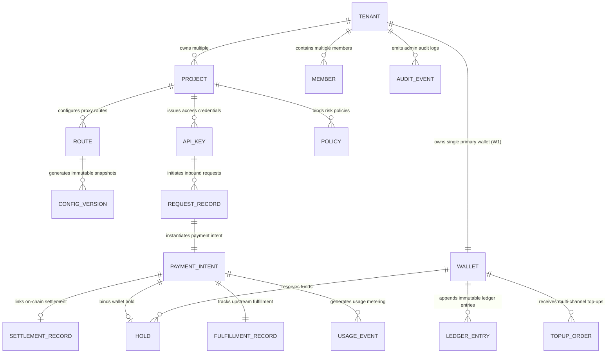

# AgentPay Multi-Tenant Logical Data Model Specification (T1.2 Specification)

> **Version**: v1.0.0 (T1.2 Unified Data Model)  
> **Status**: **Approved Specification**  
> **Prerequisite Decision**: [ADR-002: Database Selection Upgrade to PostgreSQL](./adr-002-postgresql-database-selection.md)  
> **Companion Specifications**:  
> - [specs/payment-state-machine-v2.md](./payment-state-machine-v2.md) (T1.1 Unified Payment State Machine)  
> - [specs/wallet-ledger-spec.md](./wallet-ledger-spec.md) (T1.7 Internal Virtual Wallet & Ledger Specification)  
> **DDL Script**: [`infra/postgres/schema.sql`](../infra/postgres/schema.sql)  

---

## 1. Entity Relationship Overview

The AgentPay logical data model treats the **Tenant** as a strict isolation boundary and is organized into five functional domains:



---

## 2. Identifier Prefix Conventions

To streamline cross-system log correlation, unambiguous debugging, and financial reconciliation, all primary keys use a standardized **`prefix_randomUUID/CUID`** format:

| Entity Name | Identifier Column | Prefix | Typical Value |
|---|---|---|---|
| `Tenant` | `tenant_id` | `ten_` | `ten_9a8b7c6d5e` |
| `Project` | `project_id` | `prj_` | `prj_1a2b3c4d5e` |
| `Member` | `member_id` | `usr_` | `usr_8f7e6d5c4b` |
| `ApiKey` | `key_id` | `apk_` | `apk_018f9e2d3c` |
| `Route` | `route_id` | `rou_` | `rou_4b5c6d7e8f` |
| `Policy` | `policy_id` | `pol_` | `pol_3a4b5c6d7e` |
| `ConfigVersion` | `version_id` | `ver_` | `ver_20261018001` |
| `PaymentIntent` | `intent_id` | `pi_` | `pi_7a8b9c0d1e` |
| `SettlementRecord` | `settlement_id` | `stl_` | `stl_5f6e7d8c9b` |
| `FulfillmentRecord`| `fulfillment_id` | `ful_` | `ful_1d2e3f4a5b` |
| `Wallet` | `wallet_id` | `wal_` | `wal_6c7d8e9f0a` |
| `Hold` | `hold_id` | `hld_` | `hld_4a5b6c7d8e` |
| `LedgerEntry` | `entry_id` | `ent_` | `ent_8e9f0a1b2c` |
| `TopUpOrder` | `topup_id` | `top_` | `top_3c4d5e6f7a` |
| `RequestRecord` | `request_id` | `req_` | `req_0a1b2c3d4e` |
| `UsageEvent` | `event_id` | `usg_` | `usg_5e6f7a8b9c` |
| `AuditEvent` | `audit_id` | `aud_` | `aud_9b0c1d2e3f` |

---

## 3. Five Functional Domains & Table Schemas

### 3.1 Identity & RBAC Domain

#### 1. Tenant Table (`ap_tenant`)
```sql
CREATE TABLE ap_tenant (
    tenant_id VARCHAR(64) PRIMARY KEY,
    name VARCHAR(128) NOT NULL,
    currency VARCHAR(16) NOT NULL DEFAULT 'USD' CHECK (currency IN ('CNY', 'USD', 'EUR', 'USDC')),
    status VARCHAR(32) NOT NULL DEFAULT 'active' CHECK (status IN ('active', 'suspended', 'terminated')),
    created_at TIMESTAMPTZ NOT NULL DEFAULT CURRENT_TIMESTAMP,
    updated_at TIMESTAMPTZ NOT NULL DEFAULT CURRENT_TIMESTAMP
);
```

#### 2. Project Table (`ap_project`)
Business unit within a tenant used to allocate quotas by Agent, department, or business line.
```sql
CREATE TABLE ap_project (
    project_id VARCHAR(64) PRIMARY KEY,
    tenant_id VARCHAR(64) NOT NULL REFERENCES ap_tenant(tenant_id) ON DELETE CASCADE,
    name VARCHAR(128) NOT NULL,
    budget_cap_base_units BIGINT NOT NULL DEFAULT 0, -- 0 means inherits tenant cap / no separate hard cap
    status VARCHAR(32) NOT NULL DEFAULT 'active' CHECK (status IN ('active', 'archived')),
    created_at TIMESTAMPTZ NOT NULL DEFAULT CURRENT_TIMESTAMP,
    updated_at TIMESTAMPTZ NOT NULL DEFAULT CURRENT_TIMESTAMP,
    CONSTRAINT uq_tenant_project_name UNIQUE (tenant_id, name)
);
CREATE INDEX idx_project_tenant ON ap_project(tenant_id);
```

#### 3. Member Table (`ap_member`) & RBAC Roles
```sql
CREATE TABLE ap_member (
    member_id VARCHAR(64) PRIMARY KEY,
    tenant_id VARCHAR(64) NOT NULL REFERENCES ap_tenant(tenant_id) ON DELETE CASCADE,
    email VARCHAR(256) NOT NULL,
    role VARCHAR(32) NOT NULL CHECK (role IN ('owner', 'admin', 'operator', 'viewer')),
    status VARCHAR(32) NOT NULL DEFAULT 'active' CHECK (status IN ('active', 'invited', 'disabled')),
    created_at TIMESTAMPTZ NOT NULL DEFAULT CURRENT_TIMESTAMP,
    updated_at TIMESTAMPTZ NOT NULL DEFAULT CURRENT_TIMESTAMP,
    CONSTRAINT uq_tenant_member_email UNIQUE (tenant_id, email)
);
CREATE INDEX idx_member_tenant ON ap_member(tenant_id);
```

#### 4. API Key Table (`ap_api_key`)
Identity credentials presented by an Agent or buyer when calling the gateway.
```sql
CREATE TABLE ap_api_key (
    key_id VARCHAR(64) PRIMARY KEY,
    tenant_id VARCHAR(64) NOT NULL REFERENCES ap_tenant(tenant_id) ON DELETE CASCADE,
    project_id VARCHAR(64) NOT NULL REFERENCES ap_project(project_id) ON DELETE CASCADE,
    name VARCHAR(128) NOT NULL,
    key_hash VARCHAR(128) NOT NULL UNIQUE,       -- SHA-256 hash; plaintext is never stored
    key_prefix VARCHAR(16) NOT NULL,             -- First 8 chars displayed in UI (e.g., `apk_live_`)
    scopes JSONB NOT NULL DEFAULT '["gateway:call"]'::jsonb,
    status VARCHAR(32) NOT NULL DEFAULT 'active' CHECK (status IN ('active', 'revoked', 'expired')),
    expires_at TIMESTAMPTZ NULL,
    last_used_at TIMESTAMPTZ NULL,
    created_at TIMESTAMPTZ NOT NULL DEFAULT CURRENT_TIMESTAMP
);
CREATE INDEX idx_api_key_lookup ON ap_api_key(key_hash) WHERE status = 'active';
```

---

### 3.2 Routing & Policy Domain

#### 5. Gateway Route Table (`ap_route`)
Defines externally exposed HTTP paths and their upstream backend mappings.
```sql
CREATE TABLE ap_route (
    route_id VARCHAR(64) PRIMARY KEY,
    tenant_id VARCHAR(64) NOT NULL REFERENCES ap_tenant(tenant_id) ON DELETE CASCADE,
    project_id VARCHAR(64) NOT NULL REFERENCES ap_project(project_id) ON DELETE CASCADE,
    path_pattern VARCHAR(256) NOT NULL,          -- e.g., /api/v1/llm/chat
    upstream_url VARCHAR(512) NOT NULL,          -- e.g., https://api.openai.com/v1/chat/completions
    price_base_units BIGINT NOT NULL CHECK (price_base_units >= 0),
    asset VARCHAR(16) NOT NULL DEFAULT 'USD',    -- Matches tenant base currency (CNY / USD / EUR / USDC)
    onchain_price_base_units BIGINT NULL CHECK (onchain_price_base_units >= 0), -- On-chain settlement price (6-decimal USDC)
    onchain_asset VARCHAR(16) NOT NULL DEFAULT 'USDC',
    payee_address VARCHAR(128) NOT NULL,         -- Payee wallet address (EVM 0x...)
    allowed_payment_methods VARCHAR(32) NOT NULL DEFAULT 'both' CHECK (allowed_payment_methods IN ('wallet', 'onchain', 'both')),
    timeout_ms INT NOT NULL DEFAULT 30000,
    rate_limit_rpm INT NOT NULL DEFAULT 600,
    status VARCHAR(32) NOT NULL DEFAULT 'active' CHECK (status IN ('active', 'disabled')),
    created_at TIMESTAMPTZ NOT NULL DEFAULT CURRENT_TIMESTAMP,
    updated_at TIMESTAMPTZ NOT NULL DEFAULT CURRENT_TIMESTAMP,
    CONSTRAINT uq_tenant_route_path UNIQUE (tenant_id, path_pattern)
);
```

#### 6. Security Policy Table (`ap_policy`)
Financial firewall rules (per-request cap, rolling window budget, allowlists, and circuit breaker).
```sql
CREATE TABLE ap_policy (
    policy_id VARCHAR(64) PRIMARY KEY,
    tenant_id VARCHAR(64) NOT NULL REFERENCES ap_tenant(tenant_id) ON DELETE CASCADE,
    project_id VARCHAR(64) NOT NULL REFERENCES ap_project(project_id) ON DELETE CASCADE,
    route_id VARCHAR(64) NULL REFERENCES ap_route(route_id) ON DELETE SET NULL,
    max_amount_per_request BIGINT NOT NULL CHECK (max_amount_per_request > 0),
    rolling_24h_budget_cap BIGINT NOT NULL CHECK (rolling_24h_budget_cap > 0),
    circuit_breaker_max_rpm INT NOT NULL DEFAULT 60,
    whitelisted_payees JSONB NOT NULL DEFAULT '[]'::jsonb,
    whitelisted_networks JSONB NOT NULL DEFAULT '["eip155:42161"]'::jsonb,
    is_active BOOLEAN NOT NULL DEFAULT TRUE,
    created_at TIMESTAMPTZ NOT NULL DEFAULT CURRENT_TIMESTAMP,
    updated_at TIMESTAMPTZ NOT NULL DEFAULT CURRENT_TIMESTAMP
);
```

#### 7. Configuration Version Snapshot Table (`ap_config_version`)
Stores immutable snapshots published from configuration drafts, enabling sub-second rollbacks.
```sql
CREATE TABLE ap_config_version (
    version_id VARCHAR(64) PRIMARY KEY,
    tenant_id VARCHAR(64) NOT NULL REFERENCES ap_tenant(tenant_id) ON DELETE CASCADE,
    version_number INT NOT NULL,
    snapshot_json JSONB NOT NULL,                -- Immutable snapshot containing all routes and policies
    published_by VARCHAR(64) NOT NULL REFERENCES ap_member(member_id),
    change_summary TEXT NOT NULL,
    is_active BOOLEAN NOT NULL DEFAULT FALSE,
    created_at TIMESTAMPTZ NOT NULL DEFAULT CURRENT_TIMESTAMP,
    CONSTRAINT uq_tenant_config_version UNIQUE (tenant_id, version_number)
);
CREATE INDEX idx_config_active ON ap_config_version(tenant_id, is_active);
```

---

### 3.3 Virtual Wallet & Ledger Domain

#### 8. Primary Wallet Table (`ap_wallet`)
```sql
CREATE TABLE ap_wallet (
    wallet_id VARCHAR(64) PRIMARY KEY,
    tenant_id VARCHAR(64) NOT NULL UNIQUE REFERENCES ap_tenant(tenant_id) ON DELETE RESTRICT,
    asset VARCHAR(16) NOT NULL DEFAULT 'USD',    -- Inherited from owning tenant base currency (ap_tenant.currency)
    status VARCHAR(32) NOT NULL DEFAULT 'active' CHECK (status IN ('active', 'frozen', 'frozen_arrears', 'closed')),
    version BIGINT NOT NULL DEFAULT 1,           -- Optimistic lock version number
    available_cache BIGINT NOT NULL DEFAULT 0 CHECK (available_cache >= 0 OR status = 'frozen_arrears'),
    held_cache BIGINT NOT NULL DEFAULT 0 CHECK (held_cache >= 0),
    created_at TIMESTAMPTZ NOT NULL DEFAULT CURRENT_TIMESTAMP,
    updated_at TIMESTAMPTZ NOT NULL DEFAULT CURRENT_TIMESTAMP
);
```

#### 9. Append-Only Ledger Entry Table (`ap_ledger_entry`)
```sql
CREATE TABLE ap_ledger_entry (
    entry_id VARCHAR(64) PRIMARY KEY,
    wallet_id VARCHAR(64) NOT NULL REFERENCES ap_wallet(wallet_id) ON DELETE RESTRICT,
    tenant_id VARCHAR(64) NOT NULL REFERENCES ap_tenant(tenant_id) ON DELETE RESTRICT,
    type VARCHAR(32) NOT NULL CHECK (type IN ('topup_credit', 'capture', 'hold_release', 'adjustment', 'reversal')),
    amount BIGINT NOT NULL,                      -- Positive for credits, negative for debits
    idempotency_key VARCHAR(128) NOT NULL,
    ref_type VARCHAR(32) NOT NULL CHECK (ref_type IN ('TopUpOrder', 'PaymentIntent', 'Hold', 'ManualAdjustment')),
    ref_id VARCHAR(64) NOT NULL,
    operator_id VARCHAR(64) NULL,                -- Required for manual adjustments
    reason TEXT NULL,                            -- Required for manual adjustments
    created_at TIMESTAMPTZ NOT NULL DEFAULT CURRENT_TIMESTAMP,
    CONSTRAINT uq_wallet_ledger_idempotency UNIQUE (wallet_id, idempotency_key)
);
CREATE INDEX idx_ledger_wallet_created ON ap_ledger_entry(wallet_id, created_at DESC);
```

#### 10. Fund Hold Table (`ap_hold`)
```sql
CREATE TABLE ap_hold (
    hold_id VARCHAR(64) PRIMARY KEY,
    wallet_id VARCHAR(64) NOT NULL REFERENCES ap_wallet(wallet_id) ON DELETE RESTRICT,
    payment_intent_id VARCHAR(64) NOT NULL UNIQUE, -- One intent maps to at most one hold
    amount BIGINT NOT NULL CHECK (amount > 0),
    status VARCHAR(32) NOT NULL DEFAULT 'held' CHECK (status IN ('held', 'captured', 'released', 'expired')),
    expires_at TIMESTAMPTZ NOT NULL,
    created_at TIMESTAMPTZ NOT NULL DEFAULT CURRENT_TIMESTAMP
);
CREATE INDEX idx_hold_active_expires ON ap_hold(wallet_id, expires_at) WHERE status = 'held';
```

#### 11. Unified Top-Up Order Table (`ap_topup_order`)
```sql
CREATE TABLE ap_topup_order (
    topup_id VARCHAR(64) PRIMARY KEY,
    wallet_id VARCHAR(64) NOT NULL REFERENCES ap_wallet(wallet_id) ON DELETE RESTRICT,
    tenant_id VARCHAR(64) NOT NULL REFERENCES ap_tenant(tenant_id) ON DELETE RESTRICT,
    channel VARCHAR(32) NOT NULL CHECK (channel IN ('admin_grant', 'onchain_deposit', 'fiat')),
    amount BIGINT NOT NULL CHECK (amount > 0),
    asset VARCHAR(16) NOT NULL DEFAULT 'USDC',
    status VARCHAR(32) NOT NULL DEFAULT 'created' CHECK (status IN ('created', 'pending', 'confirmed', 'failed', 'expired', 'reversed')),
    external_ref VARCHAR(128) NULL,              -- tx_hash or third-party payment gateway reference
    operator_id VARCHAR(64) NULL,
    reason TEXT NULL,
    created_at TIMESTAMPTZ NOT NULL DEFAULT CURRENT_TIMESTAMP,
    confirmed_at TIMESTAMPTZ NULL
);
CREATE INDEX idx_topup_status ON ap_topup_order(wallet_id, status);
```

---

### 3.4 Payment, Settlement & Fulfillment Domain

#### 12. Payment Intent Table (`ap_payment_intent`)
```sql
CREATE TABLE ap_payment_intent (
    intent_id VARCHAR(64) PRIMARY KEY,
    tenant_id VARCHAR(64) NOT NULL REFERENCES ap_tenant(tenant_id) ON DELETE CASCADE,
    project_id VARCHAR(64) NOT NULL REFERENCES ap_project(project_id) ON DELETE CASCADE,
    agent_id VARCHAR(64) NULL REFERENCES ap_agent(agent_id) ON DELETE SET NULL,
    route_id VARCHAR(64) NOT NULL REFERENCES ap_route(route_id),
    idempotency_key VARCHAR(128) NULL,
    request_id VARCHAR(64) NOT NULL,
    payment_method VARCHAR(32) NOT NULL CHECK (payment_method IN ('wallet', 'onchain')),
    amount_base_units BIGINT NOT NULL CHECK (amount_base_units >= 0),
    asset VARCHAR(16) NOT NULL DEFAULT 'USDC',
    status VARCHAR(32) NOT NULL DEFAULT 'created' CHECK (status IN (
        'created', 'challenged', 'authorized', 'rejected', 'expired', 'completed', 'failed', 'needs_review'
    )),
    config_version_id VARCHAR(64) NOT NULL REFERENCES ap_config_version(version_id),
    created_at TIMESTAMPTZ NOT NULL DEFAULT CURRENT_TIMESTAMP,
    updated_at TIMESTAMPTZ NOT NULL DEFAULT CURRENT_TIMESTAMP,
    CONSTRAINT uq_tenant_idempotency_intent UNIQUE (tenant_id, idempotency_key)
);
CREATE INDEX idx_intent_tenant_created ON ap_payment_intent(tenant_id, created_at DESC);
CREATE INDEX idx_intent_status ON ap_payment_intent(status) WHERE status NOT IN ('completed', 'failed', 'rejected', 'expired');
```

#### 13. On-Chain Settlement Record Table (`ap_settlement_record`)
```sql
CREATE TABLE ap_settlement_record (
    settlement_id VARCHAR(128) PRIMARY KEY,
    intent_id VARCHAR(64) NOT NULL UNIQUE REFERENCES ap_payment_intent(intent_id) ON DELETE CASCADE,
    network_id VARCHAR(64) NOT NULL,             -- CAIP-2, e.g., eip155:42161
    asset_address VARCHAR(128) NOT NULL,
    payer_address VARCHAR(128) NOT NULL,
    payee_address VARCHAR(128) NOT NULL,
    amount_base_units BIGINT NOT NULL,
    nonce VARCHAR(128) NOT NULL,
    tx_hash VARCHAR(128) NULL,
    block_number BIGINT NULL,
    status VARCHAR(32) NOT NULL CHECK (status IN (
        'not_started', 'held', 'submitted', 'pending', 'confirmed', 'released', 'failed', 'unknown'
    )),
    error_message TEXT NULL,
    created_at TIMESTAMPTZ NOT NULL DEFAULT CURRENT_TIMESTAMP,
    updated_at TIMESTAMPTZ NOT NULL DEFAULT CURRENT_TIMESTAMP,
    CONSTRAINT uq_nonce_replay_guard UNIQUE (network_id, asset_address, payer_address, nonce)
);
CREATE INDEX idx_settlement_query ON ap_settlement_record(status) WHERE status IN ('submitted', 'pending', 'unknown');
```

#### 14. Upstream Fulfillment Record Table (`ap_fulfillment_record`)
```sql
CREATE TABLE ap_fulfillment_record (
    fulfillment_id VARCHAR(64) PRIMARY KEY,
    intent_id VARCHAR(64) NOT NULL UNIQUE REFERENCES ap_payment_intent(intent_id) ON DELETE CASCADE,
    upstream_url VARCHAR(512) NOT NULL,
    upstream_status INT NULL,                    -- HTTP status code, e.g., 200, 502
    latency_ms INT NULL,
    response_body_hash VARCHAR(128) NULL,        -- SHA-256 of response body for idempotency verification
    status VARCHAR(32) NOT NULL CHECK (status IN (
        'not_started', 'in_progress', 'succeeded', 'failed', 'unknown'
    )),
    created_at TIMESTAMPTZ NOT NULL DEFAULT CURRENT_TIMESTAMP,
    updated_at TIMESTAMPTZ NOT NULL DEFAULT CURRENT_TIMESTAMP
);
```

---

### 3.5 Tracing & Audit Domain

#### 15. Inbound Request Record Table (`ap_request_record`)
```sql
CREATE TABLE ap_request_record (
    request_id VARCHAR(64) PRIMARY KEY,
    tenant_id VARCHAR(64) NOT NULL REFERENCES ap_tenant(tenant_id) ON DELETE CASCADE,
    project_id VARCHAR(64) NOT NULL REFERENCES ap_project(project_id) ON DELETE CASCADE,
    api_key_id VARCHAR(64) NULL REFERENCES ap_api_key(key_id) ON DELETE SET NULL,
    agent_id VARCHAR(64) NULL REFERENCES ap_agent(agent_id) ON DELETE SET NULL,
    route_id VARCHAR(64) NULL REFERENCES ap_route(route_id) ON DELETE SET NULL,
    config_version VARCHAR(64) NULL,
    client_ip VARCHAR(64) NOT NULL,
    http_method VARCHAR(16) NOT NULL,
    request_path VARCHAR(256) NOT NULL,
    status_code INT NOT NULL,
    duration_ms INT NOT NULL,
    error_code VARCHAR(64) NULL,
    is_replay BOOLEAN NOT NULL DEFAULT FALSE,
    intent_id VARCHAR(64) NULL,
    created_at TIMESTAMPTZ NOT NULL DEFAULT CURRENT_TIMESTAMP
);
CREATE INDEX idx_request_tenant_time ON ap_request_record(tenant_id, created_at DESC);
CREATE INDEX idx_request_agent_time ON ap_request_record(agent_id, created_at DESC);
CREATE INDEX idx_request_intent ON ap_request_record(intent_id) WHERE intent_id IS NOT NULL;
```

#### 16. Usage Metering Event Table (`ap_usage_event`)
Data source for high-frequency aggregation and billing analytics.
```sql
CREATE TABLE ap_usage_event (
    event_id VARCHAR(64) PRIMARY KEY,
    tenant_id VARCHAR(64) NOT NULL REFERENCES ap_tenant(tenant_id) ON DELETE CASCADE,
    project_id VARCHAR(64) NOT NULL REFERENCES ap_project(project_id) ON DELETE CASCADE,
    agent_id VARCHAR(64) NULL REFERENCES ap_agent(agent_id) ON DELETE SET NULL,
    route_id VARCHAR(64) NOT NULL REFERENCES ap_route(route_id) ON DELETE CASCADE,
    intent_id VARCHAR(64) NOT NULL REFERENCES ap_payment_intent(intent_id) ON DELETE CASCADE,
    amount_base_units BIGINT NOT NULL,
    asset VARCHAR(16) NOT NULL DEFAULT 'USDC',
    payment_method VARCHAR(32) NOT NULL,
    is_success BOOLEAN NOT NULL,
    created_at TIMESTAMPTZ NOT NULL DEFAULT CURRENT_TIMESTAMP
);
CREATE INDEX idx_usage_tenant_hourly ON ap_usage_event(tenant_id, created_at);
CREATE INDEX idx_usage_agent ON ap_usage_event(agent_id, created_at);
CREATE INDEX idx_usage_intent ON ap_usage_event(intent_id);
```

#### 17. Admin Audit Event Table (`ap_audit_event`)
Records who modified configurations, adjusted balances, or changed permissions and when.
```sql
CREATE TABLE ap_audit_event (
    audit_id VARCHAR(64) PRIMARY KEY,
    tenant_id VARCHAR(64) NOT NULL REFERENCES ap_tenant(tenant_id) ON DELETE CASCADE,
    operator_id VARCHAR(64) NOT NULL,            -- Operator member_id
    action VARCHAR(64) NOT NULL,                 -- e.g., route:create, wallet:adjust, key:revoke
    target_type VARCHAR(32) NOT NULL,            -- e.g., Route, Policy, Wallet, ApiKey
    target_id VARCHAR(64) NOT NULL,
    before_state JSONB NULL,
    after_state JSONB NULL,
    client_ip VARCHAR(64) NOT NULL,
    created_at TIMESTAMPTZ NOT NULL DEFAULT CURRENT_TIMESTAMP
);
CREATE INDEX idx_audit_tenant_time ON ap_audit_event(tenant_id, created_at DESC);
```

#### 18. Agent Behavior Timeline & Event Stream Table (`ap_agent_audit_event`) (T1.8 & T5.8)
Records the full runtime lifecycle event stream of Agents (`agent.request`, `agent.policy_decision`, `agent.spend`, `agent.control`, `agent.anomaly`), supporting near-real-time aggregation and querying by session (`session_id`) and task (`task_id`).
```sql
CREATE TABLE ap_agent_audit_event (
    event_id VARCHAR(64) PRIMARY KEY,
    event_type VARCHAR(64) NOT NULL,
    version VARCHAR(16) NOT NULL DEFAULT '1.0',
    occurred_at TIMESTAMPTZ NOT NULL DEFAULT CURRENT_TIMESTAMP,
    tenant_id VARCHAR(64) NOT NULL REFERENCES ap_tenant(tenant_id) ON DELETE CASCADE,
    project_id VARCHAR(64) NOT NULL REFERENCES ap_project(project_id) ON DELETE CASCADE,
    agent_id VARCHAR(64) NOT NULL REFERENCES ap_agent(agent_id) ON DELETE CASCADE,
    request_id VARCHAR(64) NOT NULL,
    idempotency_key VARCHAR(128) NULL,
    intent_id VARCHAR(64) NULL,
    hold_id VARCHAR(64) NULL,
    settlement_id VARCHAR(128) NULL,
    fulfillment_id VARCHAR(64) NULL,
    actor_type VARCHAR(32) NOT NULL,
    actor_id VARCHAR(64) NOT NULL,
    client_ip VARCHAR(64) NOT NULL,
    user_agent VARCHAR(256) NULL,
    session_id VARCHAR(128) NULL,
    task_id VARCHAR(128) NULL,
    tool_name VARCHAR(128) NULL,
    parent_request_id VARCHAR(128) NULL,
    summary TEXT NOT NULL DEFAULT '',
    data JSONB NOT NULL DEFAULT '{}'::jsonb
);
CREATE INDEX idx_agent_audit_agent_time ON ap_agent_audit_event(agent_id, occurred_at DESC);
CREATE INDEX idx_agent_audit_tenant_time ON ap_agent_audit_event(tenant_id, occurred_at DESC);
CREATE INDEX idx_agent_audit_session ON ap_agent_audit_event(session_id) WHERE session_id IS NOT NULL;
CREATE INDEX idx_agent_audit_request ON ap_agent_audit_event(request_id);
```
