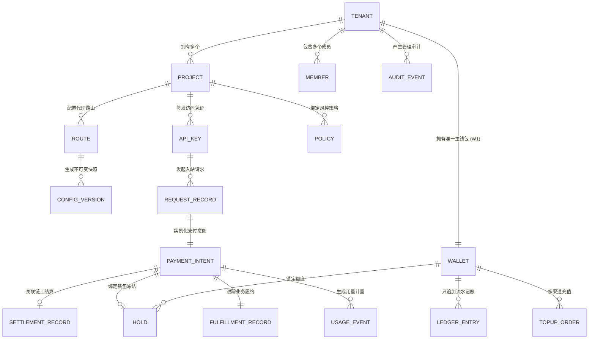

# AgentPay 多租户逻辑数据模型规范 (T1.2 Specification)

> **版本**：v1.0.0 (T1.2 统一数据模型)  
> **状态**：**已定稿 (Approved Specification)**  
> **前置决策**：[ADR-002: 数据库选型全面升级至 PostgreSQL](./adr-002-postgresql-database-selection.md)  
> **配套规范**：  
> - [specs/payment-state-machine-v2.md](./payment-state-machine-v2.md) (T1.1 统一支付状态机)  
> - [specs/wallet-ledger-spec.md](./wallet-ledger-spec.md) (T1.7 内部虚拟钱包与账本规范)  
> **DDL 脚本**：[`infra/postgres/schema.sql`](../infra/postgres/schema.sql)  

---

## 1. 实体架构全景图 (Entity Relationship Overview)

AgentPay 逻辑数据模型以 **租户（Tenant）** 为绝对隔离边界，划分为五大功能域：



---

## 2. 标识符命名规范 (Identifier Prefix Conventions)

为实现跨系统日志排查、零歧义调试与数据对账，所有业务主键统一采用 **`前缀_随机UUID/CUID`** 格式：

| 实体名称 | 标识符字段 | 前缀样例 | 典型值 |
|---|---|---|---|
| `Tenant` | `tenant_id` | `ten_` | `ten_9a8b7c6d5e` |
| `Project` | `project_id` | `prj_` | `prj_1a2b3c4d5e` |
| `Member` | `member_id` | `usr_` | `usr_8f7e6d5c4b` |
| `ApiKey` | `key_id` | `apk_` | `apk_018f9e2d3c` |
| `Route` | `route_id` | `rou_` | `rou_4b5c6d7e8f` |
| `Policy` | `policy_id` | `pol_` | `pol_3a4b5c6d7e` |
| `ConfigVersion` | `version_id` | `ver_` | `ver_20261018001` |
| `PaymentIntent` | `intent_id` | `pi_` | `pi_7a8b9c0d1e` |
| `SettlementRecord` | `settlement_id` | `stl_` | `stl_5f6e7d8c9b` |
| `FulfillmentRecord`| `fulfillment_id` | `ful_` | `ful_1d2e3f4a5b` |
| `Wallet` | `wallet_id` | `wal_` | `wal_6c7d8e9f0a` |
| `Hold` | `hold_id` | `hld_` | `hld_4a5b6c7d8e` |
| `LedgerEntry` | `entry_id` | `ent_` | `ent_8e9f0a1b2c` |
| `TopUpOrder` | `topup_id` | `top_` | `top_3c4d5e6f7a` |
| `RequestRecord` | `request_id` | `req_` | `req_0a1b2c3d4e` |
| `UsageEvent` | `event_id` | `usg_` | `usg_5e6f7a8b9c` |
| `AuditEvent` | `audit_id` | `aud_` | `aud_9b0c1d2e3f` |

---

## 3. 五大功能域实体与表结构设计

### 3.1 租户、身份与权限域 (Identity & RBAC Domain)

#### 1. 租户表 (`ap_tenant`)
```sql
CREATE TABLE ap_tenant (
    tenant_id VARCHAR(64) PRIMARY KEY,
    name VARCHAR(128) NOT NULL,
    currency VARCHAR(16) NOT NULL DEFAULT 'USD' CHECK (currency IN ('CNY', 'USD', 'EUR', 'USDC')),
    status VARCHAR(32) NOT NULL DEFAULT 'active' CHECK (status IN ('active', 'suspended', 'terminated')),
    created_at TIMESTAMPTZ NOT NULL DEFAULT CURRENT_TIMESTAMP,
    updated_at TIMESTAMPTZ NOT NULL DEFAULT CURRENT_TIMESTAMP
);
```

#### 2. 项目表 (`ap_project`)
租户下的业务单元，用于按 Agent、部门或业务线划分配额。
```sql
CREATE TABLE ap_project (
    project_id VARCHAR(64) PRIMARY KEY,
    tenant_id VARCHAR(64) NOT NULL REFERENCES ap_tenant(tenant_id) ON DELETE CASCADE,
    name VARCHAR(128) NOT NULL,
    budget_cap_base_units BIGINT NOT NULL DEFAULT 0, -- 0 表示继承租户/无单独硬顶
    status VARCHAR(32) NOT NULL DEFAULT 'active' CHECK (status IN ('active', 'archived')),
    created_at TIMESTAMPTZ NOT NULL DEFAULT CURRENT_TIMESTAMP,
    updated_at TIMESTAMPTZ NOT NULL DEFAULT CURRENT_TIMESTAMP,
    CONSTRAINT uq_tenant_project_name UNIQUE (tenant_id, name)
);
CREATE INDEX idx_project_tenant ON ap_project(tenant_id);
```

#### 3. 成员表 (`ap_member`) 与 角色权限
```sql
CREATE TABLE ap_member (
    member_id VARCHAR(64) PRIMARY KEY,
    tenant_id VARCHAR(64) NOT NULL REFERENCES ap_tenant(tenant_id) ON DELETE CASCADE,
    email VARCHAR(256) NOT NULL,
    role VARCHAR(32) NOT NULL CHECK (role IN ('owner', 'admin', 'operator', 'viewer')),
    status VARCHAR(32) NOT NULL DEFAULT 'active' CHECK (status IN ('active', 'invited', 'disabled')),
    created_at TIMESTAMPTZ NOT NULL DEFAULT CURRENT_TIMESTAMP,
    updated_at TIMESTAMPTZ NOT NULL DEFAULT CURRENT_TIMESTAMP,
    CONSTRAINT uq_tenant_member_email UNIQUE (tenant_id, email)
);
CREATE INDEX idx_member_tenant ON ap_member(tenant_id);
```

#### 4. API 密钥表 (`ap_api_key`)
Agent 或买方向网关发起请求时的身份凭证。
```sql
CREATE TABLE ap_api_key (
    key_id VARCHAR(64) PRIMARY KEY,
    tenant_id VARCHAR(64) NOT NULL REFERENCES ap_tenant(tenant_id) ON DELETE CASCADE,
    project_id VARCHAR(64) NOT NULL REFERENCES ap_project(project_id) ON DELETE CASCADE,
    name VARCHAR(128) NOT NULL,
    key_hash VARCHAR(128) NOT NULL UNIQUE,       -- SHA-256 哈希，绝不存明文
    key_prefix VARCHAR(16) NOT NULL,             -- 展示给前端识别的前 8 位（如 `apk_live_`）
    scopes JSONB NOT NULL DEFAULT '["gateway:call"]'::jsonb,
    status VARCHAR(32) NOT NULL DEFAULT 'active' CHECK (status IN ('active', 'revoked', 'expired')),
    expires_at TIMESTAMPTZ NULL,
    last_used_at TIMESTAMPTZ NULL,
    created_at TIMESTAMPTZ NOT NULL DEFAULT CURRENT_TIMESTAMP
);
CREATE INDEX idx_api_key_lookup ON ap_api_key(key_hash) WHERE status = 'active';
```

---

### 3.2 网关路由与策略域 (Routing & Policy Domain)

#### 5. 网关路由表 (`ap_route`)
定义对外暴露的 HTTP 路径与上游后端映射。
```sql
CREATE TABLE ap_route (
    route_id VARCHAR(64) PRIMARY KEY,
    tenant_id VARCHAR(64) NOT NULL REFERENCES ap_tenant(tenant_id) ON DELETE CASCADE,
    project_id VARCHAR(64) NOT NULL REFERENCES ap_project(project_id) ON DELETE CASCADE,
    path_pattern VARCHAR(256) NOT NULL,          -- 如 /api/v1/llm/chat
    upstream_url VARCHAR(512) NOT NULL,          -- 如 https://api.openai.com/v1/chat/completions
    price_base_units BIGINT NOT NULL CHECK (price_base_units >= 0),
    asset VARCHAR(16) NOT NULL DEFAULT 'USD',    -- 与租户本位币一致（CNY / USD / EUR / USDC）
    onchain_price_base_units BIGINT NULL CHECK (onchain_price_base_units >= 0), -- 链上结算价格（6位精度 USDC）
    onchain_asset VARCHAR(16) NOT NULL DEFAULT 'USDC',
    payee_address VARCHAR(128) NOT NULL,         -- 收款钱包地址 (EVM 0x...)
    allowed_payment_methods VARCHAR(32) NOT NULL DEFAULT 'both' CHECK (allowed_payment_methods IN ('wallet', 'onchain', 'both')),
    timeout_ms INT NOT NULL DEFAULT 30000,
    rate_limit_rpm INT NOT NULL DEFAULT 600,
    status VARCHAR(32) NOT NULL DEFAULT 'active' CHECK (status IN ('active', 'disabled')),
    created_at TIMESTAMPTZ NOT NULL DEFAULT CURRENT_TIMESTAMP,
    updated_at TIMESTAMPTZ NOT NULL DEFAULT CURRENT_TIMESTAMP,
    CONSTRAINT uq_tenant_route_path UNIQUE (tenant_id, path_pattern)
);
```

#### 6. 安全策略表 (`ap_policy`)
财务防火墙规则（单笔上限、滚动窗口预算、白名单与熔断器）。
```sql
CREATE TABLE ap_policy (
    policy_id VARCHAR(64) PRIMARY KEY,
    tenant_id VARCHAR(64) NOT NULL REFERENCES ap_tenant(tenant_id) ON DELETE CASCADE,
    project_id VARCHAR(64) NOT NULL REFERENCES ap_project(project_id) ON DELETE CASCADE,
    route_id VARCHAR(64) NULL REFERENCES ap_route(route_id) ON DELETE SET NULL,
    max_amount_per_request BIGINT NOT NULL CHECK (max_amount_per_request > 0),
    rolling_24h_budget_cap BIGINT NOT NULL CHECK (rolling_24h_budget_cap > 0),
    circuit_breaker_max_rpm INT NOT NULL DEFAULT 60,
    whitelisted_payees JSONB NOT NULL DEFAULT '[]'::jsonb,
    whitelisted_networks JSONB NOT NULL DEFAULT '["eip155:42161"]'::jsonb,
    is_active BOOLEAN NOT NULL DEFAULT TRUE,
    created_at TIMESTAMPTZ NOT NULL DEFAULT CURRENT_TIMESTAMP,
    updated_at TIMESTAMPTZ NOT NULL DEFAULT CURRENT_TIMESTAMP
);
```

#### 7. 配置版本快照表 (`ap_config_version`)
记录配置草稿发布后的不可变快照，支持无缝秒级回滚。
```sql
CREATE TABLE ap_config_version (
    version_id VARCHAR(64) PRIMARY KEY,
    tenant_id VARCHAR(64) NOT NULL REFERENCES ap_tenant(tenant_id) ON DELETE CASCADE,
    version_number INT NOT NULL,
    snapshot_json JSONB NOT NULL,                -- 包含全量 routes 与 policies 的不可变快照
    published_by VARCHAR(64) NOT NULL REFERENCES ap_member(member_id),
    change_summary TEXT NOT NULL,
    is_active BOOLEAN NOT NULL DEFAULT FALSE,
    created_at TIMESTAMPTZ NOT NULL DEFAULT CURRENT_TIMESTAMP,
    CONSTRAINT uq_tenant_config_version UNIQUE (tenant_id, version_number)
);
CREATE INDEX idx_config_active ON ap_config_version(tenant_id, is_active);
```

---

### 3.3 平台虚拟钱包与账本域 (Virtual Wallet & Ledger Domain)

#### 8. 钱包主账户表 (`ap_wallet`)
```sql
CREATE TABLE ap_wallet (
    wallet_id VARCHAR(64) PRIMARY KEY,
    tenant_id VARCHAR(64) NOT NULL UNIQUE REFERENCES ap_tenant(tenant_id) ON DELETE RESTRICT,
    asset VARCHAR(16) NOT NULL DEFAULT 'USD',    -- 继承自所属租户的本位币 (ap_tenant.currency)
    status VARCHAR(32) NOT NULL DEFAULT 'active' CHECK (status IN ('active', 'frozen', 'frozen_arrears', 'closed')),
    version BIGINT NOT NULL DEFAULT 1,           -- 乐观锁版本号
    available_cache BIGINT NOT NULL DEFAULT 0 CHECK (available_cache >= 0 OR status = 'frozen_arrears'),
    held_cache BIGINT NOT NULL DEFAULT 0 CHECK (held_cache >= 0),
    created_at TIMESTAMPTZ NOT NULL DEFAULT CURRENT_TIMESTAMP,
    updated_at TIMESTAMPTZ NOT NULL DEFAULT CURRENT_TIMESTAMP
);
```

#### 9. 只追加记账流水表 (`ap_ledger_entry`)
```sql
CREATE TABLE ap_ledger_entry (
    entry_id VARCHAR(64) PRIMARY KEY,
    wallet_id VARCHAR(64) NOT NULL REFERENCES ap_wallet(wallet_id) ON DELETE RESTRICT,
    tenant_id VARCHAR(64) NOT NULL REFERENCES ap_tenant(tenant_id) ON DELETE RESTRICT,
    type VARCHAR(32) NOT NULL CHECK (type IN ('topup_credit', 'capture', 'hold_release', 'adjustment', 'reversal')),
    amount BIGINT NOT NULL,                      -- 正数为增，负数为减
    idempotency_key VARCHAR(128) NOT NULL,
    ref_type VARCHAR(32) NOT NULL CHECK (ref_type IN ('TopUpOrder', 'PaymentIntent', 'Hold', 'ManualAdjustment')),
    ref_id VARCHAR(64) NOT NULL,
    operator_id VARCHAR(64) NULL,                -- 人工调账必填
    reason TEXT NULL,                            -- 人工调账必填
    created_at TIMESTAMPTZ NOT NULL DEFAULT CURRENT_TIMESTAMP,
    CONSTRAINT uq_wallet_ledger_idempotency UNIQUE (wallet_id, idempotency_key)
);
CREATE INDEX idx_ledger_wallet_created ON ap_ledger_entry(wallet_id, created_at DESC);
```

#### 10. 资金冻结表 (`ap_hold`)
```sql
CREATE TABLE ap_hold (
    hold_id VARCHAR(64) PRIMARY KEY,
    wallet_id VARCHAR(64) NOT NULL REFERENCES ap_wallet(wallet_id) ON DELETE RESTRICT,
    payment_intent_id VARCHAR(64) NOT NULL UNIQUE, -- 一个 intent 唯一对应一个 hold
    amount BIGINT NOT NULL CHECK (amount > 0),
    status VARCHAR(32) NOT NULL DEFAULT 'held' CHECK (status IN ('held', 'captured', 'released', 'expired')),
    expires_at TIMESTAMPTZ NOT NULL,
    created_at TIMESTAMPTZ NOT NULL DEFAULT CURRENT_TIMESTAMP
);
CREATE INDEX idx_hold_active_expires ON ap_hold(wallet_id, expires_at) WHERE status = 'held';
```

#### 11. 统一充值单表 (`ap_topup_order`)
```sql
CREATE TABLE ap_topup_order (
    topup_id VARCHAR(64) PRIMARY KEY,
    wallet_id VARCHAR(64) NOT NULL REFERENCES ap_wallet(wallet_id) ON DELETE RESTRICT,
    tenant_id VARCHAR(64) NOT NULL REFERENCES ap_tenant(tenant_id) ON DELETE RESTRICT,
    channel VARCHAR(32) NOT NULL CHECK (channel IN ('admin_grant', 'onchain_deposit', 'fiat')),
    amount BIGINT NOT NULL CHECK (amount > 0),
    asset VARCHAR(16) NOT NULL DEFAULT 'USDC',
    status VARCHAR(32) NOT NULL DEFAULT 'created' CHECK (status IN ('created', 'pending', 'confirmed', 'failed', 'expired', 'reversed')),
    external_ref VARCHAR(128) NULL,              -- tx_hash 或第三方网关流水
    operator_id VARCHAR(64) NULL,
    reason TEXT NULL,
    created_at TIMESTAMPTZ NOT NULL DEFAULT CURRENT_TIMESTAMP,
    confirmed_at TIMESTAMPTZ NULL
);
CREATE INDEX idx_topup_status ON ap_topup_order(wallet_id, status);
```

---

### 3.4 支付、结算与履约域 (Payment & Settlement Domain)

#### 12. 支付意图表 (`ap_payment_intent`)
```sql
CREATE TABLE ap_payment_intent (
    intent_id VARCHAR(64) PRIMARY KEY,
    tenant_id VARCHAR(64) NOT NULL REFERENCES ap_tenant(tenant_id) ON DELETE CASCADE,
    project_id VARCHAR(64) NOT NULL REFERENCES ap_project(project_id) ON DELETE CASCADE,
    agent_id VARCHAR(64) NULL REFERENCES ap_agent(agent_id) ON DELETE SET NULL,
    route_id VARCHAR(64) NOT NULL REFERENCES ap_route(route_id),
    idempotency_key VARCHAR(128) NULL,
    request_id VARCHAR(64) NOT NULL,
    payment_method VARCHAR(32) NOT NULL CHECK (payment_method IN ('wallet', 'onchain')),
    amount_base_units BIGINT NOT NULL CHECK (amount_base_units >= 0),
    asset VARCHAR(16) NOT NULL DEFAULT 'USDC',
    status VARCHAR(32) NOT NULL DEFAULT 'created' CHECK (status IN (
        'created', 'challenged', 'authorized', 'rejected', 'expired', 'completed', 'failed', 'needs_review'
    )),
    config_version_id VARCHAR(64) NOT NULL REFERENCES ap_config_version(version_id),
    created_at TIMESTAMPTZ NOT NULL DEFAULT CURRENT_TIMESTAMP,
    updated_at TIMESTAMPTZ NOT NULL DEFAULT CURRENT_TIMESTAMP,
    CONSTRAINT uq_tenant_idempotency_intent UNIQUE (tenant_id, idempotency_key)
);
CREATE INDEX idx_intent_tenant_created ON ap_payment_intent(tenant_id, created_at DESC);
CREATE INDEX idx_intent_status ON ap_payment_intent(status) WHERE status NOT IN ('completed', 'failed', 'rejected', 'expired');
```

#### 13. 链上结算明细表 (`ap_settlement_record`)
```sql
CREATE TABLE ap_settlement_record (
    settlement_id VARCHAR(64) PRIMARY KEY,
    intent_id VARCHAR(64) NOT NULL UNIQUE REFERENCES ap_payment_intent(intent_id) ON DELETE CASCADE,
    network_id VARCHAR(64) NOT NULL,             -- CAIP-2 如 eip155:42161
    asset_address VARCHAR(128) NOT NULL,
    payer_address VARCHAR(128) NOT NULL,
    payee_address VARCHAR(128) NOT NULL,
    amount_base_units BIGINT NOT NULL,
    nonce VARCHAR(128) NOT NULL,
    tx_hash VARCHAR(128) NULL,
    block_number BIGINT NULL,
    status VARCHAR(32) NOT NULL CHECK (status IN (
        'not_started', 'held', 'submitted', 'pending', 'confirmed', 'released', 'failed', 'unknown'
    )),
    error_message TEXT NULL,
    created_at TIMESTAMPTZ NOT NULL DEFAULT CURRENT_TIMESTAMP,
    updated_at TIMESTAMPTZ NOT NULL DEFAULT CURRENT_TIMESTAMP,
    CONSTRAINT uq_nonce_replay_guard UNIQUE (network_id, asset_address, payer_address, nonce)
);
CREATE INDEX idx_settlement_query ON ap_settlement_record(status) WHERE status IN ('submitted', 'pending', 'unknown');
```

#### 14. 上游业务履约表 (`ap_fulfillment_record`)
```sql
CREATE TABLE ap_fulfillment_record (
    fulfillment_id VARCHAR(64) PRIMARY KEY,
    intent_id VARCHAR(64) NOT NULL UNIQUE REFERENCES ap_payment_intent(intent_id) ON DELETE CASCADE,
    upstream_url VARCHAR(512) NOT NULL,
    upstream_status INT NULL,                    -- HTTP 状态码如 200, 502
    latency_ms INT NULL,
    response_body_hash VARCHAR(128) NULL,        -- 响应体 SHA-256，用于幂等校验
    status VARCHAR(32) NOT NULL CHECK (status IN (
        'not_started', 'in_progress', 'succeeded', 'failed', 'unknown'
    )),
    created_at TIMESTAMPTZ NOT NULL DEFAULT CURRENT_TIMESTAMP,
    updated_at TIMESTAMPTZ NOT NULL DEFAULT CURRENT_TIMESTAMP
);
```

---

### 3.5 链路追踪与审计分析域 (Tracing & Audit Domain)

#### 15. 入站请求记录表 (`ap_request_record`)
```sql
CREATE TABLE ap_request_record (
    request_id VARCHAR(64) PRIMARY KEY,
    tenant_id VARCHAR(64) NOT NULL REFERENCES ap_tenant(tenant_id) ON DELETE CASCADE,
    project_id VARCHAR(64) NOT NULL REFERENCES ap_project(project_id) ON DELETE CASCADE,
    api_key_id VARCHAR(64) NULL REFERENCES ap_api_key(key_id) ON DELETE SET NULL,
    agent_id VARCHAR(64) NULL REFERENCES ap_agent(agent_id) ON DELETE SET NULL,
    route_id VARCHAR(64) NULL REFERENCES ap_route(route_id) ON DELETE SET NULL,
    config_version VARCHAR(64) NULL,
    client_ip VARCHAR(64) NOT NULL,
    http_method VARCHAR(16) NOT NULL,
    request_path VARCHAR(256) NOT NULL,
    status_code INT NOT NULL,
    duration_ms INT NOT NULL,
    error_code VARCHAR(64) NULL,
    is_replay BOOLEAN NOT NULL DEFAULT FALSE,
    intent_id VARCHAR(64) NULL,
    created_at TIMESTAMPTZ NOT NULL DEFAULT CURRENT_TIMESTAMP
);
CREATE INDEX idx_request_tenant_time ON ap_request_record(tenant_id, created_at DESC);
CREATE INDEX idx_request_agent_time ON ap_request_record(agent_id, created_at DESC);
CREATE INDEX idx_request_intent ON ap_request_record(intent_id) WHERE intent_id IS NOT NULL;
```

#### 16. 用量计量事件表 (`ap_usage_event`)
高频聚合统计的数据源。
```sql
CREATE TABLE ap_usage_event (
    event_id VARCHAR(64) PRIMARY KEY,
    tenant_id VARCHAR(64) NOT NULL REFERENCES ap_tenant(tenant_id) ON DELETE CASCADE,
    project_id VARCHAR(64) NOT NULL REFERENCES ap_project(project_id) ON DELETE CASCADE,
    agent_id VARCHAR(64) NULL REFERENCES ap_agent(agent_id) ON DELETE SET NULL,
    route_id VARCHAR(64) NOT NULL REFERENCES ap_route(route_id) ON DELETE CASCADE,
    intent_id VARCHAR(64) NOT NULL REFERENCES ap_payment_intent(intent_id) ON DELETE CASCADE,
    amount_base_units BIGINT NOT NULL,
    asset VARCHAR(16) NOT NULL DEFAULT 'USDC',
    payment_method VARCHAR(32) NOT NULL,
    is_success BOOLEAN NOT NULL,
    created_at TIMESTAMPTZ NOT NULL DEFAULT CURRENT_TIMESTAMP
);
CREATE INDEX idx_usage_tenant_hourly ON ap_usage_event(tenant_id, created_at);
CREATE INDEX idx_usage_agent ON ap_usage_event(agent_id, created_at);
CREATE INDEX idx_usage_intent ON ap_usage_event(intent_id);
```

#### 17. 管理审计事件表 (`ap_audit_event`)
用于记录谁在什么时间修改了配置、调账或变更了权限。
```sql
CREATE TABLE ap_audit_event (
    audit_id VARCHAR(64) PRIMARY KEY,
    tenant_id VARCHAR(64) NOT NULL REFERENCES ap_tenant(tenant_id) ON DELETE CASCADE,
    operator_id VARCHAR(64) NOT NULL,            -- 操作者 member_id
    action VARCHAR(64) NOT NULL,                 -- 如 route:create, wallet:adjust, key:revoke
    target_type VARCHAR(32) NOT NULL,            -- 如 Route, Policy, Wallet, ApiKey
    target_id VARCHAR(64) NOT NULL,
    before_state JSONB NULL,
    after_state JSONB NULL,
    client_ip VARCHAR(64) NOT NULL,
    created_at TIMESTAMPTZ NOT NULL DEFAULT CURRENT_TIMESTAMP
);
CREATE INDEX idx_audit_tenant_time ON ap_audit_event(tenant_id, created_at DESC);
```

#### 18. Agent 行为时间线与事件流表 (`ap_agent_audit_event`) (T1.8 & T5.8)
记录 Agent 运行时的全生命周期行为事件流（包括 `agent.request`、`agent.policy_decision`、`agent.spend`、`agent.control`、`agent.anomaly`），支持按会话（`session_id`）与任务（`task_id`）进行准实时聚合检索。
```sql
CREATE TABLE ap_agent_audit_event (
    event_id VARCHAR(64) PRIMARY KEY,
    event_type VARCHAR(64) NOT NULL,
    version VARCHAR(16) NOT NULL DEFAULT '1.0',
    occurred_at TIMESTAMPTZ NOT NULL DEFAULT CURRENT_TIMESTAMP,
    tenant_id VARCHAR(64) NOT NULL REFERENCES ap_tenant(tenant_id) ON DELETE CASCADE,
    project_id VARCHAR(64) NOT NULL REFERENCES ap_project(project_id) ON DELETE CASCADE,
    agent_id VARCHAR(64) NOT NULL REFERENCES ap_agent(agent_id) ON DELETE CASCADE,
    request_id VARCHAR(64) NOT NULL,
    idempotency_key VARCHAR(128) NULL,
    intent_id VARCHAR(64) NULL,
    hold_id VARCHAR(64) NULL,
    settlement_id VARCHAR(64) NULL,
    fulfillment_id VARCHAR(64) NULL,
    actor_type VARCHAR(32) NOT NULL,
    actor_id VARCHAR(64) NOT NULL,
    client_ip VARCHAR(64) NOT NULL,
    user_agent VARCHAR(256) NULL,
    session_id VARCHAR(128) NULL,
    task_id VARCHAR(128) NULL,
    tool_name VARCHAR(128) NULL,
    parent_request_id VARCHAR(128) NULL,
    summary TEXT NOT NULL DEFAULT '',
    data JSONB NOT NULL DEFAULT '{}'::jsonb
);
CREATE INDEX idx_agent_audit_agent_time ON ap_agent_audit_event(agent_id, occurred_at DESC);
CREATE INDEX idx_agent_audit_tenant_time ON ap_agent_audit_event(tenant_id, occurred_at DESC);
CREATE INDEX idx_agent_audit_session ON ap_agent_audit_event(session_id) WHERE session_id IS NOT NULL;
CREATE INDEX idx_agent_audit_request ON ap_agent_audit_event(request_id);
```

