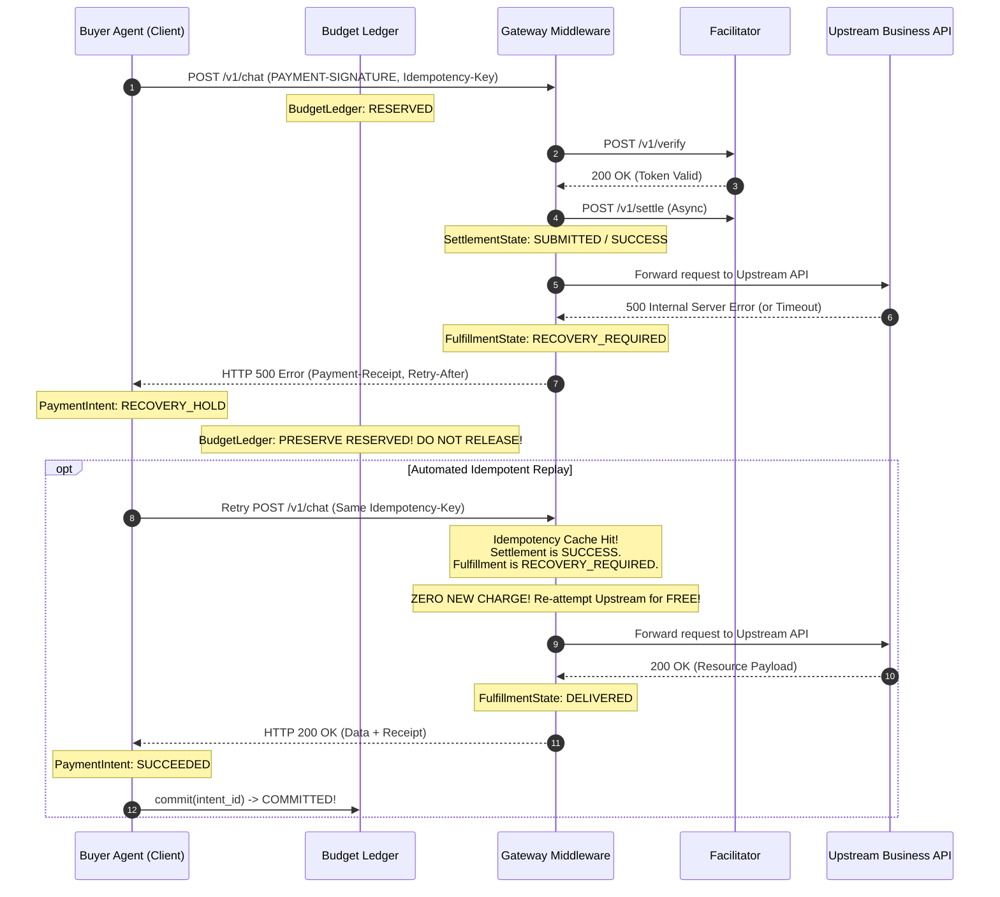

# AgentPay Multi-Dimensional State Coordination & Idempotency Specification

> **Specification Version:** 2.0.0  
> **Status:** Approved Architecture Draft  
> **Target Runtimes:** Python SDK (`python/agentpay`), Self-hosted Gateway  
> **Task Tracking:** 2026 Plan Milestone M2 (Tasks T4.1, T4.2, T4.3, T4.4, T5.4)

---

## 1. Architectural Core Principle: Multi-Dimensional Decoupling

In AgentPay, the micro-payment lifecycle is **never compressed into a single simplistic three-state enum**. A single monolithic status (such as `PENDING / SUCCESS / FAILED`) fundamentally fails to capture the asynchronous, multi-party reality of autonomous agent commerce, where blockchain consensus and upstream web delivery operate on completely independent failure planes.

Instead, AgentPay explicitly decouples the system into **four orthogonal stateful entities**, coordinated across physical process and database boundaries via deterministic transaction guards:

```text
┌─────────────────────────────────────────────────────────────────────────────────────────┐
│                               FOUR ORTHOGONAL DOMAIN OBJECTS                            │
├──────────────────────────┬──────────────────────────────────────────┬───────────────────┤
│ Domain Object            │ Core Responsibility                      │ Exact State Enum  │
├──────────────────────────┼──────────────────────────────────────────┼───────────────────┤
│ 1. Payment Intent        │ Client high-level business request cycle │ PaymentIntentState│
│ 2. Settlement            │ Blockchain / Facilitator funds transfer  │ SettlementState   │
│ 3. Fulfillment           │ Upstream API / resource payload delivery │ FulfillmentState  │
│ 4. Budget Ledger         │ Buyer local financial firewall quota lock│ BudgetLedgerState │
└──────────────────────────┴──────────────────────────────────────────┴───────────────────┘
```

```text
[ BUYER DOMAIN (Agent Host) ]                    [ GATEWAY DOMAIN (Seller Host) ]
  • Database: buyer_agentpay.db                    • Database: gateway_agentpay.db
  • 1. Payment Intent (Intent State)               • 2. Settlement (Settlement State)
  • 4. Budget Ledger (Ledger State)                • 3. Fulfillment (Fulfillment State)
  • Local Keystore / LocalSigner                   • Idempotency Cache (ap_idempotency_cache)
  • Outbound 402 Client Interceptor                • Inbound 402 Middleware & Reverse Proxy
                        │                                    ▲
                        │  HTTP 402 Challenge / Signature    │
                        └────────────────────────────────────┘
```

---

## 2. The Four Domain Objects & State Definitions

### 2.1 Object 1: Payment Intent (`PaymentIntentState`)
* **Physical Location:** Buyer Database (`ap_buyer_intent`) & Gateway Intent Registry (`ap_gateway_intent`)
* **Responsibility:** Tracks the high-level business transaction from the client's perspective.
* **State Enum:**
  - `CREATED`: Payment challenge received and parsed; intent record instantiated.
  - `PROCESSING`: Undergoing firewall policy evaluation, cryptographic signing, or dispatched in-flight over HTTP.
  - `SUCCEEDED`: Terminal business success. Upstream resource received, receipt verified, quota committed.
  - `REJECTED`: Terminal failure before network transmission (e.g. policy firewall denial, budget cap exceeded).
  - `RECOVERY_HOLD`: In-flight ambiguity (network drop, HTTP 500, timeout). Signature was sent on the wire; held in lock until idempotent retry or reconciliation.
  - `CANCELLED`: Pre-flight local cancellation before any signature was transmitted on the wire.

### 2.2 Object 2: Settlement (`SettlementState`)
* **Physical Location:** Gateway Database (`ap_gateway_settlement`) & Facilitator Node
* **Responsibility:** Tracks the cryptographic clearing and blockchain consensus of funds.
* **State Enum:**
  - `NOT_SUBMITTED`: Cryptographic authorization received and verified locally, but not yet enqueued to Facilitator.
  - `SUBMITTED`: Enqueued to Facilitator clearing queue (`/v1/settle`).
  - `PENDING`: Transaction broadcasted to mempool; waiting for block confirmations.
  - `SUCCESS`: Confirmed on-chain (or cleared by Facilitator). Final financial success.
  - `FAILED`: Definitive settlement rejection (nonce collision, contract revert, expired unspent window).
  - `UNKNOWN`: RPC latency spike, node timeout, or temporary network split during status polling.

### 2.3 Object 3: Fulfillment (`FulfillmentState`)
* **Physical Location:** Gateway Database (`ap_gateway_fulfillment`)
* **Responsibility:** Tracks whether the paying agent actually received the upstream service payload.
* **State Enum:**
  - `NOT_DELIVERED`: Initial state. Payment verified, but upstream target API not yet dispatched.
  - `DELIVERING`: Request currently in-flight to upstream business target.
  - `DELIVERED`: Upstream returned 2xx; payload cached and delivered to client with HTTP 200 OK.
  - `RECOVERY_REQUIRED`: Upstream returned 5xx, connection dropped, or timed out. Payload delivery failed, but payment was already cleared or in-flight!

### 2.4 Object 4: Budget Ledger (`BudgetLedgerState`)
* **Physical Location:** Buyer Database (`ap_budget_ledger`)
* **Responsibility:** The Buyer's out-of-band Financial Firewall quota lock.
* **Strict Three-State Enum (Mathematical Invariant P0-6):**
  - `RESERVED`: Quota atomically locked in SQLite WAL mode. Deducts from available rolling budget.
  - `COMMITTED`: Permanent expenditure finalization after HTTP 200 OK. Counts toward 24h rolling total.
  - `RELEASED`: Quota restored to available pool. ONLY allowed if signature was NEVER sent, OR reconciliation definitively proves nonce was never spent on-chain.

---

## 3. Core Safety Invariant: Decoupling Payment Success from Delivery Success

### 3.1 The "Upstream 500 / Timeout" Scenario
A primary architectural failure mode in naive payment integrations is treating "Payment" and "Delivery" as an all-or-nothing rollback. 

> [!CAUTION]
> **ANTI-PATTERN: The Naive Rollback Vulnerability**
> If the Gateway verifies payment and triggers Facilitator settlement, but the upstream LLM API returns `HTTP 500 Internal Server Error`, **THE PAYMENT MUST NEVER BE ROLLED BACK OR PRESUMED VOID**.
> 
> If the system were to blindly release the Buyer's `Budget Ledger` quota (`RELEASED`) or mark `SettlementState = FAILED`:
> 1. The Seller/Facilitator may still broadcast the valid EIP-3009 authorization on-chain and claim the funds.
> 2. The Buyer's local firewall quota is restored, allowing the Agent to spend the same budget again.
> 3. Result: **Double-spending and unmetered financial loss**.

### 3.2 The Correct State Coordination in Failure
When an upstream service fails after payment is verified:



---

## 4. Multi-Entity Coordination Transition Matrix

The table below defines how state changes synchronize across the four orthogonal dimensions:

| Trigger Event | Payment Intent (Buyer) | Settlement (Gateway) | Fulfillment (Gateway) | Budget Ledger (Buyer) | System Resolution & Actions |
| :--- | :---: | :---: | :---: | :---: | :--- |
| **Initial 402 Challenge** | `CREATED` | `NOT_SUBMITTED` | `NOT_DELIVERED` | `None` | Challenge parsed and presented to firewall. |
| **Policy Approved** | `PROCESSING` | `NOT_SUBMITTED` | `NOT_DELIVERED` | **`RESERVED`** | Quota locked atomically in `ap_budget_ledger`. |
| **Policy Denied** | `REJECTED` | `NOT_SUBMITTED` | `NOT_DELIVERED` | `None` | Fast abort; raise `PolicyViolationError`. |
| **Signature Pre-flight Abort** | `CANCELLED` | `NOT_SUBMITTED` | `NOT_DELIVERED` | **`RELEASED`** | Signature never touched the wire: safe to release quota. |
| **Request Dispatched with Sig** | `PROCESSING` | `NOT_SUBMITTED` | `NOT_DELIVERED` | **`RESERVED`** | Transmission boundary crossed: **lock frozen**. |
| **Gateway Verifies & Enqueues**| `PROCESSING` | `SUBMITTED` | `DELIVERING` | **`RESERVED`** | Facilitator queue accepts authorization. |
| **Upstream 2xx Delivered** | `SUCCEEDED` | `SUCCESS` | `DELIVERED` | **`COMMITTED`** | **Happy Path:** Quota committed, payload delivered. |
| **Upstream 5xx / Timeout** | `RECOVERY_HOLD` | `SUCCESS` / `PENDING` | `RECOVERY_REQUIRED` | **`RESERVED`** | **Orphaned Settlement:** Keep locked. Ready for free retry. |
| **Idempotent Retry Succeeds** | `SUCCEEDED` | `SUCCESS` | `DELIVERED` | **`COMMITTED`** | Upstream succeeded on retry; ledger finalized. |
| **Timeout & Chain Confirms Unspent** | `REJECTED` | `FAILED` | `RECOVERY_REQUIRED` | **`RELEASED`** | Reconciler proves nonce unspent after `validBefore + 60s`. Safe to release. |

---

## 5. Physical SQLite Schema Blueprint for T4.1

### 5.1 Buyer Database (`buyer_agentpay.db`)

```sql
-- 1. Financial Firewall Ledger (Strict Three-State Quota Engine)
CREATE TABLE IF NOT EXISTS ap_budget_ledger (
    id TEXT PRIMARY KEY,                       -- UUIDv7 reservation ID
    policy_id TEXT NOT NULL,                   -- Associated policy config
    wallet_address TEXT NOT NULL,              -- EVM address (lowercase hex)
    intent_id TEXT NOT NULL UNIQUE,            -- Corresponds to challengeId / payment intent
    amount_base_units INTEGER NOT NULL,        -- Locked amount in integer base units
    state TEXT NOT NULL CHECK(state IN ('RESERVED', 'COMMITTED', 'RELEASED')),
    created_at INTEGER NOT NULL,               -- Unix seconds
    expires_at INTEGER NOT NULL,               -- Unix seconds (created_at + ttl)
    updated_at INTEGER NOT NULL
);
CREATE INDEX IF NOT EXISTS idx_ledger_rolling 
ON ap_budget_ledger (policy_id, state, created_at, expires_at);

-- 2. Buyer Payment Intent Tracking
CREATE TABLE IF NOT EXISTS ap_buyer_intent (
    intent_id TEXT PRIMARY KEY,                -- challengeId
    domain TEXT NOT NULL,                      -- Target merchant domain
    resource_uri TEXT NOT NULL,                -- Target URI path
    amount_base_units INTEGER NOT NULL,
    asset_address TEXT NOT NULL,
    network_id TEXT NOT NULL,
    payee_address TEXT NOT NULL,
    nonce TEXT,                                -- EIP-3009 nonce (hex)
    state TEXT NOT NULL CHECK(state IN (
        'CREATED', 'PROCESSING', 'SUCCEEDED', 'REJECTED', 'RECOVERY_HOLD', 'CANCELLED'
    )),
    error_message TEXT,
    created_at INTEGER NOT NULL,
    updated_at INTEGER NOT NULL
);
```

### 5.2 Gateway Database (`gateway_agentpay.db`)

```sql
-- 3. Inbound Payment Settlement
CREATE TABLE IF NOT EXISTS ap_gateway_settlement (
    settlement_id TEXT PRIMARY KEY,            -- stl_...
    intent_id TEXT NOT NULL UNIQUE,            -- challengeId
    network_id TEXT NOT NULL,
    asset_address TEXT NOT NULL,
    payer_address TEXT NOT NULL,
    payee_address TEXT NOT NULL,
    amount_base_units INTEGER NOT NULL,
    nonce TEXT NOT NULL,
    tx_hash TEXT,                              -- Blockchain transaction hash
    block_number INTEGER,
    state TEXT NOT NULL CHECK(state IN (
        'NOT_SUBMITTED', 'SUBMITTED', 'PENDING', 'SUCCESS', 'FAILED', 'UNKNOWN'
    )),
    error_message TEXT,
    created_at INTEGER NOT NULL,
    updated_at INTEGER NOT NULL,
    -- P0-7 Invariant: Strict replay defense on EVM nonce level
    CONSTRAINT uq_nonce_replay UNIQUE (network_id, asset_address, payer_address, nonce)
);

-- 4. Upstream Fulfillment Tracking
CREATE TABLE IF NOT EXISTS ap_gateway_fulfillment (
    fulfillment_id TEXT PRIMARY KEY,          -- ful_...
    intent_id TEXT NOT NULL UNIQUE,           -- challengeId
    upstream_url TEXT NOT NULL,
    upstream_status INTEGER,                  -- Upstream HTTP status (200, 500, etc.)
    state TEXT NOT NULL CHECK(state IN (
        'NOT_DELIVERED', 'DELIVERING', 'DELIVERED', 'RECOVERY_REQUIRED'
    )),
    response_body_blob BLOB,                  -- Cached payload for idempotent replay
    response_headers_json TEXT,
    created_at INTEGER NOT NULL,
    updated_at INTEGER NOT NULL
);

-- 5. Strict Idempotency Lease Cache
CREATE TABLE IF NOT EXISTS ap_idempotency_cache (
    payer_address TEXT NOT NULL,
    idempotency_key TEXT NOT NULL,
    intent_id TEXT NOT NULL,
    locked_until INTEGER NOT NULL,            -- In-flight lease lock expiration
    response_status INTEGER,
    response_headers_json TEXT,
    response_body_blob BLOB,
    created_at INTEGER NOT NULL,
    updated_at INTEGER NOT NULL,
    PRIMARY KEY (payer_address, idempotency_key)
);
```

---

## 6. Implementation Guardrails for T4.X & T5.X

1. **State Independence:** Code in `T4.2` must define four separate Enum classes (`PaymentIntentState`, `SettlementState`, `FulfillmentState`, `BudgetLedgerState`). Do not collapse or cross-reference their raw values.
2. **Atomic SQLite Transactions:** Any coordinated update must execute within an explicit `BEGIN IMMEDIATE;` block to prevent race conditions during high-concurrency dispatch.
3. **Reconciliation Authority (`T4.3`):** Reconciliation probes Facilitator status and on-chain receipts. If settlement is confirmed (`SUCCESS`), fulfillment status is checked. If fulfillment is `RECOVERY_REQUIRED`, it triggers upstream re-execution rather than financial release.
