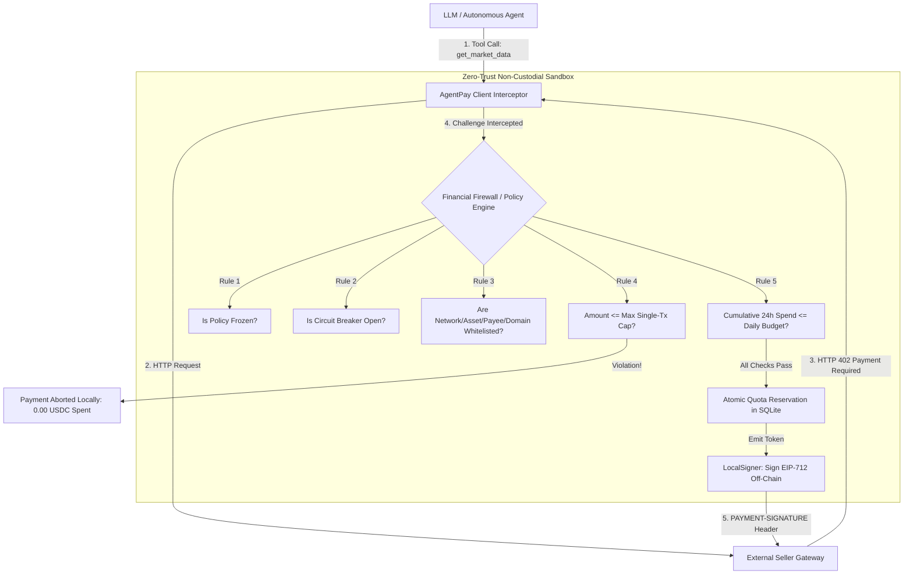

# AgentPay Financial Firewall & Policy Configuration Reference

> **Document Version:** 1.0.0  
> **Target Module:** `agentpay.policy` (`PolicyConfig`, `SQLitePolicyEngine`, `PaymentPolicyEvaluator`)  
> **Status:** Production Ready (2026 Baseline)  
> **Audience:** AI Agent Developers, Risk Engineers, System Architects  

---

## 1. Overview & Architectural Role

The **AgentPay Financial Firewall** (`SQLitePolicyEngine`) is a local, deterministic, non-custodial gatekeeper running directly alongside your AI Agent.

When an autonomous agent attempts to call a paid tool or an external API returns `HTTP 402 Payment Required`, the firewall intercepts the payment challenge **before** any cryptographic signature is computed and **before** any funds leave the wallet.



### Core Security Guarantees
- **Non-Custodial**: Private keys reside only in the local runtime. Keys are never transmitted over the network or exposed to model context prompts.
- **Fail-Closed**: Any unhandled exception, syntax error, database lock timeout, or unknown token defaults to an immediate abort (`PAYMENT_ABORTED_SAFELY`).
- **Two-Phase Commit (2PC)**: Quota is reserved atomically (`RESERVED`) prior to signing and committed (`COMMITTED`) only upon receiving `HTTP 200 OK`. If the server drops connection, reserved quota safely auto-releases.

---

## 2. `PolicyConfig` Schema Reference

The `PolicyConfig` model (defined in `agentpay.policy.models.PolicyConfig`) enforces immutable validation rules via Pydantic v2.

### 2.1 Identity & Wallet Parameters

| Field | Type | Default | Description |
| :--- | :---: | :---: | :--- |
| `id` | `str` | **Required** | Unique string identifier for this policy (e.g., `"agent_firewall_primary"`). |
| `name` | `str` | `id` | Human-readable label for logs and metrics. |
| `wallet_address` | `str` | **Required** | Checksummed EVM address of the Buyer wallet (auto-normalized to lowercase). Must match `0x[a-fA-F0-9]{40}`. |

### 2.2 Financial Limits (Integer Base Units)

All monetary amounts in AgentPay policies are strictly represented as **integer atomic base units**. Floating point values (`float`) are explicitly rejected at construction time to prevent floating-point rounding errors.

| Field | Type | Default | Description |
| :--- | :---: | :---: | :--- |
| `max_per_tx_base_units` | `int` | **Required** | Maximum atomic units allowed for a single transaction (e.g. `100_000` for $0.10 USDC). |
| `rolling_budget_24h_base_units` | `int` | **Required** | Rolling 24-hour spending budget across sliding 86,400-second window (e.g. `1_000_000` for $1.00 USDC). |
| `lifetime_budget_base_units` | `int \| None` | `None` | Optional hard lifetime cap. Once total historical committed spend exceeds this, all future payments abort. |

### 2.3 Whitelist Matrix (Zero-Trust Access Control)

If a whitelist is configured with one or more entries, any payment request targeting an unlisted entity is immediately rejected. Empty frozensets indicate that filtering for that dimension is unconstrained.

| Field | Type | Default | Description |
| :--- | :---: | :---: | :--- |
| `whitelist_networks` | `frozenset[str]` | `frozenset()` | Allowed CAIP-2 network identifiers. Example: `{"eip155:421614", "eip155:8453"}`. |
| `whitelist_assets` | `frozenset[str]` | `frozenset()` | Allowed ERC-20 token contract addresses (e.g., Circle USDC address). Addresses are auto-lowercased. |
| `whitelist_payees` | `frozenset[str]` | `frozenset()` | Approved merchant/seller recipient EVM addresses. |
| `whitelist_domains` | `frozenset[str]` | `frozenset()` | Approved API hostnames (e.g. `{"api.marketdata.com", "llm.provider.ai"}`). Port and protocol are stripped. |

### 2.4 Circuit Breaker Parameters

The circuit breaker halts infinite runaway agent loops when anomalous frequency or consecutive failures occur.

| Field | Type | Default | Description |
| :--- | :---: | :---: | :--- |
| `circuit_max_rpm` | `int` | `15` | Maximum allowed payment requests per minute (60s sliding window). Exceeding this trips the breaker to `OPEN`. |
| `circuit_consecutive_failures` | `int` | `5` | Number of consecutive settlement or upstream failures before tripping breaker. |
| `circuit_cooldown_seconds` | `int` | `300` | Cooldown duration (seconds) before an `OPEN` breaker enters `HALF_OPEN` to permit a single test probe. |
| `is_frozen` | `bool` | `False` | Administrative kill-switch. When `True`, all payment attempts immediately abort with `POLICY_FROZEN`. |

---

## 3. Base Unit Math & Currency Conversions

Circle USDC uses **6 decimal places** on EVM blockchains (Arbitrum, Base, Ethereum).

$$\text{Base Units} = \text{USDC Amount} \times 10^6$$

### Conversion Reference Table

| USD / USDC Value | Exact Integer Base Units | Usage Recommendation |
| :---: | :---: | :--- |
| **\$0.0001** | `100` | Token-level streaming inference / telemetry |
| **\$0.001** | `1,000` | Standard search or micro-database query |
| **\$0.01** | `10,000` | Web browsing, document scraping |
| **\$0.05** | `50,000` | LLM reasoning call (e.g. Claude 3.5 Sonnet / GPT-4o) |
| **\$0.10** | `100_000` | **Recommended `max_per_tx_base_units` for autonomous agents** |
| **\$1.00** | `1_000_000` | **Recommended `rolling_budget_24h_base_units` for testing** |
| **\$5.00** | `5_000_000` | Heavy GPU batch computation |
| **\$25.00** | `25_000_000` | Enterprise agent daily budget limit |

### Helper Conversion Functions in Python
```python
def usd_to_base_units(dollars: float, decimals: int = 6) -> int:
    """Convert human USD float to integer base units safely."""
    return int(round(dollars * (10 ** decimals)))

def base_units_to_usd(base_units: int, decimals: int = 6) -> float:
    """Convert integer base units to human USD float."""
    return base_units / (10 ** decimals)
```

---

## 4. Storage Engine: In-Memory vs. Persistent SQLite

AgentPay's `SQLitePolicyEngine` supports two operating modes:

### 4.1 In-Memory Sandbox (`:memory:`)
Used for unit tests, local algorithm verification, and zero-filesystem demos:

```python
from agentpay.policy import SQLitePolicyEngine, PolicyConfig

policy = SQLitePolicyEngine.create_in_memory(
    PolicyConfig(
        id="sandbox_policy",
        wallet_address="0x6c7a9c5b4655075b6ff9292f71b822f56f833e56",
        max_per_tx_base_units=100_000,       # $0.10
        rolling_budget_24h_base_units=1_000_000, # $1.00
        circuit_max_rpm=5,
    )
)
```

### 4.2 Persistent Local SQLite Database
Used for production deployments. Preserves 24-hour rolling budgets and circuit breaker states across process restarts:

```python
import sqlite3
from agentpay.policy import SQLitePolicyEngine, PolicyConfig

# Open persistent database file with WAL mode enabled
conn = sqlite3.connect("./data/agent_wallet.db")
conn.execute("PRAGMA journal_mode=WAL;")

policy = SQLitePolicyEngine(
    conn=conn,
    config=PolicyConfig(
        id="production_agent_firewall",
        wallet_address="0x6c7a9c5b4655075b6ff9292f71b822f56f833e56",
        max_per_tx_base_units=200_000,       # $0.20
        rolling_budget_24h_base_units=5_000_000, # $5.00
        circuit_max_rpm=10,
        circuit_cooldown_seconds=600,
        whitelist_networks=frozenset(["eip155:421614"]), # Arbitrum Sepolia only
        whitelist_assets=frozenset(["0x75faf114eafb1BDbe2F0316DF893fd58CE46AA4d"]),
    )
)
```

---

## 5. Integration Code Examples

### 5.1 Bare Client with Financial Firewall
```python
import os
from agentpay.client import AgentPayClient, LocalSigner
from agentpay.policy import SQLitePolicyEngine, PolicyConfig

# 1. Initialize local signer
signer = LocalSigner(os.environ["BUYER_PRIVATE_KEY"])

# 2. Configure financial firewall
config = PolicyConfig(
    id="market_agent_firewall",
    wallet_address=signer.address,
    max_per_tx_base_units=50_000,          # Max $0.05 per call
    rolling_budget_24h_base_units=500_000, # Max $0.50 per day
    circuit_max_rpm=5,                     # Max 5 calls/min
)
policy = SQLitePolicyEngine.create_in_memory(config)

# 3. Create client guarded by policy
client = AgentPayClient(signer=signer, policy=policy)

# 4. Transparently invoke paid APIs over standard HTTPS
response = client.get("https://api.seller.com/v1/market-data?ticker=NVDA")
print("Response Status:", response.status_code)
print("Data:", response.json())
```

### 5.2 LangChain Autonomous Agent Integration
```python
from agentpay.client import AgentPayClient, LocalSigner
from agentpay.policy import SQLitePolicyEngine, PolicyConfig
from agentpay.integrations.langchain import PaidTool, AgentPayToolWrapper

# Configure client with firewall
signer = LocalSigner(os.environ["BUYER_PRIVATE_KEY"])
policy = SQLitePolicyEngine.create_in_memory(
    PolicyConfig(
        id="langchain_firewall",
        wallet_address=signer.address,
        max_per_tx_base_units=100_000,       # $0.10
        rolling_budget_24h_base_units=1_000_000, # $1.00
        circuit_max_rpm=5,
    )
)
client = AgentPayClient(signer=signer, policy=policy)

# Wrap paid tool
market_tool = PaidTool(
    name="get_stock_quote",
    description="Fetch real-time stock price (costs $0.05 USDC per query)",
    endpoint="https://api.seller.com/v1/market-data",
    method="GET",
    client=client,
)

# Agent execution is 100% protected against infinite runaway loops
# When circuit breaker trips, tool observation returns friendly rejection:
# "AgentPay Firewall Rejected: [CIRCUIT_BREAKER_OPEN] Payment policy rejected 402 challenge"
```

---

## 6. Operational Playbooks

### 6.1 Unfreezing a Tripped Circuit Breaker
If an agent triggers rapid retries and trips the circuit breaker to `OPEN`, the breaker automatically transitions to `HALF_OPEN` after `circuit_cooldown_seconds` (default 300s).

To manually unfreeze or reset the circuit breaker immediately via Python:
```python
policy.reset_circuit_breaker(intent_id="manual_admin_override")
```

### 6.2 Emergency Kill-Switch (Freezing All Payments)
To immediately block all outgoing transactions without terminating running agent processes:
```python
policy.freeze(reason="Suspected prompt injection anomaly")
```
All subsequent payment attempts will instantly fail with `POLICY_FROZEN`, preventing any balance depletion.
