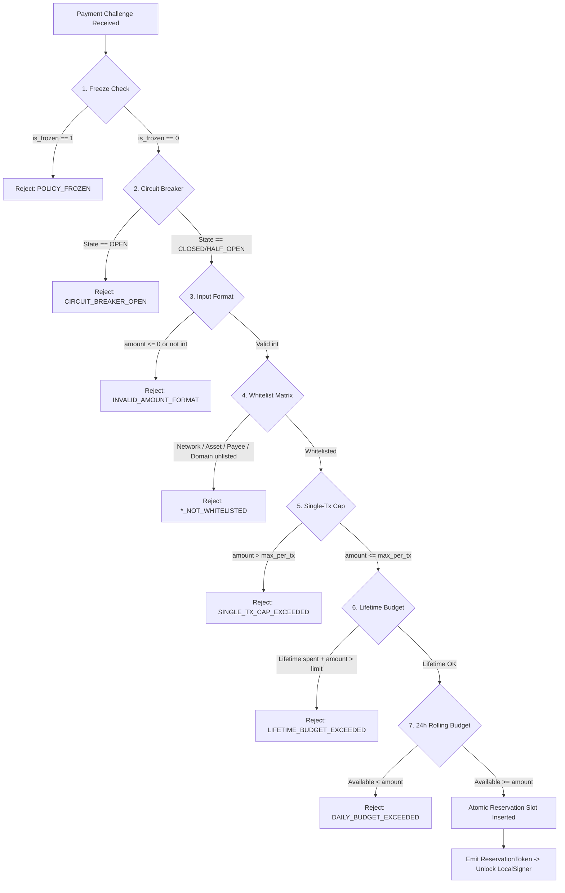
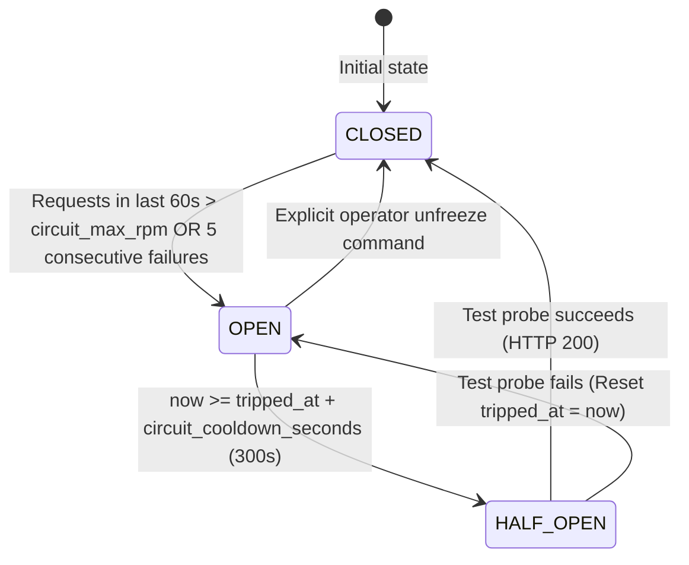

# AgentPay Policy Engine Specification

> **Specification Version:** 1.1.0  
> **Status:** Draft  
> **Target Implementations:** Python SDK (`agentpay.policy`), SQLite Ledger  
> **Task Tracking:** 2026 Plan Milestone M1 (Tasks T1.3, T2.1, T2.2, T2.3, T2.4, P0-6, P1-11, P1-12, P1-18, P1-21, P1-23)

---

## 1. Overview & Policy Architecture

The **Policy Engine** operates as an independent, deterministic financial firewall between the untrusted agent/LLM context and the cryptographic wallet signer.



---

## 2. Standardized Error Codes (Language-Agnostic, P1-18)

All errors returned by the Policy Engine map to standard uppercase string codes:

| Error Code | HTTP Status Equivalent | Description |
| :--- | :---: | :--- |
| `POLICY_FROZEN` | 403 Forbidden | Policy is administratively frozen or locked by circuit breaker. |
| `CIRCUIT_BREAKER_OPEN` | 429 Too Many Requests | Rate of spending or consecutive failures exceeded threshold. |
| `INVALID_AMOUNT_FORMAT` | 400 Bad Request | Amount is non-integer, zero, negative, or malformed. |
| `NETWORK_NOT_WHITELISTED` | 403 Forbidden | CAIP-2 network ID is not present in policy whitelist. |
| `ASSET_NOT_WHITELISTED` | 403 Forbidden | Token contract address is not in policy whitelist. |
| `PAYEE_NOT_WHITELISTED` | 403 Forbidden | Recipient address is not in policy whitelist. |
| `DOMAIN_NOT_WHITELISTED` | 403 Forbidden | Target API domain is not in policy whitelist. |
| `SINGLE_TX_CAP_EXCEEDED` | 400 Bad Request | Transaction amount exceeds `max_per_tx_base_units`. |
| `LIFETIME_BUDGET_EXCEEDED` | 402 Payment Required | Aggregate lifetime spend ceiling reached. |
| `DAILY_BUDGET_EXCEEDED` | 402 Payment Required | Rolling 24-hour window budget exhausted. |
| `RESERVATION_EXPIRED` | 410 Gone | Quota reservation lease window (`expires_at`) elapsed. |
| `RESERVATION_ALREADY_FINALIZED` | 409 Conflict | Attempted to release or double-commit a settled reservation. |

---

## 3. Evaluation Precedence & Short-Circuit Order (P1-21)

When a payment challenge arrives, the evaluation pipeline **MUST** evaluate rules in this strict sequential order, short-circuiting on the first failure:

1. **Policy Administrative Lock (`is_frozen`):** If `is_frozen == 1`, immediately abort with `POLICY_FROZEN`.
2. **Circuit Breaker State (`breaker_state`):**
   * If `OPEN`, immediately abort with `CIRCUIT_BREAKER_OPEN`.
   * If `HALF_OPEN`, permit only 1 in-flight test probe transaction.
3. **Format & Precision Validation:**
   * Validate `amount > 0` and `amount` is an integer base unit. If invalid, abort with `INVALID_AMOUNT_FORMAT`.
4. **Whitelist Matrix (Order: Network $\to$ Asset $\to$ Payee $\to$ Domain):**
   * If `network` not in whitelist $\to$ `NETWORK_NOT_WHITELISTED`.
   * If `asset` not in whitelist $\to$ `ASSET_NOT_WHITELISTED`.
   * If `payee` not in whitelist $\to$ `PAYEE_NOT_WHITELISTED`.
   * If `domain` provided and not in whitelist $\to$ `DOMAIN_NOT_WHITELISTED`.
5. **Single-Transaction Cap:** If `amount > max_per_tx_base_units` $\to$ `SINGLE_TX_CAP_EXCEEDED`.
6. **Lifetime Budget Ceiling (if configured):** If $\text{TotalCommitted}_{\text{lifetime}} + \text{amount} > \text{lifetime\_budget\_base\_units}$ $\to$ `LIFETIME_BUDGET_EXCEEDED`.
7. **24-Hour Rolling Budget Ledger:** Execute atomic reservation in `ap_budget_ledger`. If available quota $< \text{amount}$ $\to$ `DAILY_BUDGET_EXCEEDED`.

---

## 4. Two-Phase Reservation Protocol Semantics (P0-1, P0-6)

### 4.1 Interface Contract
```python
class IPolicyEngine:
    def reserve(
        self,
        intent_id: str,
        amount: int,
        payee: str,
        asset: str,
        network: str,
        domain: str | None = None,
        ttl_seconds: int = 360
    ) -> ReservationToken:
        """Atomically checks precedence rules and locks quota in ap_budget_ledger."""
        ...

    def commit(self, intent_id: str) -> None:
        """
        Transitions reservation from RESERVED to COMMITTED upon HTTP 200 OK.
        Idempotent: Subsequent calls for the same intent_id are no-ops.
        """
        ...

    def release(self, intent_id: str, reason: str | None = None) -> None:
        """
        Transitions reservation from RESERVED to RELEASED.
        Guarded: If intent was already COMMITTED, raises RESERVATION_ALREADY_FINALIZED.
        Idempotent: Releasing an already RELEASED intent is a no-op.
        """
        ...
```

### 4.2 SQLite Atomic Reservation Query (P0-6)
Executed within `BEGIN IMMEDIATE` transaction to guarantee process-level exclusivity:

```sql
-- Step 1: Calculate current committed spend in last 24h + active unexpired reservations
SELECT 
    p.is_frozen,
    p.breaker_state,
    p.max_per_tx_base_units,
    p.rolling_budget_24h_base_units,
    p.lifetime_budget_base_units,
    COALESCE(SUM(l.amount_base_units), 0) AS current_rolling_usage
FROM ap_policy p
LEFT JOIN ap_budget_ledger l 
    ON p.id = l.policy_id 
    AND (
        (l.state = 'COMMITTED' AND l.created_at >= :now_seconds - 86400)
        OR
        (l.state = 'RESERVED' AND l.expires_at > :now_seconds)
    )
WHERE p.id = :policy_id
GROUP BY p.id;
```

---

## 5. Circuit Breaker Specification (P1-12)



* **Persistence:** `breaker_state` and `tripped_at` are persisted in `ap_policy`.
* **Auto-Quarantine:** When tripped, `breaker_state = 'OPEN'`, `tripped_at = now`.
* **Probe Locking:** When in `HALF_OPEN`, only one reservation with `is_probe = 1` may be issued until settled.
