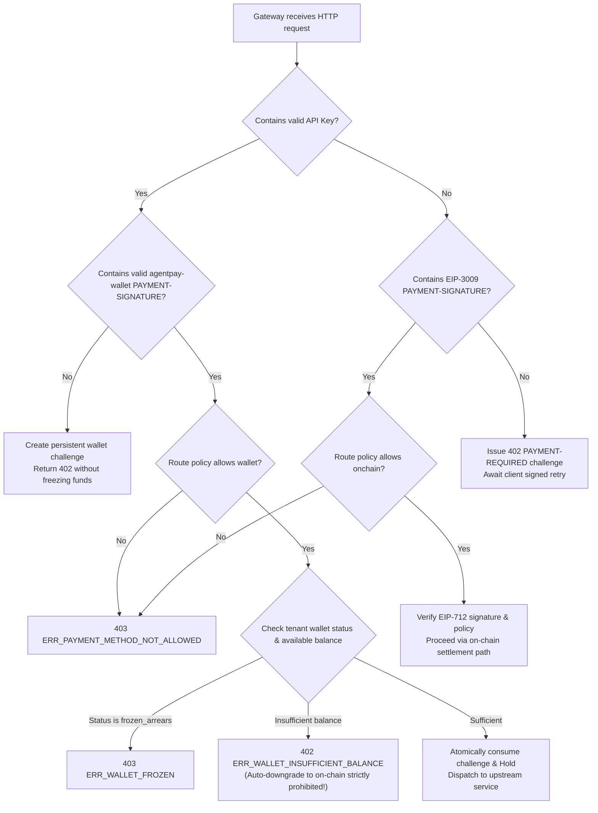

# AgentPay Python/Go Protocol Consistency Specification (T1.3 Specification)

> **Version**: v2.0.0 (T1.3 Unified Protocol Contract)  
> **Status**: **Approved Specification**  
> **Scope**: Python Client/Buyer SDK, Go Gateway Data Plane, Control Plane API & Reconciliation System  
> **Cross-Language Test Vectors**:  
> - [`specs/conformance/protocol-errors.json`](./conformance/protocol-errors.json) (Canonical Error Taxonomy & Schema)  
> - [`specs/test-vectors/dual-path-protocol.json`](./test-vectors/dual-path-protocol.json) (Dual-Path Protocol Conformance Test Vectors)  
> - [`specs/conformance/state-machine.json`](./conformance/state-machine.json) (State Machine Transition Vectors)  

> **Wallet Channel Extension**: The virtual wallet executes over an x402 V2-style `PAYMENT-REQUIRED` / `PAYMENT-SIGNATURE` round-trip using AgentPay's native `agentpay-wallet` scheme rather than an EIP-3009 on-chain authorization. Field definitions, validation rules, and persistent replay-protection requirements are specified in [`agentpay-wallet-x402-extension.md`](./agentpay-wallet-x402-extension.md), which supersedes the earlier "direct deduction upon API Key arrival" flow.

---

## 1. Goals & Design Principles

To guarantee 100% behavioral parity between the **Python Buyer SDK** and the **Cloud-Native Go Gateway** across network interactions, error handling, and state arbitration, the T1.3 specification establishes a unified wire-level protocol contract:

1. **Single Source of Truth**: All protocol headers, error codes, state enums, and test vectors are maintained as machine-readable JSON under `specs/`, and both Python and Go execute against the exact same test suites.
2. **Case-Insensitive & Schema-Strict Formatting**: HTTP header names are parsed case-insensitively, while payloads are validated against strict JSON Schemas; unknown or malformed fields are rejected safely.
3. **Deterministic Payment Method Arbitration**: Explicitly separates on-chain x402 signed payments from internal virtual wallet deductions, **strictly prohibiting silent or automatic fallback to on-chain billing when wallet balance is insufficient**.
4. **Unified Error Response Model**: Every service returns a canonical JSON error envelope, eliminating backend-specific error branching in client SDKs.

---

## 2. HTTP Protocol Headers Specification

### 2.1 On-Chain x402 Payment Channel
| Header Name | Direction | Syntax & Encoding | Specification |
|---|---|---|---|
| `PAYMENT-REQUIRED` | Gateway → Client (402) | `PAYMENT-REQUIRED: <Base64URL(JSON_Payload)>` | RFC 6648 compliant; carries challenge parameters issued by the gateway |
| `PAYMENT-SIGNATURE`| Client → Gateway (Retry) | `PAYMENT-SIGNATURE: <Base64URL(JSON_Payload)>` | Carries the buyer wallet's EIP-3009 cryptographic authorization |

#### Challenge Payload Schema (`PAYMENT-REQUIRED`)
```json
{
  "version": "2.0",
  "challengeId": "ch_01j7xyz890abcdef12345678",
  "network": "eip155:421614",
  "asset": "0x036CbD53842c5426634e7929541eC2318f3dCF7e",
  "assetSymbol": "USDC",
  "decimals": 6,
  "amount": "50000",
  "payee": "0x70997970C51812dc3A010C7d01b50e0d17dc79C8",
  "scheme": "EIP-3009",
  "validAfter": 1729000000,
  "validBefore": 1729000300,
  "facilitatorUrl": "https://facilitator.agentpay.org",
  "resourceUri": "/v1/llm/chat"
}
```

#### Authorization Payload Schema (`PAYMENT-SIGNATURE`)
```json
{
  "version": "2.0",
  "challengeId": "ch_01j7xyz890abcdef12345678",
  "payer": "0xf39Fd6e51aad88F6F4ce6aB8827279cffFb92266",
  "scheme": "EIP-3009",
  "nonce": "0x1234567890abcdef1234567890abcdef1234567890abcdef1234567890abcdef",
  "validAfter": 1729000000,
  "validBefore": 1729000300,
  "signature": {
    "v": 28,
    "r": "0xd90ab6b36f43fea017b168106d443b874dbeaeec24a4c416b7abc38afa9baa83",
    "s": "0x530e805bb1a29839651fac0cb1f3f1c05a7c659760488173ed1fd582819467e0",
    "serialized": "d90ab6b36f43fea017b168106d443b874dbeaeec24a4c416b7abc38afa9baa83530e805bb1a29839651fac0cb1f3f1c05a7c659760488173ed1fd582819467e01c"
  }
}
```

---

### 2.2 Virtual Wallet Payment Channel
| Header Name | Direction | Syntax & Format | Specification |
|---|---|---|---|
| `Authorization` | Client → Gateway | `Authorization: Bearer apk_live_...` | Passes the tenant-issued API Key |
| `PAYMENT-REQUIRED` | Gateway → Client (402) | `PAYMENT-REQUIRED: <Base64URL(JSON_Payload)>` | Returns a quote challenge with `scheme=agentpay-wallet`; the initial request must never freeze or deduct funds |
| `PAYMENT-SIGNATURE` | Client → Gateway (Retry) | `PAYMENT-SIGNATURE: <Base64URL(JSON_Payload)>` | Returns the challenge-bound AgentPay wallet authorization (no EIP-712 signature; API Key still authenticates the caller) |
| `Idempotency-Key` | Client → Gateway | `Idempotency-Key: <string>` | Client business-level unique key (max 128 characters) |

Full payload schemas, single-use challenge state transitions, and cross-instance anti-replay rules for virtual wallet requests are defined in the wallet extension specification. The gateway must execute a Hold only after validating the authorization retry; presenting an API Key alone only retrieves a quote challenge and never triggers a deduction.

---

## 3. Dual-Path Payment Method Arbitration

When the Gateway receives an inbound request, it evaluates the following deterministic arbitration flow:



> [!CAUTION]
> **No Auto-Downgrade Invariant**  
> Wallet mode must first return an `agentpay-wallet` challenge and may deduct funds only after the client's local policy approves and retries the request. If the wallet balance is insufficient, the gateway must return `402 ERR_WALLET_INSUFFICIENT_BALANCE` and terminate the flow. **It is strictly prohibited** to silently issue an EIP-3009 on-chain challenge instead or trigger unauthorized on-chain private key signing and gas consumption.

---

## 4. Canonical Error Taxonomy

Whenever any service returns a non-2xx response, it must emit the canonical JSON error envelope:

```json
{
  "error": {
    "code": "ERR_WALLET_INSUFFICIENT_BALANCE",
    "message": "Wallet available balance is insufficient to cover this request.",
    "domain": "WALLET",
    "status": 402,
    "requestId": "req_01j7xyz890abcdef12345678",
    "details": {
      "requiredAmount": 50000,
      "availableBalance": 20000
    }
  }
}
```

| Error Code | HTTP Status | Domain | Trigger Condition & Meaning |
|---|---|---|---|
| `ERR_PAYMENT_REQUIRED` | 402 | PROTOCOL | Resource requires on-chain payment; challenge issued |
| `ERR_WALLET_INSUFFICIENT_BALANCE` | 402 | WALLET | Internal virtual wallet available balance is insufficient; overdraft prohibited |
| `ERR_WALLET_FROZEN` | 403 | WALLET | Wallet is administratively frozen or in `frozen_arrears` status |
| `ERR_PAYMENT_METHOD_NOT_ALLOWED` | 403 | ROUTING | Submitted payment method conflicts with the route's allowed methods (`wallet`/`onchain`) |
| `ERR_POLICY_BUDGET_EXCEEDED` | 403 | POLICY | 24-hour rolling window or lifetime budget cap exceeded |
| `ERR_POLICY_MAX_PER_TX` | 403 | POLICY | Single-transaction amount exceeds the configured safety cap |
| `ERR_POLICY_CIRCUIT_BROKEN` | 429 | POLICY | Runaway Agent loop or high-frequency burst detected; circuit breaker open |
| `ERR_API_KEY_INVALID` | 401 | AUTH | API Key does not exist, has been revoked, or has expired |
| `ERR_API_KEY_SCOPE_DENIED` | 403 | AUTH | API Key lacks the required permission scope for the target route |
| `ERR_TENANT_SUSPENDED` | 403 | TENANT | Tenant organization has been suspended by an administrator |
| `ERR_SIGNATURE_INVALID` | 401 | CRYPTOGRAPHY | EIP-712 signature verification failed or payload was tampered with |
| `ERR_NONCE_REPLAY` | 409 | SETTLEMENT | On-chain nonce has already been used or replayed |
| `ERR_IDEMPOTENCY_CONFLICT` | 409 | IDEMPOTENCY | Same idempotency key reused with different request parameters or concurrent conflict |
| `ERR_HOLD_EXPIRED` | 408 | WALLET | Wallet Hold reservation expired before fulfillment completed |
| `ERR_UPSTREAM_TIMEOUT` | 504 | GATEWAY | Connection or read timeout occurred while calling the upstream service |
| `ERR_UPSTREAM_FAILED` | 502 | GATEWAY | Upstream business service returned a 5xx server error |
| `ERR_CONFIG_VERSION_EXPIRED` | 409 | CONFIG | Configuration version associated with the request was rolled back or expired |

---

## 5. Identifier Rules & Idempotency Consistency

1. **Uniqueness & Formatting Standards**:
   - `request_id`: Must be prefixed with `req_` or conform to UUIDv4, generated immediately upon accepting an inbound connection.
   - `idempotency_key`: Explicitly supplied by the caller via header (max 128 characters). The gateway enforces uniqueness scoped to `(tenant_id, idempotency_key)`.
   - `payment_intent_id`: Must be prefixed with `pi_`.
   - `settlement_id`: Must be prefixed with `stl_`.
   - `fulfillment_id`: Must be prefixed with `ful_`.
   - `hold_id`: Must be prefixed with `hld_`.
2. **Idempotency Hit Handling**:
   - When an identical `idempotency_key` arrives with an identical request body hash:
     - If the intent is already completed, immediately replay the cached response from the original request (including original HTTP status code, headers, and body).
     - If the intent is still executing (`in_progress`), return `409 ERR_IDEMPOTENCY_CONFLICT` or poll according to tenant configuration.
   - When an identical `idempotency_key` arrives with a mismatched request body hash:
     - Immediately return `409 ERR_IDEMPOTENCY_CONFLICT` and reject tampered retries.
