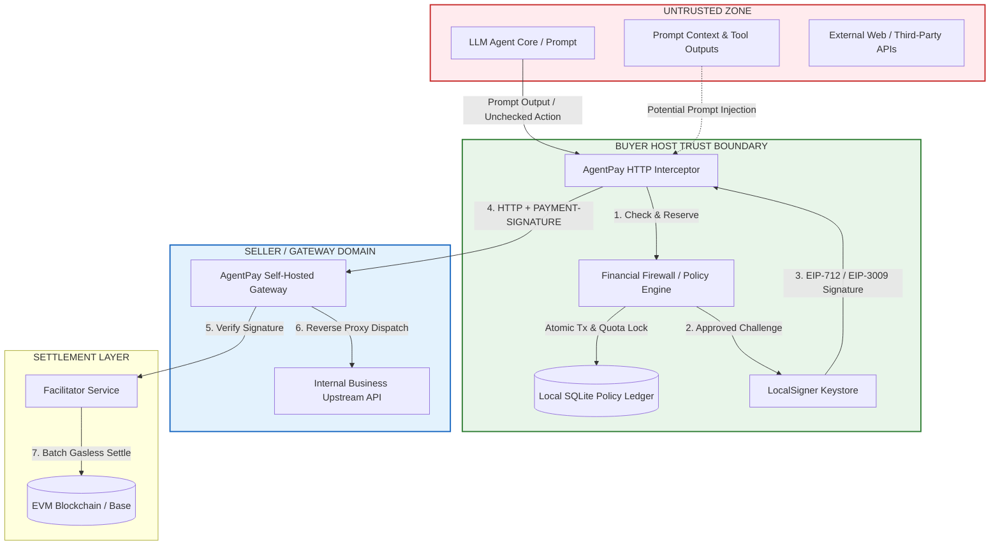

# AgentPay Security & Threat Model Specification (v0)

> **Specification Version:** 1.1.0 (Threat Model v0)  
> **Status:** Draft  
> **Target Runtimes:** Python SDK (`agentpay`), Self-hosted Gateway  
> **Task Tracking:** 2026 Plan Milestone M2 (Tasks T1.2, P0-4, P0-5, P1-7, P1-8, P1-9, P1-10)

---

## 1. System Context & Trust Boundaries

AgentPay operates at the boundary between non-deterministic Large Language Models (LLMs) and deterministic cryptographic financial networks.

### Trust Matrix

| Actor / Component | Trust Level | Rationale |
| :--- | :---: | :--- |
| **LLM Agent & Prompt Context** | ❌ **Untrusted** | Susceptible to prompt injection, jailbreaking, and hallucination. Must never hold or see raw private keys. |
| **Policy Engine (Firewall)** | 🛡️ **Trusted** | In-process deterministic code executing independently of model tokens. |
| **Local SQLite Ledger** | 🛡️ **Trusted** | Local filesystem storage operating under exclusive file locks (`WAL` + `BEGIN IMMEDIATE`). |
| **LocalSigner / Wallet** | 🛡️ **Trusted** | Memory-isolated signer; only signs pre-evaluated, valid EIP-712 payloads. |
| **Self-Hosted Gateway** | ⚖️ **Semi-Trusted** | Enforces price quotes and proxies requests; verified via Facilitator and HMAC hashes. |
| **External API / Third-Party Upstream** | ❌ **Untrusted** | Could return exorbitant 402 quotes, spoof headers, or drop connections post-payment. |
| **Facilitator Node** | ⚖️ **Semi-Trusted** | Verifies and batches signatures on-chain. Cannot steal funds because authorizations are payee-pinned. |

---

## 2. In-Scope Threats & Defenses (Buyer Domain - What Is Defended)

The v0 security architecture explicitly defends the Buyer against 7 threat vectors:

### T1: Financial Prompt Injection & Self-Granting
* **Defense:** LLM context possesses zero programmatic hooks to alter policy files, SQLite tables, or budget configurations. All checks execute via in-process deterministic Python code before invoking the private key.

### T2: Runaway Agent Infinite-Loop Drain
* **Defense:** Rolling RPM frequency circuit breaker (e.g. max 15 req/min) + hard 24h rolling budget pool. Trips to `OPEN` state upon burst detection.

### T3: Rogue Upstream Quote Gouging & Price Creep (P1-7)
* **Defense:** Hard `max_per_tx_base_units` integer comparison + strict payee/asset/network whitelisting. Optionally enforces resource price ceilings against sudden price inflation.

### T4: Cross-Chain & Cross-Contract Replay Attacks
* **Defense:** EIP-712 domain separator cryptographically binds `chainId` (e.g., `84532`) and `verifyingContract` (token address).

### T5: Signature Replay & Double-Spending
* **Defense:** EIP-3009 32-byte secure random nonce generated via `secrets.token_bytes(32)`. Gateway enforces unique `(network, asset, payer, nonce)`.

### T6: Delayed Submission & Arbitrage Hold
* **Defense:** Authorizations enforce strict expiration: $\text{validBefore} = \text{validAfter} + 300\text{s}$. Expired authorizations are mathematically invalid on-chain.

### T7: Concurrent Budget Race Conditions
* **Defense:** Evaluated and locked inside an exclusive SQLite transaction (`BEGIN IMMEDIATE`). Quota is moved to `RESERVED` before signing.

---

## 3. Gateway Security & Inbound Threat Defenses (Gateway Domain, P0-5)

The self-hosted gateway explicitly defends against the following 5 seller-side threats:

| Threat Category | Description | Primary Defense |
| :--- | :--- | :--- |
| **G1: Front-Running Drain / Cancel Attack** | In "optimistic delivery", buyer receives data before settlement. A rogue buyer immediately transfers funds away or invokes `cancelAuthorization`. | 1. Gateway queries node RPC for buyer token balance during verification. 2. High-value routes offer `settle_before_deliver: true`. 3. Low-value micro-transactions accept small default risk. |
| **G2: Idempotency Cache Hijacking** | An attacker guesses or sniffs an `Idempotency-Key` and fetches paid response without paying. | Cache is strictly bound to `(payer_address, idempotency_key)`. Replay requests MUST carry a signature from the same `payer_address`. |
| **G3: SSRF & Internal Network Exposure** | Malicious HTTP requests attempt path traversal or internal IP routing via reverse proxy. | 1. Gateway routes defined strictly via static YAML upstream URLs. 2. Strips hop-by-hop headers and internal auth tokens. 3. Disallows HTTP redirects (`follow_redirects=False`) to private subnets. |
| **G4: 402 Challenge & Facilitator DoS Flood** | Attackers spam unauthenticated requests to exhaust Facilitator quota or CPU. | 1. Inbound IP rate limiting on 402 challenge generation. 2. Gateway employs circuit breaker on outgoing Facilitator `/v1/verify` calls. |
| **G5: Configuration Tampering** | Local file tampering with route prices or payee addresses. | Gateway YAML configuration loaded with read-only permissions (`chmod 400`) and validated on startup. |

---

## 4. Explicit Non-Goals for v0 (What Is Not Defended, P0-4, P1-10)

The following threats are **EXPLICITLY OUT OF SCOPE** for the v0 milestone:

| Threat Category | Status in v0 | Explanation & 2027 Mitigation Plan |
| :--- | :---: | :--- |
| **N1: Host Machine Root Compromise** | ❌ **Not Protected** | If an attacker has root access or reads memory, they can extract plaintext keys from `LocalSigner`. *2027 Plan:* Hardware security modules (HSM) and Cloud KMS signers. |
| **N2: Economic Waste within Budget Quota** | ❌ **Not Protected** | If an agent spends $0.001 within allowed budget on a whitelisted API that produces useless answers, AgentPay cannot judge semantic quality. |
| **N3: Semantic Data Quality / Garbage Upstream** | ❌ **Not Protected** | If an upstream API returns HTTP 200 with invalid or hallucinated data, AgentPay verifies payment delivery, not content truthfulness. |
| **N4: Facilitator Complete Denial of Service (DoS)** | ❌ **Not Protected** | If all Facilitator nodes go offline, transactions cannot settle on-chain. Buyer funds are safe (not stolen), but payment flow halts. |
| **N5: Unsupported Token Contracts** | ❌ **Not Protected** | Tokens that lack native EIP-3009 (`transferWithAuthorization`) support cannot be settled gaslessly. v0 strictly targets standard USDC-compatible contracts. |
| **N6: Malicious In-Process Tools (P0-4)** | ❌ **Not Protected** | In the v0 embedded library mode, the LLM runtime and the SDK share a Python process. A tool with arbitrary code execution (`eval`) or arbitrary file read/write can bypass the interceptor. *2027 Plan:* Isolated out-of-process local sidecar daemon running under a dedicated OS user. |

---

## 5. Fundamental Invariants & Operational Rules

### Invariant 1: Anti-Overspend Rule (P0-1, P1-9)
* Once an intent enters `SIGNATURE_SENT`, network failure **CANNOT** automatically trigger quota release. Quota remains `RESERVED` until `now > validBefore + 60s` **AND** on-chain authorization state is proven unspent.

### Invariant 2: Single-Ledger Invariant (P0-4)
* **One private key corresponds to exactly one SQLite ledger file.** Running multiple Agent processes using the same wallet key against separate SQLite files will result in budget multiplication and is strictly prohibited.

### Invariant 3: Fail-Closed Default
* In any circumstance of database lock failure, serialization error, or unhandled exception within the Policy Engine, **the transaction MUST default to REJECTED**.
