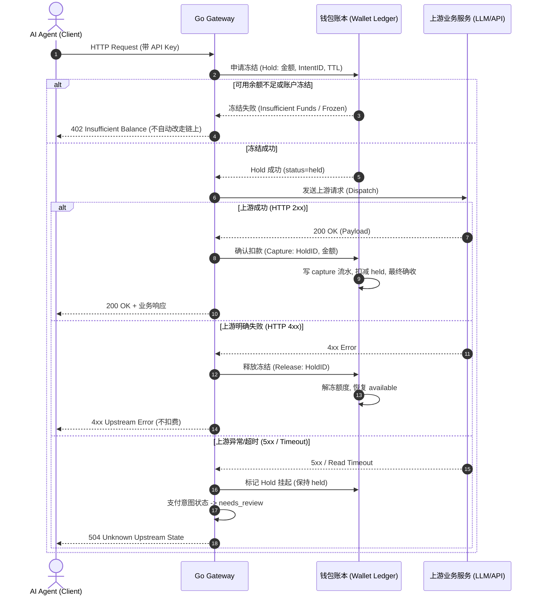

# AgentPay 内部虚拟钱包与账本规范 (T1.7 Specification)

> **版本**：v1.0.0 (T1.7 统一规范)  
> **状态**：**已定稿 (Approved Specification)**  
> **前置任务**：T0.1 / T0.2 (基线已冻结) / T1.1 (统一状态机)  
> **适用范围**：控制面管理系统、Go Gateway 数据面、消费与充值对账模块  

---

## 1. 目标与范围

为了降低 Agent 频繁上链结算的高 Gas 成本与网络延迟，AgentPay 支持**平台内部虚拟钱包（Internal Virtual Wallet）与双轨记账账本**：
- 用户/租户无需每笔请求发起链上交易，可直接通过内部虚拟钱包账户余额极速扣费；
- **v1 核心范围**：租户账户体系、只追加不可变流水账本（Append-Only Ledger）、冻结（Hold）/ 确认扣费（Capture）/ 释放（Release）机制、三种充值渠道统一抽象、日终/准实时自动对账；
- **v1 明确范围外**：v1 明确**不支持提现（No Withdrawal）**、不支持用户间相互转账、不支持利息与跨币种兑换，以最小化金融合规与资金托管风险。

---

## 2. 核心架构决策（W1–W6 已拍定）

| 决策编号 | 核心事项 | 确定方案 | 决策依据与安全考量 |
|---|---|---|---|
| **W1** | **钱包归属层级** | **租户级（Tenant-level）** | 每个租户拥有且仅拥有一个主钱包账户。子项目（Project）不设独立子钱包，而是通过 T3.4 的租户项目限额与预算策略控制子项目额度，避免资金碎片化。 |
| **W2** | **计价单位与资产** | **整数最小单位 + 单一资产代码** | v1 仅支持一种核心计价资产（如 `USDC`，6 位小数整数，1 USDC = 1,000,000 base units）。**严禁使用 float**。 |
| **W3** | **冻结超时 (Hold TTL)** | **`upstream_timeout + 60s`** | 默认 120 秒。必须覆盖上游 API 的最大超时时间加上网络安全抖动余量。 |
| **W4** | **履约未知 (Unknown) 处理** | **保持冻结并转 `needs_review`** | 上游 5xx 或连接中断时，冻结保持锁定，**既不自动扣费也不自动释放**，防止恶意重试双花或白白损失服务。 |
| **W5** | **支付方式选择与降级** | **凭证路由，严禁自动降级** | 客户端携带有效 API Key 且路由策略允许 wallet 时走钱包；携带 x402 签名载荷走链上。**钱包余额不足时直接返回 `402 Insufficient Funds`，严禁静默改走链上**。 |
| **W6** | **欠费与负余额处置** | **欠费冻结（`frozen_arrears`）** | 发生法币拒付或冲正致使余额为负时，账户状态变更为 `frozen_arrears`，系统拒绝一切新 Hold 请求，直至充值补足。 |

---

## 3. 数据模型定义

### 3.1 钱包主账户 (`Wallet`)
每个租户全局唯一的资金容器。

| 字段 | 类型 | 约束 | 说明 |
|---|---|---|---|
| `wallet_id` | `VARCHAR(64)` | PK | 钱包唯一标识（`wal_...`） |
| `tenant_id` | `VARCHAR(64)` | UNIQUE, NOT NULL | 归属租户 ID |
| `asset` | `VARCHAR(16)` | NOT NULL | 资产代码（v1 固定为 `USDC`） |
| `status` | `VARCHAR(32)` | NOT NULL | `active`（正常）、`frozen`（管理员冻结）、`frozen_arrears`（欠费冻结）、`closed`（注销） |
| `version` | `BIGINT` | NOT NULL | 乐观锁版本号（并发控制） |
| `available_cache` | `BIGINT` | NOT NULL | 可用余额缓存（以流水重新计算为准） |
| `held_cache` | `BIGINT` | NOT NULL | 冻结金额缓存（以状态为 held 的 Hold 之和为准） |
| `created_at` | `TIMESTAMPTZ` | NOT NULL | 创建时间（带时区时间戳） |
| `updated_at` | `TIMESTAMPTZ` | NOT NULL | 更新时间（带时区时间戳） |

### 3.2 只追加账本流水 (`LedgerEntry`)
不可修改、不可删除的不可变金融流水底账。

| 字段 | 类型 | 约束 | 说明 |
|---|---|---|---|
| `entry_id` | `VARCHAR(64)` | PK | 流水唯一标识（`ent_...`） |
| `wallet_id` | `VARCHAR(64)` | FK, NOT NULL | 归属钱包 ID |
| `tenant_id` | `VARCHAR(64)` | NOT NULL | 归属租户 ID |
| `type` | `VARCHAR(32)` | NOT NULL | `topup_credit`（充值入账）、`capture`（扣费入账）、`hold_release`（解除冻结）、`adjustment`（管理员调账）、`reversal`（冲正回滚） |
| `amount` | `BIGINT` | NOT NULL | 变动金额整数（正数增余额，负数减余额） |
| `idempotency_key`| `VARCHAR(128)`| NOT NULL | 同一钱包内唯一约束，防止重复记账 |
| `ref_type` | `VARCHAR(32)` | NOT NULL | 关联对象类型（`TopUpOrder`、`PaymentIntent`、`Hold`） |
| `ref_id` | `VARCHAR(64)` | NOT NULL | 关联业务 ID |
| `operator_id` | `VARCHAR(64)` | NULL | 操作者 ID（人工调账时必填） |
| `reason` | `TEXT` | NULL | 调账原因说明（人工调账时必填） |
| `created_at` | `TIMESTAMPTZ` | NOT NULL | 记账时间（带时区时间戳） |

### 3.3 资金冻结凭单 (`Hold`)
请求生命周期内的临时配额锁定凭单。

| 字段 | 类型 | 约束 | 说明 |
|---|---|---|---|
| `hold_id` | `VARCHAR(64)` | PK | 冻结唯一标识（`hld_...`） |
| `wallet_id` | `VARCHAR(64)` | FK, NOT NULL | 归属钱包 ID |
| `payment_intent_id`| `VARCHAR(64)`| UNIQUE, NOT NULL | 绑定的支付意图 ID |
| `amount` | `BIGINT` | NOT NULL | 冻结金额（最小单位正整数） |
| `status` | `VARCHAR(32)` | NOT NULL | `held`（冻结中）、`captured`（已扣款）、`released`（已全额释放）、`expired`（已超时过期） |
| `expires_at` | `TIMESTAMPTZ` | NOT NULL | 冻结到期时间（带时区时间戳） |
| `created_at` | `TIMESTAMPTZ` | NOT NULL | 创建时间（带时区时间戳） |

### 3.4 统一充值单 (`TopUpOrder`)
三类充值渠道共用的充值凭证。

| 字段 | 类型 | 约束 | 说明 |
|---|---|---|---|
| `topup_id` | `VARCHAR(64)` | PK | 充值单唯一标识（`top_...`） |
| `wallet_id` | `VARCHAR(64)` | FK, NOT NULL | 充值目标钱包 |
| `tenant_id` | `VARCHAR(64)` | NOT NULL | 租户 ID |
| `channel` | `VARCHAR(32)` | NOT NULL | `admin_grant`（管理员发放）、`onchain_deposit`（链上充值）、`fiat`（法币充值） |
| `amount` | `BIGINT` | NOT NULL | 充值金额最小单位正整数 |
| `asset` | `VARCHAR(16)` | NOT NULL | 充值币种（`USDC`） |
| `status` | `VARCHAR(32)` | NOT NULL | `created`、`pending`、`confirmed`、`failed`、`expired`、`reversed` |
| `external_ref` | `VARCHAR(128)`| NULL | 链上 tx_hash 或第三方网关交易流水号 |
| `created_at` | `TIMESTAMPTZ` | NOT NULL | 下单时间（带时区时间戳） |

---

## 4. 核心记账法则与安全不变量

1. **可用余额守卫 (Non-Negative Available Invariant)**：
   - 任何时刻：`available = 累积入账总额 - 累积确认扣款总额 - 当前 held 总额`。
   - 发起 Hold 冻结时，必须验证 `available >= request_amount`；若不足则立即拒绝。
2. **账本只追加 (Append-Only Invariant)**：
   - `LedgerEntry` 严禁任何 `UPDATE` 或 `DELETE` 操作；更正历史错误必须通过生成 `reversal` 或 `adjustment` 的新流水追加实现。
3. **强幂等记账 (Idempotency Invariant)**：
   - 同一 `idempotency_key` 在相同 `wallet_id` 范围内只能有一笔有效流水，重复请求直接返回初次记账记录。
4. **强行级锁 / 条件版本更新 (Concurrency Control)**：
   - 生产数据库（PostgreSQL）执行余额冻结与扣款必须使用行级悲观锁：
     ```sql
     SELECT * FROM ap_wallet WHERE wallet_id = $1 FOR UPDATE;
     ```
   - 或者使用严格条件更新版本号：
     ```sql
     UPDATE ap_wallet 
     SET available_cache = available_cache - $amount, held_cache = held_cache + $amount, version = version + 1 
     WHERE wallet_id = $1 AND available_cache >= $amount AND version = $current_version;
     ```

---

## 5. 钱包支付完整链路与状态流转



---

## 6. 充值渠道三阶段推进策略

| 阶段 | 渠道 | 核心业务流 | 防范风险与合规边界 |
|---|---|---|---|
| **Phase 1 (v1)** | **管理员发放 (`admin_grant`)** | 具备管理员权限的角色通过控制台或 API 录入充值单，系统立即写入 `topup_credit` 流水 | 必须强制记录 `operator_id` 与 `reason`，纳入审计日志（T1.5），防止越权与滥发。 |
| **Phase 2 (v1.x)**| **链上充值 (`onchain_deposit`)** | 租户向指定收款地址转入 USDC，网关监听入账事件并在达到所需确认数（1 确认）后以 `tx_hash` 为幂等键入账 | 防范链上重组回滚、错币种充值、重复入账；异常充值转人工处理。 |
| **Phase 3 (之后)** | **法币充值 (`fiat`)** | 接入合规第三方支付网关（Stripe / 支付宝 / 微信），接收 Webhook 验签回调后入账 | 回调严格验签；若遭遇拒付退款，触发 `reversal` 冲正流水，余额不足扣减时触发 W6 `frozen_arrears` 冻结。 |

---

## 7. 账本对账与一致性检查 (T5.7 基准)

系统定时任务（每小时/每日）自动执行五重对账平账检查：
1. **流水余额重算核对**：`SUM(LedgerEntry) == Wallet.available_cache + Wallet.held_cache`；
2. **冻结单完整核对**：所有处于 `held` 状态的 Hold 记录金额之和精确等于 `Wallet.held_cache`；
3. **充值单一对一核对**：每个状态为 `confirmed` 的 `TopUpOrder` 严格对应一条且仅一条 `topup_credit` 流水；
4. **扣款与交付核对**：每个 `captured` 的 Hold 严格对应一条结算记录与一条 2xx 履约记录；
5. **僵尸冻结探测**：`now > expires_at` 且依然处于 `held` 状态的记录为 0。
