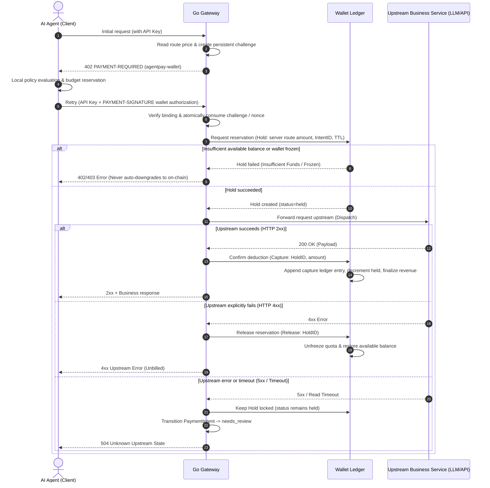

# AgentPay Internal Virtual Wallet & Ledger Specification (T1.7 Specification)

> **Version**: v1.0.0 (T1.7 Unified Specification)  
> **Status**: **Approved Specification**  
> **Prerequisites**: T0.1 / T0.2 (Frozen baseline) / T1.1 (Unified State Machine)  
> **Scope**: Control Plane Management System, Go Gateway Data Plane, Consumption & Top-Up Reconciliation Modules  

---

## 1. Goals & Scope

To eliminate high gas costs and blockchain confirmation latency for high-frequency Agent calls, AgentPay provides an **Internal Virtual Wallet and Dual-Rail Accounting Ledger**:
- Users and tenants can settle requests instantaneously against their internal virtual wallet balance without broadcasting an on-chain transaction for every API call.
- **v1 Core Scope**: Tenant account hierarchy, append-only immutable financial ledger (`Append-Only Ledger`), `Hold` / `Capture` / `Release` lifecycle, unified abstraction across three top-up channels, and automated end-of-day / near-real-time reconciliation.
- **Explicitly Out of Scope for v1**: v1 explicitly **does not support withdrawals (`No Withdrawal`)**, peer-to-peer transfers between users, interest accrual, or cross-currency exchange, minimizing financial regulatory and custodial exposure.

---

## 2. Core Architectural Decisions (W1–W6 Finalized)

| Decision ID | Core Topic | Finalized Design | Rationale & Security Considerations |
|---|---|---|---|
| **W1** | **Wallet Ownership Granularity** | **Tenant-Level** | Each tenant owns exactly one primary wallet account. Sub-projects (`Project`) do not maintain separate sub-wallets; instead, project-level quotas and spending policies (T3.4) govern project expenditure, preventing fund fragmentation. |
| **W2** | **Base Currency & Precision** | **Single Tenant Base Currency + 6-Decimal Micro-Unit Integers** | A tenant selects a single base fiat currency (`CNY`, `USD`, or `EUR`) upon registration, initializing a primary wallet in that currency that is permanently locked once ledger entries occur (see [`currency-and-multichain-spec.md`](./currency-and-multichain-spec.md)). The internal ledger uses a fixed 6-decimal integer precision (`1 CNY/USD/EUR = 1,000,000 base units`); **floating-point types are strictly prohibited**. |
| **W3** | **Reservation Timeout (Hold TTL)** | **`upstream_timeout + 60s`** | Defaults to 120 seconds. Must cover the maximum upstream API timeout plus a safety margin for network jitter. |
| **W4** | **Ambiguous Fulfillment (`unknown`) Handling** | **Keep Hold Locked & Escalate to `needs_review`** | Upon an upstream 5xx error or unexpected connection drop, the reservation remains locked—**neither auto-captured nor auto-released**—preventing malicious retry double-spending or unbilled service loss. |
| **W5** | **Payment Method Selection & Fallback** | **Challenge Negotiation; Auto-Downgrade Strictly Prohibited** | An initial request with an API Key receives an `agentpay-wallet` challenge; only after the client's local policy approves and retries with `PAYMENT-SIGNATURE` does the gateway place a wallet Hold. On-chain payments continue using EIP-3009. **When wallet balance is insufficient, the gateway immediately returns `402 Insufficient Funds` and never silently falls back to on-chain billing.** See [`agentpay-wallet-x402-extension.md`](./agentpay-wallet-x402-extension.md) for payload schemas and persistent replay protection. |
| **W6** | **Arrears & Negative Balance Handling** | **Arrears Freeze (`frozen_arrears`)** | If a fiat chargeback or reversal drives a wallet balance negative, the account transitions to `frozen_arrears` and blocks all new Hold requests until topped up. |

---

## 3. Data Model Definitions

### 3.1 Primary Wallet Account (`Wallet`)
Globally unique fund container per tenant.

| Column | Type | Constraints | Description |
|---|---|---|---|
| `wallet_id` | `VARCHAR(64)` | PK | Unique wallet identifier (`wal_...`) |
| `tenant_id` | `VARCHAR(64)` | UNIQUE, NOT NULL | Owning tenant ID |
| `asset` | `VARCHAR(16)` | NOT NULL | Tenant base currency code (`CNY`, `USD`, `EUR`, or legacy `USDC`) |
| `status` | `VARCHAR(32)` | NOT NULL | `active` (normal), `frozen` (admin freeze), `frozen_arrears` (arrears freeze), `closed` (decommissioned) |
| `version` | `BIGINT` | NOT NULL | Optimistic lock version number for concurrency control |
| `available_cache` | `BIGINT` | NOT NULL | Cached available balance (authoritatively derived from ledger entries) |
| `held_cache` | `BIGINT` | NOT NULL | Cached reserved balance (equal to the sum of Holds in `held` status) |
| `created_at` | `TIMESTAMPTZ` | NOT NULL | Creation timestamp with timezone |
| `updated_at` | `TIMESTAMPTZ` | NOT NULL | Last update timestamp with timezone |

### 3.2 Append-Only Ledger Entry (`LedgerEntry`)
Immutable financial ledger records that can never be modified or deleted.

| Column | Type | Constraints | Description |
|---|---|---|---|
| `entry_id` | `VARCHAR(64)` | PK | Unique ledger entry identifier (`ent_...`) |
| `wallet_id` | `VARCHAR(64)` | FK, NOT NULL | Owning wallet ID |
| `tenant_id` | `VARCHAR(64)` | NOT NULL | Owning tenant ID |
| `type` | `VARCHAR(32)` | NOT NULL | `topup_credit` (top-up credit), `capture` (deduction capture), `hold_release` (hold release), `adjustment` (admin adjustment), `reversal` (chargeback/reversal) |
| `amount` | `BIGINT` | NOT NULL | Signed integer balance delta (positive for credits, negative for debits) |
| `idempotency_key`| `VARCHAR(128)`| NOT NULL | Scoped unique constraint per wallet to prevent duplicate posting |
| `ref_type` | `VARCHAR(32)` | NOT NULL | Referenced entity type (`TopUpOrder`, `PaymentIntent`, `Hold`) |
| `ref_id` | `VARCHAR(64)` | NOT NULL | Referenced business entity ID |
| `operator_id` | `VARCHAR(64)` | NULL | Operator ID (mandatory for manual adjustments) |
| `reason` | `TEXT` | NULL | Adjustment reason (mandatory for manual adjustments) |
| `created_at` | `TIMESTAMPTZ` | NOT NULL | Ledger posting timestamp with timezone |

### 3.3 Fund Reservation Voucher (`Hold`)
Temporary quota reservation voucher scoped to a request lifecycle.

| Column | Type | Constraints | Description |
|---|---|---|---|
| `hold_id` | `VARCHAR(64)` | PK | Unique hold identifier (`hld_...`) |
| `wallet_id` | `VARCHAR(64)` | FK, NOT NULL | Owning wallet ID |
| `payment_intent_id`| `VARCHAR(64)`| UNIQUE, NOT NULL | Bound payment intent ID |
| `amount` | `BIGINT` | NOT NULL | Reserved amount (positive integer in base units) |
| `status` | `VARCHAR(32)` | NOT NULL | `held` (active reservation), `captured` (deducted), `released` (returned in full), `expired` (timed out) |
| `expires_at` | `TIMESTAMPTZ` | NOT NULL | Reservation expiration timestamp with timezone |
| `created_at` | `TIMESTAMPTZ` | NOT NULL | Creation timestamp with timezone |

### 3.4 Unified Top-Up Order (`TopUpOrder`)
Shared top-up voucher across all three funding channels. External fiat top-ups (`fiat`) are converted into 6-decimal wallet base units upon crediting via $\text{amount} = \text{payment\_minor\_amount} \times 10^{6 - \text{iso\_decimals}}$.

| Column | Type | Constraints | Description |
|---|---|---|---|
| `topup_id` | `VARCHAR(64)` | PK | Unique top-up order identifier (`top_...`) |
| `wallet_id` | `VARCHAR(64)` | FK, NOT NULL | Target wallet ID |
| `tenant_id` | `VARCHAR(64)` | NOT NULL | Owning tenant ID |
| `channel` | `VARCHAR(32)` | NOT NULL | `admin_grant` (admin grant), `onchain_deposit` (on-chain deposit), `fiat` (fiat payment) |
| `amount` | `BIGINT` | NOT NULL | Credited wallet amount (positive 6-decimal integer in base units) |
| `asset` | `VARCHAR(16)` | NOT NULL | Credited base currency (`CNY`, `USD`, `EUR`, matching `Wallet.asset`) |
| `payment_currency` | `VARCHAR(16)` | NULL | Actual currency paid on the external channel (e.g., WeChat `'CNY'`, Stripe `'USD'`, or on-chain `'USDC'`) |
| `payment_minor_amount` | `BIGINT` | NULL | Raw minor-unit amount on the external payment channel (e.g., fen for CNY or cents for USD) |
| `status` | `VARCHAR(32)` | NOT NULL | `created`, `pending`, `confirmed`, `failed`, `expired`, `reversed` |
| `external_ref` | `VARCHAR(128)`| NULL | On-chain `tx_hash` or third-party payment gateway transaction ID |
| `created_at` | `TIMESTAMPTZ` | NOT NULL | Order creation timestamp with timezone |

---

## 4. Core Accounting Rules & Safety Invariants

1. **Non-Negative Available Balance Invariant**:
   - At all times: `available = sum(credits) - sum(captured debits) - sum(active holds)`.
   - Every Hold request must verify `available >= request_amount` and reject immediately if insufficient.
2. **Append-Only Ledger Invariant**:
   - `LedgerEntry` strictly prohibits `UPDATE` or `DELETE` operations; historical corrections must be recorded by appending new `reversal` or `adjustment` entries.
3. **Idempotent Posting Invariant**:
   - Each `idempotency_key` may produce at most one valid ledger entry within a given `wallet_id`; duplicate requests return the original entry.
4. **Row-Level Locking / Conditional Version Updates (Concurrency Control)**:
   - Production PostgreSQL balance reservations and deductions must acquire a pessimistic row lock:
     ```sql
     SELECT * FROM ap_wallet WHERE wallet_id = $1 FOR UPDATE;
     ```
   - Or enforce a conditional optimistic version update:
     ```sql
     UPDATE ap_wallet 
     SET available_cache = available_cache - $amount, held_cache = held_cache + $amount, version = version + 1 
     WHERE wallet_id = $1 AND available_cache >= $amount AND version = $current_version;
     ```

---

## 5. End-to-End Wallet Payment Flow & State Transitions



---

## 6. Three-Phase Top-Up Channel Rollout Strategy

| Phase | Channel | Core Business Flow | Risk Mitigation & Compliance Boundary |
|---|---|---|---|
| **Phase 1 (v1)** | **Admin Grant (`admin_grant`)** | Authorized administrators submit a grant order via the console or API, immediately appending a `topup_credit` ledger entry | Mandatorily records `operator_id` and `reason` in the audit trail (T1.5) to prevent privilege abuse or unauthorized issuance. |
| **Phase 2 (v1.x)**| **On-Chain Deposit (`onchain_deposit`)** | Tenant transfers USDC to a designated deposit address; gateway monitors inbound transfers and credits the wallet using `tx_hash` as the idempotency key after reaching required confirmations (1 block) | Protects against chain reorgs, wrong-asset deposits, and double-crediting; anomalous deposits escalate to manual review. |
| **Phase 3 (Future)** | **Fiat Top-Up (`fiat`)** | Integrates compliant third-party payment gateways (Stripe / Alipay / WeChat Pay) and credits the wallet upon verified Webhook callbacks | Enforces strict webhook signature verification; chargebacks trigger a `reversal` entry and transition the wallet to `frozen_arrears` (W6) if balance turns negative. |

---

## 7. Ledger Reconciliation & Consistency Checks (T5.7 Baseline)

Scheduled background jobs (hourly and daily) execute five automated reconciliation checks:
1. **Ledger Balance Recomputation**: `SUM(LedgerEntry) == Wallet.available_cache + Wallet.held_cache`.
2. **Active Hold Sum Check**: The sum of all `Hold` records in `held` status equals `Wallet.held_cache` exactly.
3. **One-to-One Top-Up Verification**: Every `TopUpOrder` in `confirmed` status maps to exactly one `topup_credit` ledger entry.
4. **Capture-to-Delivery Verification**: Every `captured` Hold maps to exactly one settlement record and one 2xx fulfillment record.
5. **Zombie Hold Detection**: Zero records remain in `held` status where `now > expires_at`.
