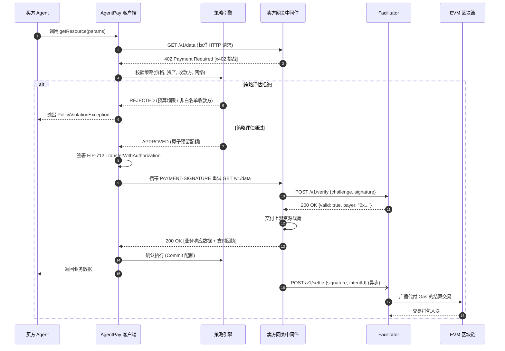
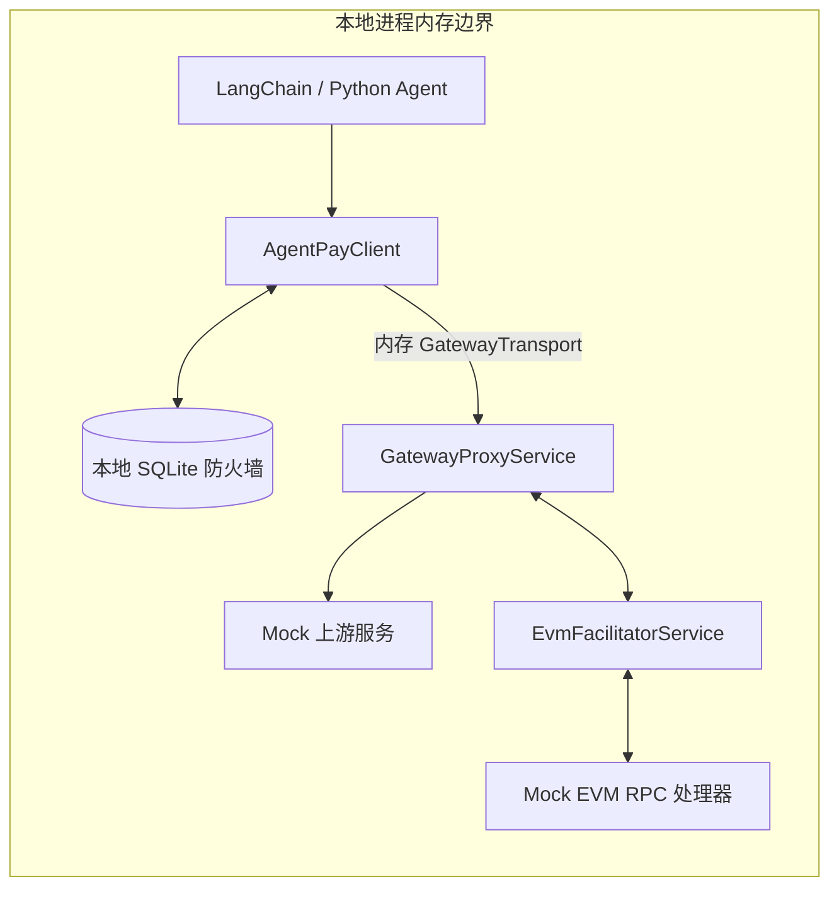

# AgentPay 架构规范

## 1. 概述与架构目标

**AgentPay** 是面向自主 AI Agent 的开源非托管金融基础设施与安全防护层。它基于 **x402 V2** 协议标准化了 HTTP 微支付流程，并集成了独立于模型之外的**金融防火墙（策略引擎）**，防止因 AI 幻觉、无限循环调用及未授权交易导致的资金损失。

### 核心设计原则
1. **对 AI 自主行为零信任（Zero-Trust）：** AI 模型只能提议交易，密码学签名与支付执行严格发生在独立于 LLM 的确定性策略边界之后。
2. **解耦的异步生命周期：** 将高层支付意图（Intent）、区块链共识结算（Settlement）与下游业务履约（Fulfillment）正交解耦，抵御网络超时引发的状态不一致。
3. **跨语言等价性（路线图）：** 由规范驱动的一致性测试向量确保当前 Python/Go 实现及规划中的多语言 SDK 在协议、状态机与密码学行为上 100% 确定性对齐。
4. **免 Gas 微支付结算：** 采用 EIP-712 / EIP-3009 签名授权。买方 Agent 无需持有任何原生 Gas 代币（ETH/MATIC 等），Gas 由 Facilitator 节点代付并完成链上结算。

---

## 2. 系统拓扑与核心组件

```mermaid
graph TB
    subgraph Buyer Ecosystem [买方域 (Buyer Domain)]
        Agent[自主 AI Agent / LLM]
        Client[AgentPay 客户端拦截器]
        PolicyEngine[金融防火墙 / 策略引擎]
        KeyStore[钱包 / KMS 签名器]
        
        Agent -->|HTTP 请求| Client
        Client -->|校验单笔限额与预算| PolicyEngine
        PolicyEngine -->|批准并预留配额| Client
        Client -->|请求签名| KeyStore
        KeyStore -->|EIP-712 签名| Client
    end

    subgraph Seller Ecosystem [卖方 / 服务提供方域]
        Gateway[API 网关 / 卖方中间件]
        SellerDB[(卖方 PostgreSQL)]
        ResourceService[核心业务 API / 资源服务]
        
        Gateway -->|校验幂等与凭证| SellerDB
        Gateway -->|验证通过后分发| ResourceService
    end

    subgraph Infrastructure [结算与协同基础设施]
        Facilitator[Facilitator 结算服务]
        FacilitatorDB[(Facilitator PostgreSQL)]
        ReconciliationWorker[对账与故障恢复 Worker]
        Chain[(EVM 区块链: Base / Arbitrum)]
        
        Facilitator -->|管理 Nonce 与交易队列| FacilitatorDB
        Facilitator -->|广播结算交易| Chain
        ReconciliationWorker -->|探测挂起交易与重组| Chain
    end

    Client -->|1. 初始请求| Gateway
    Gateway -->|2. HTTP 402 + 挑战载荷| Client
    Client -->|3. 重试请求 + PAYMENT-SIGNATURE| Gateway
    Gateway -->|4. 校验签名与 Nonce| Facilitator
    Facilitator -->|5. 签名有效| Gateway
    Gateway -->|6. 返回付费资源 200 OK| Client
    Gateway -->|7. 提交结算| Facilitator
```

### 组件角色与职责

| 组件 | 核心职责 |
| :--- | :--- |
| **Buyer Agent（买方 Agent）** | 发起工具、API 与数据源 HTTP 调用的上层 Agent 运行时或业务脚本。 |
| **AgentPay Client Interceptor（客户端拦截器）** | 透明的 HTTP 客户端封装：自动捕获 `402 Payment Required`、触发策略评估、收集 EIP-712 签名并重放请求。 |
| **Policy Engine（金融防火墙）** | 独立安全引擎：强制执行频率限制、单笔上限、24 小时滚动预算与收款方白名单。 |
| **Gateway / Seller Proxy（网关代理）** | 高性能 Go 反向代理（`gateway-go`）：拦截入站请求、签发 x402 挑战、管理虚拟钱包预留并协调验签。 |
| **Facilitator Service（结算服务）** | 高性能结算网关：校验链下 EIP-712/3009 签名、代付 Gas 并提交链上结算交易。 |
| **Reconciliation Worker（对账恢复服务）** | 异步巡检服务：轮询未确认结算、修复网络分区后的未知状态并触发自动恢复流程。 |

---

## 3. 协议与标准基线

1. **x402 V2 协议：**
   * **挑战响应头（Challenge Header）：** `PAYMENT-REQUIRED`，携带 Base64/JSON 编码的挑战载荷，包含支持的支付方案、网络、代币合约地址、价格与过期时间戳。
   * **授权请求头（Authorization Header）：** `PAYMENT-SIGNATURE`，包含付款方地址、Nonce、过期时间、签名类型（`EIP-712` 或 `EIP-3009`）及原始密码学签名。
2. **CAIP-2 链标识符：**
   * 标准化链命名空间（例如 Base 主网为 `eip155:8453`，Base Sepolia 为 `eip155:84532`，Arbitrum Sepolia 为 `eip155:421614`）。
3. **EIP-712 与 EIP-3009 授权：**
   * 类型安全的结构化签名（`TransferWithAuthorization` / `ReceiveWithAuthorization`）。
   * 消除传统 ERC-20 `approve` + `transferFrom` 两步交易的 Gas 开销。
4. **幂等性标准：**
   * 每笔支付请求均携带 `Idempotency-Key`（UUIDv4）请求头与确定性 SHA-256 载荷摘要。
5. **EIP-1559 动态费用与代付机制：**
   * Facilitator 结算广播默认采用 EIP-1559（Type 2）交易并设置 1.5 倍 `baseFee` 安全缓冲（$\text{maxFeePerGas} = \max(\lfloor \text{baseFee} \times 1.5 \rfloor + \text{priorityFee},\; \lfloor \text{gasPrice} \times 1.35 \rfloor + \text{priorityFee})$），在不增加实际 Gas 消耗的前提下彻底防止区块 BaseFee 瞬时波动导致的拒单，并支持向 Legacy Type 0 交易自适应回退（详见 [gas-cost-and-settlement-models.md](./gas-cost-and-settlement-models.md)）。

---

## 4. 端到端支付时序流



---

## 5. 技术栈与多语言路线图

在满足不同运行时需求的同时保证协议行为严格一致：

### 5.1 当前实现（v0.1.x 基线）
* **Go 反向代理网关 (`services/gateway/`)：** 高吞吐云原生反向代理、内嵌策略引擎、多租户虚拟钱包与账本、低延迟 EIP-712 验签（`geth/crypto`）、结构化日志与极小容器镜像体积。
* **Python 客户端 SDK (`sdk/python/packages/agentpay`)：** 面向主流 AI Agent 与 LLM 框架生态（LangChain、CrewAI、AutoGen、LlamaIndex），提供透明 HTTP 拦截器（`httpx`、`aiohttp`）与原生 MCP 工具封装。

### 5.2 多语言路线图（2027+）
* **TypeScript / Node.js 技术栈：** 面向 JS/TS AI Agent（浏览器、Bun、MCP Server）及 Next.js / Express 微服务。
* **Java 技术栈：** 面向企业级金融后端与 Spring Cloud 网关。

### 5.3 共享一致性测试向量 (`specs/conformance/test-vectors/`)
* 跨 `eth-account`/`web3.py`（Python）、`go-ethereum`（Go）及未来 SDK 的 EIP-712 Domain Separator 序列化测试。
* x402 V2 挑战解析器与签名编码器测试。
* 状态机迁移边界条件测试。
* 带 64 位整数溢出保护的策略预算扣减数学验证。

---

## 6. Gas 经济学与结算代付模型

在 EIP-3009 元交易（`transferWithAuthorization`）机制下，买方 Agent 在密码学层面完全免 Gas（仅需持有 USDC 等支付代币，0 ETH 要求），而由链上交易调用方（`msg.sender` / Facilitator）支付矿工 Gas 费。

AgentPay 正式定义了三种结算代付模式（详见 [`specs/gas-cost-and-settlement-models.md`](./gas-cost-and-settlement-models.md)）：

1. **模式 1：卖方补贴型免 Gas 结算（2026 基线 - v0.1.0）：**
   * Facilitator 代付 L2 原生 Gas（Arbitrum Sepolia / Base Sepolia，每笔约 $0.001 - $0.005）；买方仅按 API 标价支付 USDC。
   * 适用于高毛利 API 与零摩擦 Agent 微支付。
2. **模式 2：动态 Gas 附加费补偿（2027 Q1 - v0.2.0）：**
   * 网关动态估算 EVM Gas + L1 数据费，通过预言机折算为 USDC 后附加到 Challenge `amount` 中；买方通过一次 USDC 签名同时支付服务费与 Gas 成本，全额补偿 Facilitator。
   * 适用于以太坊 L1、Gas 高峰期或低毛利算力透传 API。
3. **模式 3：批量聚合与状态通道延迟结算（2027 Q2 - v0.3.0）：**
   * 网关在链下校验授权并立即响应业务；Facilitator 通过批量合约或状态通道定期汇总上链。
   * 将单笔交易 Gas 摊薄 95% 以上，支持亚美分（$0.0001）级按 Token 流式微支付。

---

## 7. 部署拓扑架构

AgentPay 支持两种核心部署拓扑，分别面向研发测试阶段与生产多 Agent 运行环境：**本地嵌入式模拟沙箱**（快速开发与单测）与**云原生分布式架构**（生产 API 商业化与多租户网关）。

```
┌─────────────────────────────────────────────────────────────────────────────────────────┐
│                                 AgentPay 部署拓扑对比                                   │
├────────────────────────────────────────────┬────────────────────────────────────────────┤
│ 1. 本地嵌入式模拟拓扑 (Local Embedded)     │ 2. 云原生分布式拓扑 (Cloud-Native)         │
├────────────────────────────────────────────┼────────────────────────────────────────────┤
│ • 单进程 / 本地沙箱                        │ • 多层跨网络分布式部署                     │
│ • 内存级传输（零 TCP 网络开销）            │ • 买方 Agent 运行于本地或私有 VPC          │
│ • Mock EVM JSON-RPC（零 Gas / 免测试币）   │ • 卖方网关部署于公有云 / K8s               │
│ • 亚毫秒级 CI/CD 执行速度                  │ • 独立云端 Facilitator 结算节点            │
│ • 适用于单元测试、本地演示与离线开发       │ • 对接 Arbitrum/Base 测试网或主网          │
└────────────────────────────────────────────┴────────────────────────────────────────────┘
```

### 7.1 拓扑 1：本地嵌入式模拟沙箱

#### 架构特征
所有组件在单一本地运行时（进程或测试框架）内执行，彻底消除外部网络依赖：
* **买方 Agent 与客户端 SDK**：直接在本地 Python 运行时内执行。
* **金融防火墙**：`SQLitePolicyEngine` 基于内存数据库（`:memory:`）或本地临时 SQLite 文件（`buyer_wallet.db`）运行，提供完整的 ACID 两阶段预留。
* **传输层**：`AgentPayClient` 使用内存级 ASGI 传输通道（`GatewayTransport`），直接将 HTTP 请求路由至 `GatewayProxyService`，无需绑定 TCP 端口或经过操作系统防火墙。
* **Facilitator 与 EVM RPC**：由 `MockArbitrumSepoliaRpcHandler` 本地模拟以太坊 JSON-RPC 2.0 方法（`eth_sendRawTransaction`、`eth_getTransactionReceipt`、`eth_call`、`eth_estimateGas`），生成确定性的 32 字节交易哈希。



#### 核心适用场景
1. **自动化 CI/CD**：3 秒内跑完端到端集成与安全测试套件（`make check`，340+ 用例）。
2. **离线算法验证**：在无外网环境下测试 Agent 工具调用与熔断器触发逻辑。
3. **一键演示**：`make demo` 开箱即用运行该拓扑。

---

### 7.2 拓扑 2：云原生分布式架构

在真实生产环境中，买方与卖方运行在完全独立的信任域与网络域中，仅通过公网标准 HTTPS 通信。

```mermaid
graph TB
    subgraph Buyer Trust Domain [买方信任域 (本地环境 / 私有 Pod)]
        Agent[自主 AI Agent]
        Client[AgentPayClient SDK]
        Firewall[(本地金融防火墙<br/>SQLite / Redis)]
        KeyStore[买方钱包私钥<br/>LocalSigner / AWS KMS / Vault]
        
        Agent -->|1. 工具调用| Client
        Client <-->|3. 预算预留与策略校验| Firewall
        Client <-->|4. EIP-712 离线签名| KeyStore
    end

    subgraph Public Network [公网 HTTPS / 443 端口]
        Client -->|2. 初始请求| PublicGW
        Client -->|5. 携带 PAYMENT-SIGNATURE 重放| PublicGW
    end

    subgraph Seller / Platform Cloud Domain [卖方 / 平台云端域 (Kubernetes / VPC)]
        PublicGW[云端入口 / AgentPay 网关代理<br/>agentpay-gateway:443]
        SellerDB[(网关状态协调存储<br/>PostgreSQL / SQLite)]
        UpstreamAPI[受保护的内部微服务<br/>上游 REST / gRPC API]
        FacilitatorNode[云端 Facilitator 节点<br/>agentpay-facilitator:8001]
        FacilitatorKey[Facilitator Gas 钱包<br/>L2 ETH 代付密钥]

        PublicGW <-->|幂等与状态| SellerDB
        PublicGW -->|验证通过后转发| UpstreamAPI
        PublicGW -->|6. 校验签名| FacilitatorNode
        PublicGW -.->|8. 异步结算任务| FacilitatorNode
        FacilitatorNode <--> FacilitatorKey
    end

    subgraph Decentralized Ledger [去中心化账本 (EVM 区块链)]
        EVMNode[公共 EVM RPC 节点<br/>Alchemy / Infura / QuickNode]
        Chain[(Arbitrum Sepolia / Base<br/>Circle USDC 合约)]

        FacilitatorNode <-->|RPC 调用| EVMNode
        EVMNode -->|9. EIP-1559 广播| Chain
    end
```

#### 组件部署与安全边界

#### 1. 买方域（本地环境 / 买方 Kubernetes Pod）
* **零信任原则（私钥永不出本地信任域）**：
  买方私钥（`BUYER_PRIVATE_KEY`）严格保存在买方本地进程或安全密钥管理服务（KMS）中，**绝不**通过网络传输、绝不发送给网关，也绝不共享给 Facilitator。
* **本地金融防火墙强制拦截**：
  `SQLitePolicyEngine` 作为 AI Agent 的本地组件运行。当外部卖方网关返回 `HTTP 402 Payment Required` 时，防火墙在本地拦截挑战：
  * 校验单笔交易上限、24 小时滚动预算与 RPM 频率限制。
  * 若卖方网关索要异常高价（例如索要 $500 而非 $0.05），本地防火墙**立即在客户端中止请求**，零资金流出钱包，零网络请求触达区块链。
* **免 Gas 钱包体验**：
  买方钱包**仅需持有 Circle USDC**，无需准备任何原生 Gas 代币（ETH），彻底省去 Agent 开发者的多币种余额管理与自动补气运维负担。
* **客户端调用示例（标准 HTTPS）**：
  ```python
  # 买方客户端：通过公网 HTTPS 直接与云端网关通信
  signer = LocalSigner(os.environ["BUYER_PRIVATE_KEY"])
  policy = SQLitePolicyEngine(conn, config)
  # 默认 httpx 传输层通过标准公网 HTTPS 通信
  client = AgentPayClient(signer=signer, policy=policy)
  
  # 透明调用云端付费网关
  resp = client.get("https://api.seller.com/v1/market-data?ticker=NVDA")
  ```

#### 2. 卖方云端域（Kubernetes 集群 / 云端 VPC）
* **AgentPay 网关 (`agentpay-gateway`)**：
  * 部署在面向公网的云负载均衡器（SLB / Ingress / Nginx）443 端口之后。
  * 拦截未认证请求，根据 `gateway.yaml` 或数据库快照匹配路由，签发 x402 V2 挑战，并管理幂等租约。
  * 将验证通过的请求转发至位于私有 VPC 子网内的受保护上游微服务（`upstream`）。
* **Facilitator 结算服务 (`agentpay-facilitator`)**：
  * 作为内部微服务（如 `http://facilitator-service.internal:8001`）或托管服务部署。
  * 持有代付 Gas 的运营密钥（`FACILITATOR_PRIVATE_KEY`）。
  * 连接具备主备冗余的高可用 EVM RPC 节点（Alchemy、QuickNode、Infura 等）。
  * 执行链下签名校验与链上 Nonce 状态查询（`authorizationState`）。
  * 运行异步结算工作线程（`AsyncSettlementWorker`），将支付打包为带 1.5 倍动态 BaseFee 缓冲的 EIP-1559 Type-2 交易，确保稳定入块。

#### 云端网关配置示例 (`gateway.yaml`)：
```yaml
version: "1.0"

server:
  host: "0.0.0.0"
  port: 8000

# 云端 Facilitator 服务端点（VPC 内网地址）
facilitator:
  url: "http://facilitator-service.internal:8001"
  timeout_seconds: 5.0

# 路由商业化定价矩阵
routes:
  - path: "/v1/market-data"
    upstream: "http://market-service.production.svc.cluster.local:9000/v1/market-data"
    methods: ["GET"]
    price: "0.05 USDC"
    pay_to: "0x70997970C51812dc3A010C7d01b50e0d17dc79C8"
    network: "eip155:421614"                           # Arbitrum Sepolia
    asset: "0x75faf114eafb1BDbe2F0316DF893fd58CE46AA4d" # Circle USDC 合约

  - path: "/v1/ai/heavy-compute"
    upstream: "http://inference-service.production.svc.cluster.local:8080/compute"
    methods: ["POST"]
    price: "2.50 USDC"
    pay_to: "0x70997970C51812dc3A010C7d01b50e0d17dc79C8"
    network: "eip155:421614"
    asset: "0x75faf114eafb1BDbe2F0316DF893fd58CE46AA4d"
```

---

### 7.3 部署拓扑对比矩阵

| 评估维度 | 拓扑 1：本地嵌入式沙箱 | 拓扑 2：云原生分布式架构 |
| :--- | :--- | :--- |
| **主要运行环境** | 开发者本地工作站、CI/CD Runner | 云端 VPC、Kubernetes、Docker Swarm |
| **网络传输协议** | 内存 ASGI 通道（`GatewayTransport`） | 公网 HTTPS（TLS 1.3，443 端口） |
| **私钥存放位置** | 本地测试密钥（`LocalSigner`） | 买方本地 Agent Pod / KMS（绝不上传） |
| **防火墙位置** | 本地内存 / SQLite 文件 | 买方 Agent 本地 Sidecar（零信任边界） |
| **区块链目标** | 本地 EVM RPC 模拟器（零网络调用） | 公共测试网/主网（Arbitrum Sepolia / Base） |
| **买方 Gas 代币需求** | 零（模拟） | 零（EIP-3009 免 Gas 元交易） |
| **Facilitator 角色** | 同步内存 Mock 处理器 | 独立异步后台结算服务 |
| **结算延迟** | < 1 ms | 1.5 – 3.0 s（网络传输与出块时间） |
| **环境搭建成本** | 零配置（`make demo`） | 容器化部署（`docker compose` / K8s） |
