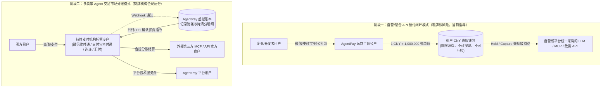
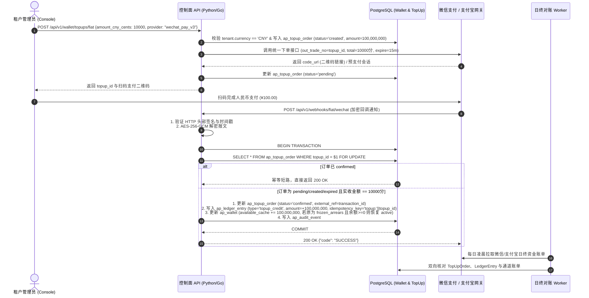
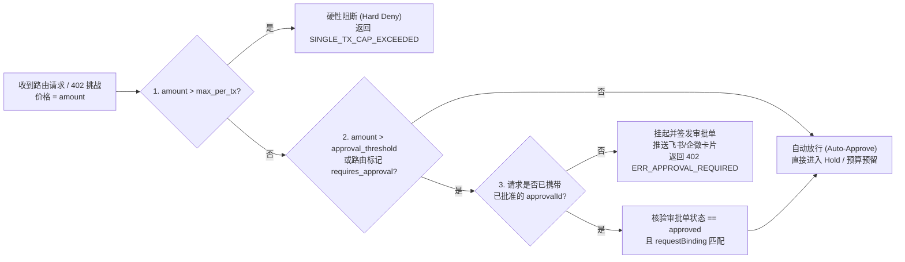
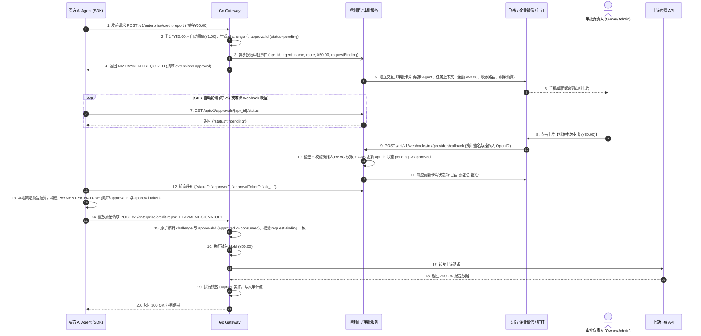

# AgentPay 国内版法币充值与飞书/企微审批扩展规范 (T3.8 & HITL Specification)

> **版本**：v1.0.0-draft (国内商业化与企业内控扩展规范)  
> **状态**：**产品规范与架构规划 (Planning & Product Specification)**  
> **关联任务**：T3.8（评估并实现法币充值）、T1.7（虚拟钱包与账本契约）、T1.9（多法币本位制规范）、T2.9（Gateway Agent 级策略执行）  
> **前置规范**：  
> - [`specs/zh/wallet-ledger-spec.md`](./wallet-ledger-spec.md) (T1.7 内部虚拟钱包与账本规范)  
> - [`specs/currency-and-multichain-spec.md`](../currency-and-multichain-spec.md) (T1.9 多法币虚拟钱包本位制规范)  
> - [`specs/agentpay-wallet-x402-extension.md`](../agentpay-wallet-x402-extension.md) (虚拟钱包 x402 协议扩展)  
> - [`specs/zh/payment-state-machine-v2.md`](./payment-state-machine-v2.md) (T1.1 统一支付状态机)  

---

## 1. 背景、目标与范围

### 1.1 背景与核心痛点
AgentPay 现有基线（v0.1.0 ~ v1.0）已完成了基于 `EIP-3009` 的链上免 Gas 结算以及基于 `agentpay-wallet` 的内部虚拟钱包账本（支持 `CNY` 6 位微单位精度与 `admin_grant` 管理员充值）。然而在国内商业化落地时，面临两大核心诉求：

1. **高频微支付与国内法币支付基建的断层**：国内企业与开发者使用人民币（`CNY`）结算，习惯使用微信支付、支付宝及企业对公转账，并需要合规的增值税发票与对账单；但传统移动支付最小单位为“1 分（`¥0.01`）”，且无法在 AI Agent 毫秒级 API 调用中逐笔拉起收银台。
2. **企业 AI 内控对“人在回路（Human-in-the-Loop, HITL）”的刚需**：现有策略引擎对超限请求采用“一刀切”直接拒绝（`SINGLE_TX_CAP_EXCEEDED`）。但在真实企业场景中，当 Agent 发起中高额调用（如单次购买 `¥50` 的企查查深度报告或启动高成本算力任务）时，企业希望**自动挂起请求并推送飞书/企业微信/钉钉审批卡片**，由负责人一键批准后继续执行，而非直接报错中断任务。

### 1.2 核心范围
- **法币充值与合规清分规划（T3.8）**：明确国内防“二清”合规架构、微信支付/支付宝/对公汇款三类充值通道抽象、异步 Webhook 验签与幂等入账、退款/拒付冲正（联动 W6 `frozen_arrears`）、日终三方对账及电子发票闭环。
- **飞书/企微/钉钉超额审批扩展（HITL Approval）**：定义策略引擎的三级审批梯度（自动放行 / 人工审批 / 硬顶阻断）、x402 `agentpay-wallet` 协议审批挑战扩展、IM 交互式卡片回调状态机，以及买方 SDK 的轮询/异步恢复机制。
- **阶段边界声明**：当前法币充值与 IM 审批处于**产品规范与架构规划阶段**，尚未在生产代码启用；本规范作为后续 T3.8 及企业版内控模块研发的唯一设计基线。

---

## 2. 核心架构决策（CN1–CN8）

| 决策编号 | 决策事项 | 确定方案 | 决策依据与合规/安全考量 |
| :--- | :--- | :--- | :--- |
| **CN1** | **合规模式与“二清”红线** | **阶段一采用闭环算力/API 预付消费；阶段二采用持牌机构空中分账** | 严守央行无证经营支付业务（“二清”）红线。v1 严禁余额提现与跨租户转账（延续 W1/T1.7），充值仅用于消耗本平台自营/聚合 API；未来多卖家市场必须接入微信电商收付通、支付宝直付通或持牌分账网关直接清分。 |
| **CN2** | **法币入账精度转换** | **外部以“分”收款，入账边界一次性乘 $10^4$ 转为 6 位微单位** | 延续 T1.9 规范：微信/支付宝以人民币“分（`iso_decimals = 2`）”交互，入账 `ap_ledger_entry` 时严格按 $\text{amount\_base\_units} = \text{payment\_minor\_amount} \times 10,000$ 转换为 6 位微单位整数，全程严禁 `float`。 |
| **CN3** | **充值单幂等与防重放** | **双层幂等键：`external_ref` + `uq_wallet_ledger_idempotency`** | 第三方支付渠道会多次重发 Webhook 通知。系统以 `topup:{topup_id}` 作为账本 `idempotency_key`，并在 `ap_topup_order` 强制校核实收币种与实收分位金额，杜绝重复入账与金额篡改。 |
| **CN4** | **退款与拒付处置** | **未消费可申请原路退回；发生通道侧强行退款/拒付则写入 `reversal` 并触发 `frozen_arrears`** | 严格对齐 T1.7 决策 W6：若外部支付通道发生管理员强制退款或拒付冲正，生成负数 `reversal` 流水；一旦导致 `available_cache < 0`，钱包立即转入 `frozen_arrears` 冻结一切新 Hold。 |
| **CN5** | **超额人工审批触发梯度** | **在 `max_amount_per_request` 之下增设软阈值 `approval_threshold_base_units`** | 将单笔风控拆为三档：$\le \text{threshold}$ 自动放行；$(\text{threshold}, \text{max\_per\_tx}]$ 触发飞书/企微审批；$> \text{max\_per\_tx}$ 直接硬拒绝，兼顾自动化效率与大额资金安全。 |
| **CN6** | **审批等待期间的连接管理** | **禁止在网关长连接中阻塞等待人工点击；采用“402 审批挑战 + 凭单轮询/重放”** | 人类审批耗时通常在数秒至数十分钟，若阻塞网关 HTTP 连接会导致 Goroutine 耗尽与上游连接雪崩。网关立即返回 `402 ERR_APPROVAL_REQUIRED` 与 `approval_id`，由客户端 SDK 轮询或接收回调后重放。 |
| **CN7** | **IM 审批卡片安全契约** | **回调强制验签 + 审批人 RBAC 校验 + CAS 单次状态迁移** | 飞书/企微卡片回调必须验证官方签名与时间戳（防重放窗口 300s），校验点击人是否具备该租户 `owner`/`admin` 审批权限，并通过数据库条件更新保证同一审批单只能被决议一次。 |
| **CN8** | **审批通过后的资金锁定期** | **审批通过仅签发一次性授权许可，实际扣款仍走标准 `Hold -> Capture` 流程** | 人工点击“批准”时不直接扣减余额（防止客户端已放弃请求导致白扣费），而是将审批单置为 `approved`；买方 SDK 携带已批准的 `approvalId` 重试时，网关再原子执行钱包 `Hold` 与上游调用。 |

---

## 3. 模块一：国内法币充值体系规范（T3.8 详细规划）

### 3.1 合规架构演进路径



### 3.2 支持的法币充值渠道矩阵

在 `ap_topup_order.channel = 'fiat'` 下，通过扩展 `provider` 字段支持国内三大主力充值方式：

| 渠道标识 (`provider`) | 交互形态 | 适用客群 | 最小充值额 | 到账时效 | 核心技术标准 |
| :--- | :--- | :--- | :---: | :---: | :--- |
| **`wechat_pay_v3`** | PC 端 Native 扫码支付 / 移动端 JSAPI | 个人开发者、中小团队 | `¥10.00` (`1000` 分) | 秒级（异步 Webhook） | 微信支付 API v3、`AEAD_AES_256_GCM` 报文解密、平台证书验签 |
| **`alipay_v3`** | 当面付扫码 / 电脑网站支付 | 个人开发者、中小企业 | `¥10.00` (`1000` 分) | 秒级（异步 Webhook） | 支付宝 OpenAPI v3、`RSA2` 异步通知验签 |
| **`bank_transfer`** | 线下对公网银汇款 + 识别码/水单核销 | 中大型企业客户（需开专票） | `¥1,000.00` (`100000` 分) | 银企直连准实时 / 人工审核 T+1 | 专属汇款附言码（`AP-TOP-{topup_id}`）+ 双人复核入账 |

### 3.3 法币充值端到端时序与状态流转



### 3.4 充值单状态机与异常守卫

1. **状态集合**：`created` $\to$ `pending` $\to$ `confirmed` / `expired` / `failed` $\to$ `reversed`。
2. **迟到回调恢复（Late Webhook Recovery）**：
   - 若充值单因超过 15 分钟未收到回调被定时任务标记为 `expired`，但随后收到了微信/支付宝验证通过的真实付款成功回调，系统**必须允许从 `expired` 跃迁至 `confirmed`** 并正常入账，严禁丢单吞款。
3. **金额与币种强一致性校验（Amount Tamper Guard）**：
   - 回调中的 `amount.payer_total`（或支付宝 `total_amount`）必须与 `ap_topup_order.payment_minor_amount` 完全相等，且币种必须为 `'CNY'`；若不一致，拒绝自动入账，将订单标记为 `failed` 并触发高优安全告警。
4. **冲正与欠费联动（Reversal & Arrears Protection）**：
   - 若发生渠道侧退款或拒付回调，在同一数据库事务中：
     1. 将 `ap_topup_order.status` 更新为 `reversed`；
     2. 插入一条 `type = 'reversal'`、`amount = -topup.amount`、`idempotency_key = 'rev:' || topup_id` 的只追加流水；
     3. 扣减 `ap_wallet.available_cache`；若扣减后 `available_cache < 0`，自动将 `ap_wallet.status` 置为 `frozen_arrears`（遵循 W6 决策），立即阻断该租户下所有 Agent 的新支付请求。

### 3.5 企业财务与电子发票闭环规划
为满足国内 B 端客户财务报销要求，法币充值模块配套规划“先消后开”与“充值即开”双模式发票工作流：
- **开票主体与类目**：支持申请增值税普通发票（电子）与增值税专用发票（数电票），标准开票类目为 `*信息技术服务*技术服务费` 或 `*现代服务*算力与信息系统服务费`。
- **可开票额度计算**：$\text{可开票金额} = \sum \text{已确认法币充值总额} - \sum \text{已冲正/退款总额} - \sum \text{已开票或开票中金额}$，完全排除 `admin_grant`（管理员赠送体验金）部分。

---

## 4. 模块二：飞书 / 企微 / 钉钉人工审批（HITL Approval）扩展规范

### 4.1 三级策略评估梯度（Three-Tier Policy Evaluation）

在现有 [policy-engine-spec.md](../policy-engine-spec.md) 的确定性评估流水线第 5 步（`Single-Transaction Cap`）中，引入**软审批阈值（`approval_threshold_base_units`）**，将单笔金额控制精细化为三级：



- **Tier 1：自动放行区（$\text{amount} \le \text{approval\_threshold\_base\_units}$）**：毫秒级自动通过，无需人工介入（例如单次调用 $\le ¥1.00$）。
- **Tier 2：人工审批区（$\text{approval\_threshold\_base\_units} < \text{amount} \le \text{max\_amount\_per\_request}$）**：触发飞书/企业微信/钉钉交互式审批卡片（例如单次调用在 $¥1.00 \sim ¥100.00$ 之间）。
- **Tier 3：绝对禁区（$\text{amount} > \text{max\_amount\_per\_request}$）**：无论是否有人工审批，均由金融防火墙直接拒绝，防止配置失误导致天价账单。

### 4.2 x402 `agentpay-wallet` 协议审批挑战扩展

当请求落入 **Tier 2（人工审批区）** 时，Go Gateway 遵循 **CN6 决策（不阻塞 HTTP 长连接）**，创建持久化审批单（`ap_approval_request`），异步发送飞书/企微卡片，并立即向客户端返回 `HTTP 402 Payment Required`。

响应头 `PAYMENT-REQUIRED` 中的 JSON 载荷在兼容 [`agentpay-wallet-x402-extension.md`](../agentpay-wallet-x402-extension.md) 的基础上，于 `extensions.approval` 字段携带审批元数据：

```json
{
  "version": "2.0",
  "challengeId": "ch_01J7XYZ890ABCDEF12345678",
  "scheme": "agentpay-wallet",
  "network": "agentpay:internal-ledger",
  "asset": "CNY",
  "assetSymbol": "¥",
  "decimals": 6,
  "amount": "50000000",
  "payee": "agentpay:route:rou_4b5c6d7e8f",
  "validAfter": 1792540800,
  "validBefore": 1792542600,
  "resourceUri": "/v1/enterprise/credit-report",
  "extensions": {
    "paymentMethod": "wallet",
    "routeId": "rou_4b5c6d7e8f",
    "requestBinding": "sha256:9f86d081884c7d659a2feaa0c55ad015a3bf4f1b2b0b822cd15d6c15b0f00a08",
    "approval": {
      "required": true,
      "approvalId": "apr_01J7XYZ999ABCDEF12345678",
      "status": "pending",
      "reason": "AMOUNT_EXCEEDS_AUTO_THRESHOLD",
      "thresholdAmount": "1000000",
      "channels": ["feishu", "wecom"],
      "pollUrl": "/api/v1/approvals/apr_01J7XYZ999ABCDEF12345678/status",
      "pollIntervalMs": 2000,
      "expiresAt": 1792542600
    }
  }
}
```

### 4.3 飞书 / 企业微信 / 钉钉审批交互闭环



### 4.4 交互式审批卡片规范与安全防线

1. **卡片核心展示要素**：
   - **申请方身份**：租户名称、项目名称（`project.name`）、Agent 名称（`agent.name`）、会话/任务 ID（`session_id` / `task_id`）；
   - **交易明细**：目标路由标题与路径（`route.title` / `path_pattern`）、本次申请金额（如 `¥50.00 CNY`）、触发原因（如 `超过单笔免审额度 ¥1.00`）；
   - **预算水位参考**：当前项目 24h 已用预算 / 预算上限、租户虚拟钱包当前可用余额；
   - **操作按钮**：`[批准本次调用]`、`[拒绝并阻断]`、`[批准并在 1 小时内对该路由免审]`（可选高级策略）。
2. **防篡改请求绑定（Request Binding Enforcement）**：
   - 审批单 `ap_approval_request` 强制绑定首次请求的 `request_binding`（即 `SHA-256(method + path + query + body_sha256)`）。
   - 当 Agent 在审批通过后重放请求时，若偷偷修改了请求路径、查询参数或 Body（例如将查询 1 家公司改为批量查询 100 家公司），网关重算 `request_binding` 发现与审批单不一致，**立即以 `401 ERR_WALLET_AUTH_INVALID` 拒绝消费**。
3. **买方 SDK 两种等待策略（SDK Waiting Modes）**：
   - **同步阻塞轮询模式（`approval_mode="Wait"`，默认适用于后台脚本/批处理 Agent）**：SDK 收到含 `extensions.approval` 的 402 响应后，在配置的 `max_approval_wait_seconds`（默认 300 秒）内按退避间隔轮询 `pollUrl`；一旦变为 `approved` 自动完成重放，对上层 LangChain / MCP 调用完全透明；若变为 `rejected` 或超时，抛出 `PolicyApprovalRejectedException` 或 `PolicyApprovalTimeoutException`。
   - **异步挂起中断模式（`approval_mode="Raise"`，适用于对话式/工作流平台如 Coze、Dify、LangGraph）**：SDK 立即抛出包含 `approval_id` 与 `challenge_id` 的结构化异常 `ApprovalRequiredInterrupt`，让上层 Agent 框架保存 Checkpoint 状态并向终端用户回复“已提交财务审批（单号 `apr_...`），批准后将自动继续”。

---

## 5. 模块三：数据模型与 DDL 扩展规划（PostgreSQL Schema Evolution）

在 [`infra/postgres/schema.sql`](../../infra/postgres/schema.sql) 现有 18 张表基础上，国内版扩展以下字段与表结构：

### 5.1 扩展现有策略表与充值单表
```sql
-- 1. 扩展 ap_policy：增加人工审批软阈值与审批通道配置
ALTER TABLE ap_policy
    ADD COLUMN IF NOT EXISTS approval_threshold_base_units BIGINT NULL CHECK (approval_threshold_base_units > 0),
    ADD COLUMN IF NOT EXISTS approval_channels JSONB NOT NULL DEFAULT '[]'::jsonb, -- 如 ["feishu", "wecom", "dingtalk"]
    ADD COLUMN IF NOT EXISTS approval_timeout_seconds INT NOT NULL DEFAULT 1800 CHECK (approval_timeout_seconds BETWEEN 60 AND 86400);

-- 2. 扩展 ap_topup_order：细化第三方支付提供商与开票状态
ALTER TABLE ap_topup_order
    ADD COLUMN IF NOT EXISTS provider VARCHAR(32) NULL CHECK (provider IN ('wechat_pay_v3', 'alipay_v3', 'bank_transfer', 'stripe', 'manual')),
    ADD COLUMN IF NOT EXISTS payer_account VARCHAR(128) NULL,        -- 微信 openid / 支付宝 buyer_id / 银行付款账号脱敏标识
    ADD COLUMN IF NOT EXISTS raw_notify_payload JSONB NULL,          -- 验签通过后的渠道回调脱敏快照
    ADD COLUMN IF NOT EXISTS invoice_status VARCHAR(32) NOT NULL DEFAULT 'uninvoiced' CHECK (invoice_status IN ('not_eligible', 'uninvoiced', 'invoicing', 'invoiced'));
```

### 5.2 新增人工审批单表 (`ap_approval_request`)
```sql
CREATE TABLE IF NOT EXISTS ap_approval_request (
    approval_id VARCHAR(64) PRIMARY KEY,                             -- 前缀 apr_
    tenant_id VARCHAR(64) NOT NULL REFERENCES ap_tenant(tenant_id) ON DELETE CASCADE,
    project_id VARCHAR(64) NOT NULL REFERENCES ap_project(project_id) ON DELETE CASCADE,
    agent_id VARCHAR(64) NULL REFERENCES ap_agent(agent_id) ON DELETE SET NULL,
    route_id VARCHAR(64) NOT NULL REFERENCES ap_route(route_id) ON DELETE RESTRICT,
    challenge_id VARCHAR(64) NOT NULL UNIQUE REFERENCES ap_wallet_challenge(challenge_id) ON DELETE CASCADE,
    intent_id VARCHAR(64) NOT NULL UNIQUE REFERENCES ap_payment_intent(intent_id) ON DELETE CASCADE,
    amount_base_units BIGINT NOT NULL CHECK (amount_base_units > 0),
    asset VARCHAR(16) NOT NULL DEFAULT 'CNY',
    request_binding VARCHAR(80) NOT NULL,                            -- 强绑定原始请求摘要，防审批后篡改参数
    trigger_reason VARCHAR(64) NOT NULL,                             -- 如 AMOUNT_EXCEEDS_AUTO_THRESHOLD
    status VARCHAR(32) NOT NULL DEFAULT 'pending' CHECK (status IN (
        'pending', 'approved', 'rejected', 'expired', 'consumed'
    )),
    approval_token_hash VARCHAR(128) NULL,                           -- 批准后签发给 SDK 的一次性重放令牌哈希
    decided_by_member_id VARCHAR(64) NULL REFERENCES ap_member(member_id),
    decided_via_channel VARCHAR(32) NULL,                            -- feishu / wecom / dingtalk / console
    decided_by_external_uid VARCHAR(128) NULL,                       -- 飞书 open_id / 企微 userid
    decision_comment TEXT NULL,
    im_message_ids JSONB NOT NULL DEFAULT '{}'::jsonb,               -- 记录各通道推送的 message_id 以便回调更新卡片
    expires_at TIMESTAMPTZ NOT NULL,
    decided_at TIMESTAMPTZ NULL,
    consumed_at TIMESTAMPTZ NULL,
    created_at TIMESTAMPTZ NOT NULL DEFAULT CURRENT_TIMESTAMP
);

CREATE INDEX IF NOT EXISTS idx_approval_tenant_status ON ap_approval_request(tenant_id, status, created_at DESC);
CREATE INDEX IF NOT EXISTS idx_approval_expiry ON ap_approval_request(status, expires_at) WHERE status = 'pending';
```

### 5.3 新增企业 IM 与通知通道绑定表 (`ap_im_integration`)
```sql
CREATE TABLE IF NOT EXISTS ap_im_integration (
    integration_id VARCHAR(64) PRIMARY KEY,                          -- 前缀 imi_
    tenant_id VARCHAR(64) NOT NULL REFERENCES ap_tenant(tenant_id) ON DELETE CASCADE,
    provider VARCHAR(32) NOT NULL CHECK (provider IN ('feishu', 'wecom', 'dingtalk')),
    name VARCHAR(128) NOT NULL,
    app_id VARCHAR(128) NOT NULL,
    secret_enc BYTEA NOT NULL,                                       -- KMS/AES-GCM 加密存储的 AppSecret / Webhook Key
    verification_token_enc BYTEA NULL,                               -- 回调验签 Token / Encrypt Key
    target_chat_id VARCHAR(128) NULL,                                -- 审批群聊 ID 或指定审批人列表
    approver_member_ids JSONB NOT NULL DEFAULT '[]'::jsonb,          -- 允许点击批准的 ap_member ID 列表
    status VARCHAR(32) NOT NULL DEFAULT 'active' CHECK (status IN ('active', 'disabled')),
    created_at TIMESTAMPTZ NOT NULL DEFAULT CURRENT_TIMESTAMP,
    updated_at TIMESTAMPTZ NOT NULL DEFAULT CURRENT_TIMESTAMP
);
```

---

## 6. 标准化错误码扩展（Protocol Error Taxonomy Extension）

在 `specs/conformance/protocol-errors.json` 中规划新增以下国内版与审批流专属错误码：

| 错误码 (`code`) | HTTP 状态码 | 触发场景与客户端处理语义 |
| :--- | :---: | :--- |
| `ERR_APPROVAL_REQUIRED` | `402` | 请求金额超过自动放行阈值（`approval_threshold_base_units`），已生成审批单并推送飞书/企微，SDK 需根据 `extensions.approval` 轮询或挂起。 |
| `ERR_APPROVAL_PENDING` | `409` | 买方携带 `approvalId` 重试，但审批人尚未在飞书/企微点击批准。 |
| `ERR_APPROVAL_REJECTED` | `403` | 审批人在飞书/企微卡片中明确点击了“拒绝”，终端任务应立即中止，禁止重试。 |
| `ERR_APPROVAL_EXPIRED` | `410` | 审批单超过 `expires_at` 仍未获批，需重新发起请求。 |
| `ERR_FIAT_WEBHOOK_SIGNATURE_INVALID` | `401` | 微信支付/支付宝/IM 回调验签失败或时间戳超出 300s 防重放窗口。 |
| `ERR_FIAT_AMOUNT_MISMATCH` | `409` | 支付渠道回调实收金额与 `ap_topup_order.payment_minor_amount` 不一致，拦截入账并转人工核查。 |

---

## 7. 国内版分阶段发展路线图（Roadmap）

### Phase 1：CNY 虚拟钱包闭环与飞书/企微 Webhook 审批 MVP（P0，1–2 个月）
- **目标**：在不引入复杂支付牌照依赖的前提下，先跑通国内企业内部 AI 成本内控与飞书/企微超额审批闭环。
- **核心交付**：
  1. 启用租户 `CNY` 本位币与线下对公转账/管理员充值凭证录入（基于现有 `admin_grant` 扩展水单附件记录）；
  2. 实现 `ap_policy.approval_threshold_base_units` 与 `ap_approval_request` 状态机；
  3. 优先支持**飞书自定义机器人 / 应用卡片**与**企业微信应用消息**的超额审批推送与回调验签；
  4. Python SDK 支持 `approval_mode="Wait"` 自动轮询重放与 `approval_mode="Raise"` 异步中断。

### Phase 2：微信支付 V3 / 支付宝直连充值与自动化对账（P1，2–3 个月）
- **目标**：实现 SaaS 自助式人民币扫码充值与 T5.7 日终三方自动对账。
- **核心交付**：
  1. 接入微信支付 Native/JSAPI（V3 接口）与支付宝当面付扫码充值；
  2. 完成 Webhook 幂等入账、迟到回调恢复、退款/拒付 `reversal` 冲正与 W6 `frozen_arrears` 欠费自动冻结；
  3. 在日终对账 Worker 中接入微信/支付宝资金账单自动下载与五重平账校验；
  4. Web 控制台（`console`）上线人民币扫码充值弹窗、月度消耗账单导出与电子发票申请入口。

### Phase 3：国产智能体生态集成与高价值 MCP 样板间（P1，3–4 个月）
- **目标**：融入国内主流 Agent 开发生态，建立开箱即用的付费工具标杆。
- **核心交付**：
  1. 发布适配**扣子（Coze）、Dify、FastGPT、阿里云百炼**的 AgentPay 预算防火墙与飞书审批插件；
  2. 封装 3–5 个国内刚需 B2B 数据源（工商司法查询、金融行情、实名核验、商业地理）的标准化按次计费 MCP Server 样板。

### Phase 4：持牌分账路由与法币免密代扣（P2，远期演进）
- **目标**：支撑多卖方入驻的国内 Agent-to-Agent 商业交易市场。
- **核心交付**：
  1. 对接微信电商收付通 / 支付宝直付通 / 持牌聚合支付空中分账接口，实现买方预付消耗向外部卖方商户的合规 T+1 清分；
  2. 探索数字人民币（e-CNY）智能合约子钱包与支付宝/微信委托代扣（`scheme = "fiat-mandate"`），实现免预充值的受控法币微支付。
