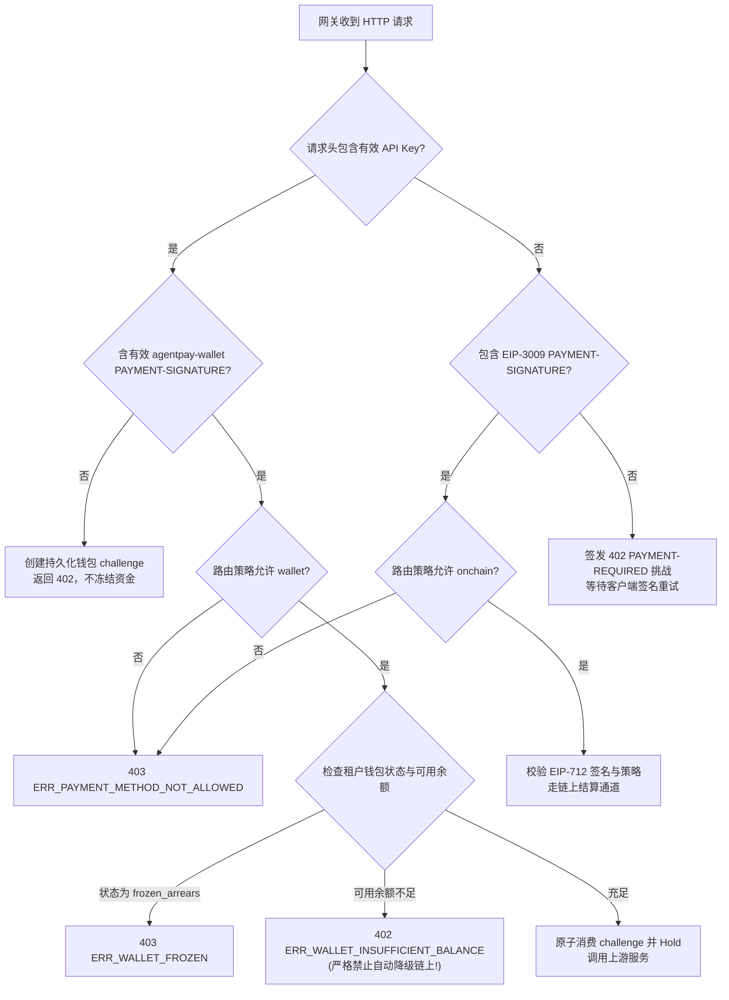

# AgentPay Python/Go 协议一致性契约规范 (T1.3 Specification)

> **版本**：v2.0.0 (T1.3 统一协议契约)  
> **状态**：**已定稿 (Approved Specification)**  
> **适用范围**：Python Client/Buyer SDK、Go Gateway 数据面、控制面 API 与对账系统  
> **跨语言测试向量**：  
> - [`specs/conformance/protocol-errors.json`](../conformance/protocol-errors.json) (统一错误码表与 Schema)  
> - [`specs/test-vectors/dual-path-protocol.json`](../test-vectors/dual-path-protocol.json) (双轨协议一致性测试向量)  
> - [`specs/conformance/state-machine.json`](../conformance/state-machine.json) (状态机迁移向量)  

> **钱包通道扩展**：虚拟钱包通过 x402 V2 风格的 `PAYMENT-REQUIRED` / `PAYMENT-SIGNATURE` 往返执行，但使用 AgentPay 自有的 `agentpay-wallet` scheme，不属于 EIP-3009 标准支付授权。字段、校验和持久化防重放要求以 [`agentpay-wallet-x402-extension.md`](../agentpay-wallet-x402-extension.md) 为准。本文原先“API Key 到达后直接扣款”的虚拟钱包流程由该扩展取代。

---

## 1. 目标与设计原则

为确保 **Python 买方客户端（Buyer SDK）** 与 **Go 云原生网关（Go Gateway）** 在网络交互、错误处理与状态裁定时行为 100% 同构，T1.3 规范制定统一的协议层通信契约：

1. **单点事实（Single Source of Truth）**：所有协议头、错误码、状态枚举与测试向量均以机器可读的 JSON 存储在 `specs/` 中，Python 与 Go 共同读取运行相同的测试套件；
2. **严密格式化（Case-Insensitive & Schema-Strict）**：HTTP 头部字段名称遵循大小写不敏感解析，载荷格式遵循严格 JSON Schema 验证，未知或非法字段一律安全拦截；
3. **确定性支付方式裁定**：明确区分链上 x402 签名支付与内部虚拟钱包扣费，**严禁在余额不足时静默或自动降级为链上扣费**；
4. **统一错误响应模型**：全系统遵循一致的 JSON 错误响应格式，避免客户端对不同后端的错误进行分支适配。

---

## 2. HTTP 协议头契约 (Headers Specification)

### 2.1 链上 x402 支付通道
| Header 名称 | 作用方 | 语法与编码 | 规范定义 |
|---|---|---|---|
| `PAYMENT-REQUIRED` | Gateway → Client (402) | `PAYMENT-REQUIRED: <Base64URL(JSON_Payload)>` | RFC 6648 兼容，携带出题方挑战明细 |
| `PAYMENT-SIGNATURE`| Client → Gateway (重发) | `PAYMENT-SIGNATURE: <Base64URL(JSON_Payload)>` | 包含买方钱包针对 EIP-3009 的签名凭证 |

#### Challenge Payload 结构 (`PAYMENT-REQUIRED`)
```json
{
  "version": "2.0",
  "challengeId": "ch_01j7xyz890abcdef12345678",
  "network": "eip155:421614",
  "asset": "0x036CbD53842c5426634e7929541eC2318f3dCF7e",
  "assetSymbol": "USDC",
  "decimals": 6,
  "amount": "50000",
  "payee": "0x70997970C51812dc3A010C7d01b50e0d17dc79C8",
  "scheme": "EIP-3009",
  "validAfter": 1729000000,
  "validBefore": 1729000300,
  "facilitatorUrl": "https://facilitator.agentpay.org",
  "resourceUri": "/v1/llm/chat"
}
```

#### Authorization Payload 结构 (`PAYMENT-SIGNATURE`)
```json
{
  "version": "2.0",
  "challengeId": "ch_01j7xyz890abcdef12345678",
  "payer": "0xf39Fd6e51aad88F6F4ce6aB8827279cffFb92266",
  "scheme": "EIP-3009",
  "nonce": "0x1234567890abcdef1234567890abcdef1234567890abcdef1234567890abcdef",
  "validAfter": 1729000000,
  "validBefore": 1729000300,
  "signature": {
    "v": 28,
    "r": "0xd90ab6b36f43fea017b168106d443b874dbeaeec24a4c416b7abc38afa9baa83",
    "s": "0x530e805bb1a29839651fac0cb1f3f1c05a7c659760488173ed1fd582819467e0",
    "serialized": "d90ab6b36f43fea017b168106d443b874dbeaeec24a4c416b7abc38afa9baa83530e805bb1a29839651fac0cb1f3f1c05a7c659760488173ed1fd582819467e01c"
  }
}
```

---

### 2.2 虚拟钱包支付通道
| Header 名称 | 作用方 | 语法与格式 | 规范定义 |
|---|---|---|---|
| `Authorization` | Client → Gateway | `Authorization: Bearer apk_live_...` | 传递租户签发的 API Key |
| `PAYMENT-REQUIRED` | Gateway → Client (402) | `PAYMENT-REQUIRED: <Base64URL(JSON_Payload)>` | 返回 `scheme=agentpay-wallet` 的报价 challenge；首个请求不得冻结或扣款 |
| `PAYMENT-SIGNATURE` | Client → Gateway (重发) | `PAYMENT-SIGNATURE: <Base64URL(JSON_Payload)>` | 返回绑定 challenge 的 AgentPay 钱包授权；不含 EIP-712 签名，API Key 仍用于鉴权 |
| `Idempotency-Key` | Client → Gateway | `Idempotency-Key: <string>` | 客户端业务级唯一键（最大 128 字符） |

虚拟钱包请求的完整载荷、一次性 challenge 状态和跨实例防重放要求见扩展规范。网关必须在授权通过后才执行 Hold；API Key 单独出现只能取得报价 challenge，不能触发扣款。

---

## 3. 双轨支付方式裁定与选择规则 (Payment Method Arbitration)

当 Gateway 收到请求时，遵循以下确定性状态机裁定流：



> [!CAUTION]
> **绝对禁止自动降级原则 (No Auto-Downgrade Invariant)**  
> 钱包模式必须先返回 `agentpay-wallet` challenge，待客户端策略批准并重试后才能扣款。若钱包余额不足，网关必须返回 `402 ERR_WALLET_INSUFFICIENT_BALANCE` 并中断流程。**绝对禁止**擅自改向客户端下发 EIP-3009 链上挑战；禁止未经用户授权产生链上私钥签名与 Gas 消耗！

---

## 4. 全量标准错误码表 (Canonical Error Taxonomy)

所有服务返回非 2xx 响应时，必须返回标准 JSON 结构：

```json
{
  "error": {
    "code": "ERR_WALLET_INSUFFICIENT_BALANCE",
    "message": "Wallet available balance is insufficient to cover this request.",
    "domain": "WALLET",
    "status": 402,
    "requestId": "req_01j7xyz890abcdef12345678",
    "details": {
      "requiredAmount": 50000,
      "availableBalance": 20000
    }
  }
}
```

| 错误码 (Code) | HTTP Status | 领域 (Domain) | 触发条件与含义 |
|---|---|---|---|
| `ERR_PAYMENT_REQUIRED` | 402 | PROTOCOL | 访问资源需要链上支付，下发 challenge |
| `ERR_WALLET_INSUFFICIENT_BALANCE` | 402 | WALLET | 内部虚拟钱包可用余额不足，禁止透支 |
| `ERR_WALLET_FROZEN` | 403 | WALLET | 钱包已被冻结或处于欠费冻结（`frozen_arrears`）状态 |
| `ERR_PAYMENT_METHOD_NOT_ALLOWED` | 403 | ROUTING | 提交的支付手段与当前路由允许的方式（wallet/onchain）冲突 |
| `ERR_POLICY_BUDGET_EXCEEDED` | 403 | POLICY | 24 小时滚动窗口或终身预算上限超额 |
| `ERR_POLICY_MAX_PER_TX` | 403 | POLICY | 单笔交易金额超过安全上限 |
| `ERR_POLICY_CIRCUIT_BROKEN` | 429 | POLICY | 检测到 Agent 循环调用或高频激增，熔断器生效 |
| `ERR_API_KEY_INVALID` | 401 | AUTH | API Key 不存在、已被撤销或已过有效期 |
| `ERR_API_KEY_SCOPE_DENIED` | 403 | AUTH | API Key 缺少访问目标路由所需的权限 Scope |
| `ERR_TENANT_SUSPENDED` | 403 | TENANT | 租户组织已被管理员禁用 |
| `ERR_SIGNATURE_INVALID` | 401 | CRYPTOGRAPHY | EIP-712 签名验签不通过或载荷被篡改 |
| `ERR_NONCE_REPLAY` | 409 | SETTLEMENT | 链上 Nonce 已被使用或重放 |
| `ERR_IDEMPOTENCY_CONFLICT` | 409 | IDEMPOTENCY | 同一幂等键伴随不同的请求参数或并发冲突 |
| `ERR_HOLD_EXPIRED` | 408 | WALLET | 钱包 Hold 锁定期在履约前超时失效 |
| `ERR_UPSTREAM_TIMEOUT` | 504 | GATEWAY | 调用上游真实业务服务发生连接或读超时 |
| `ERR_UPSTREAM_FAILED` | 502 | GATEWAY | 上游真实业务服务返回 5xx 服务端错误 |
| `ERR_CONFIG_VERSION_EXPIRED` | 409 | CONFIG | 请求关联的配置版本已被回滚或失效 |

---

## 5. 标识符规则与幂等一致性

1. **唯一性生成标准**：
   - `request_id`：必须以 `req_` 为前缀或符合 UUIDv4 标准，在收到入站连接的第一时间生成；
   - `idempotency_key`：由调用方显式在 Header 提供（最大 128 字符）。网关以 `(tenant_id, idempotency_key)` 为联合租户唯一键；
   - `payment_intent_id`：必须以 `pi_` 为前缀；
   - `settlement_id`：必须以 `stl_` 为前缀；
   - `fulfillment_id`：必须以 `ful_` 为前缀；
   - `hold_id`：必须以 `hld_` 为前缀。
2. **幂等命中处理**：
   - 收到相同 `idempotency_key` 且请求体哈希完全相符：
     - 若意图已完成，直接返回首次请求的缓存响应（含原始 HTTP 状态码、响应头与响应体）；
     - 若意图尚在执行中（`in_progress`），返回 `409 ERR_IDEMPOTENCY_CONFLICT` 或按租户配置轮询等待。
   - 收到相同 `idempotency_key` 但请求体哈希不一致：
     - 立即返回 `409 ERR_IDEMPOTENCY_CONFLICT`，禁止篡改重试。
